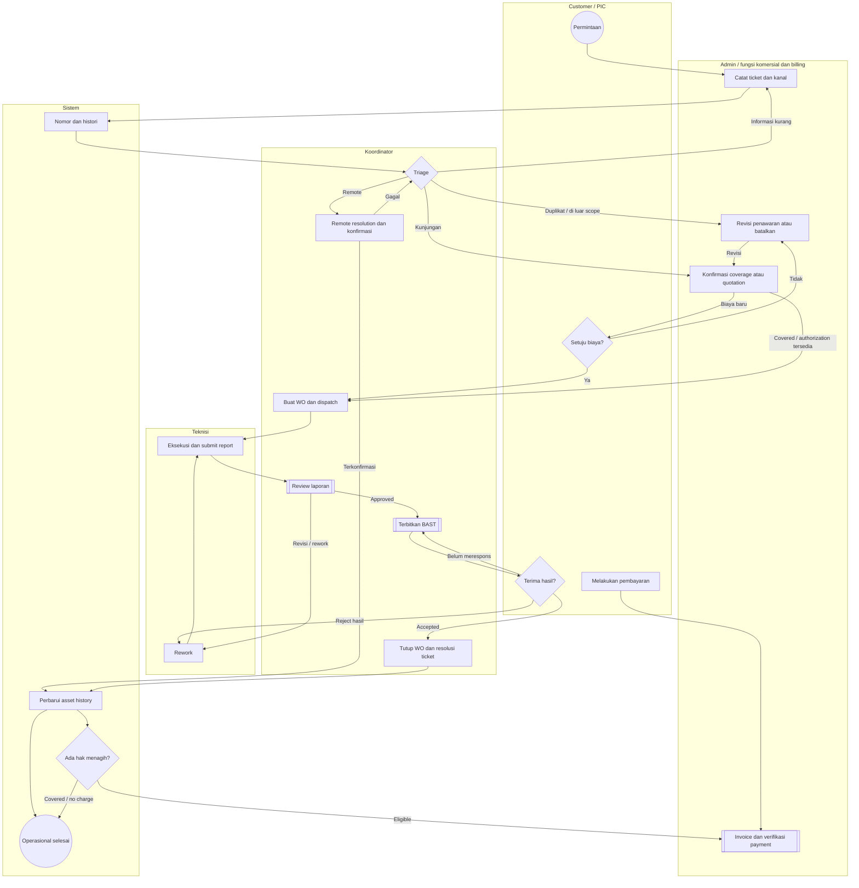
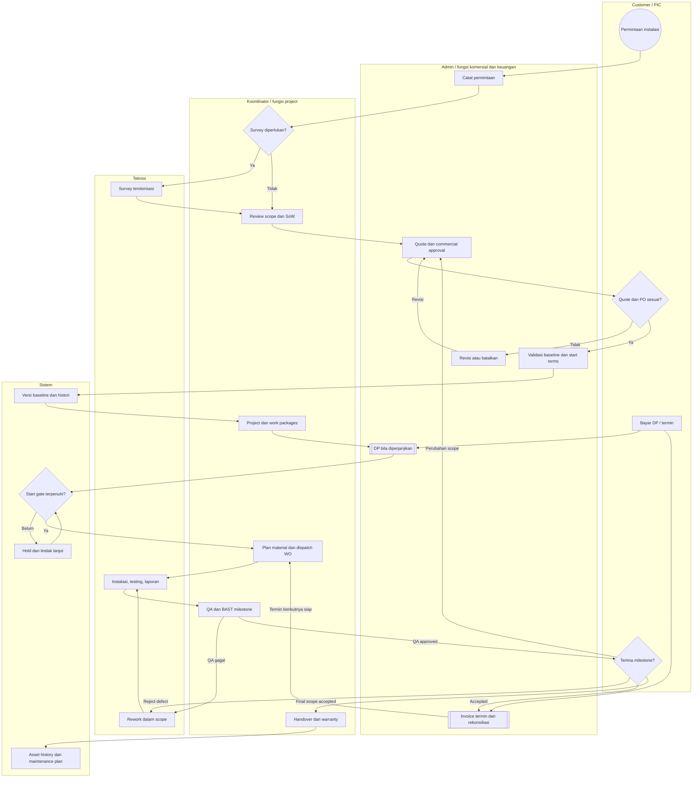
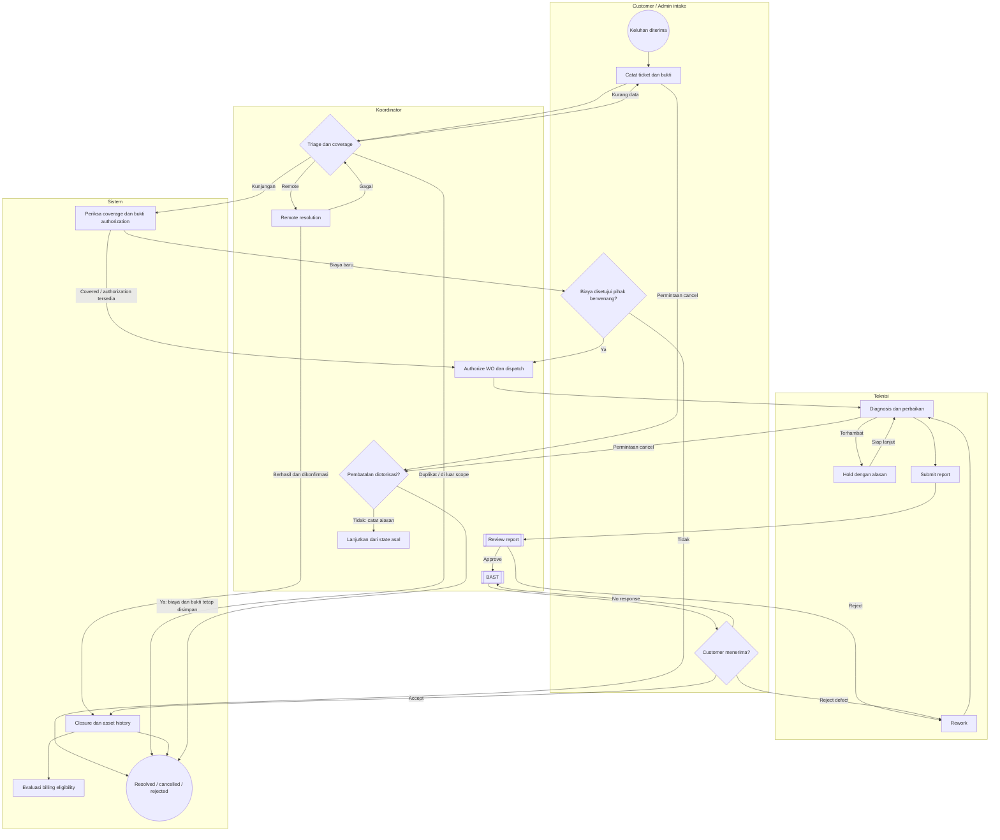
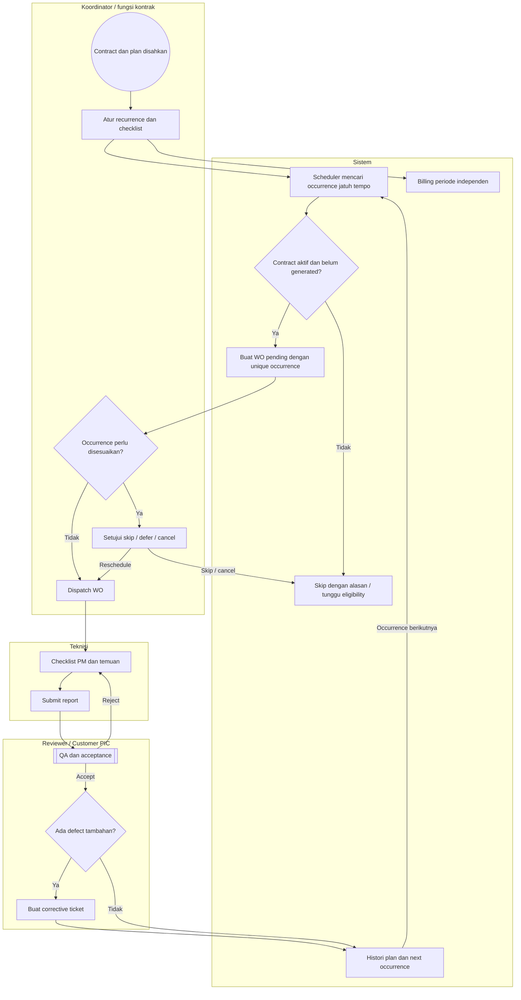
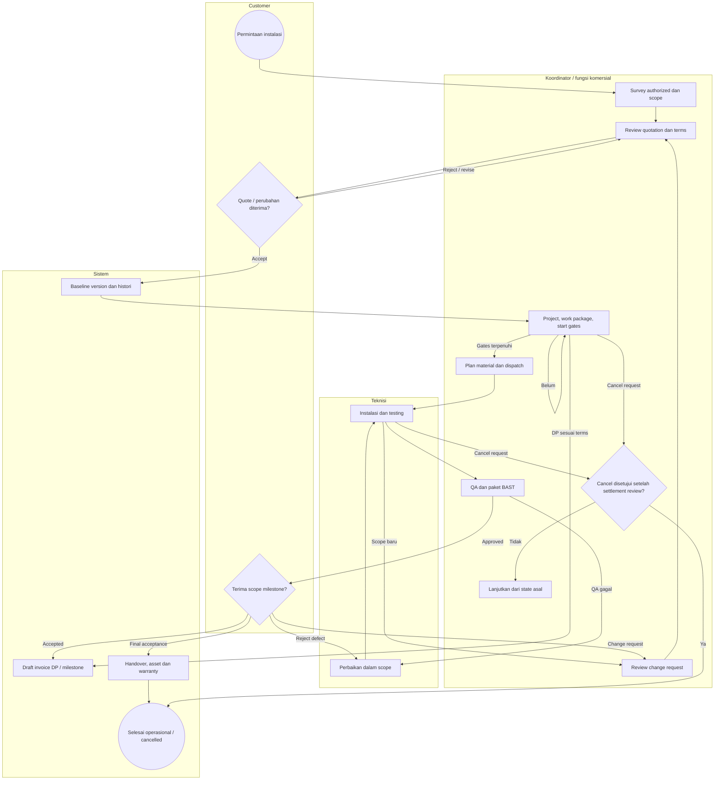
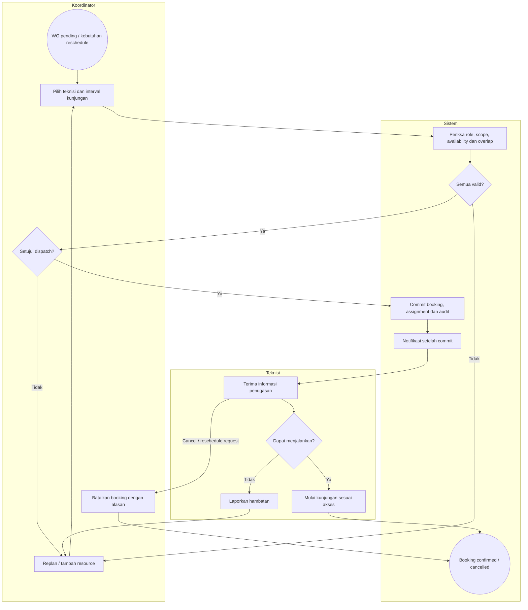
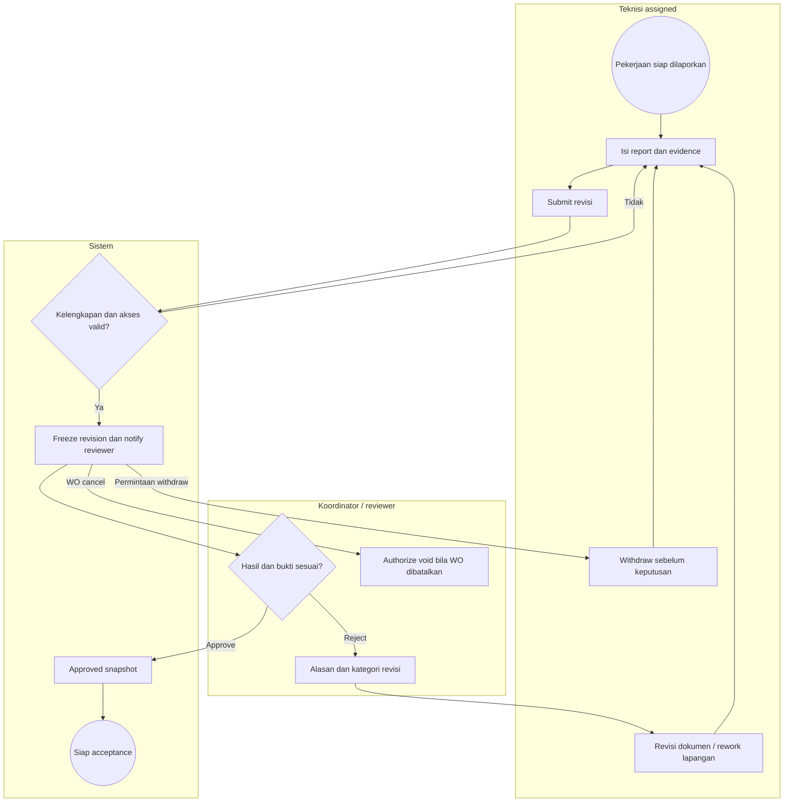
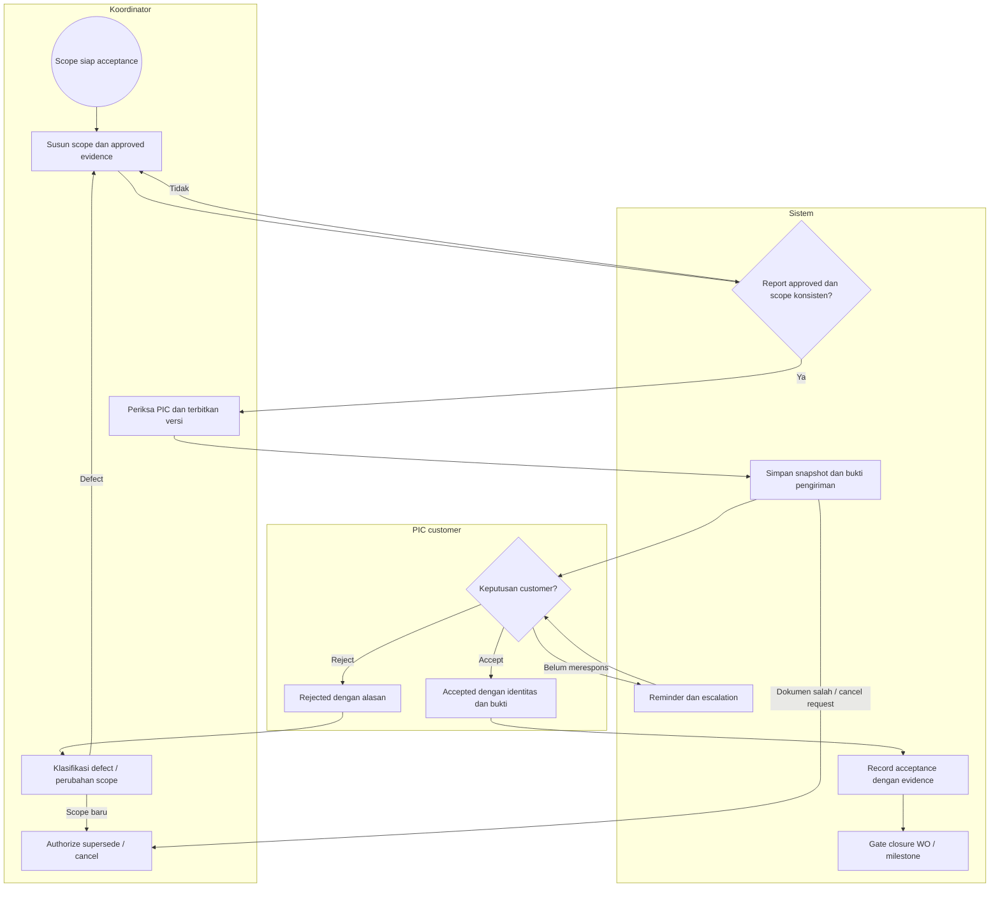
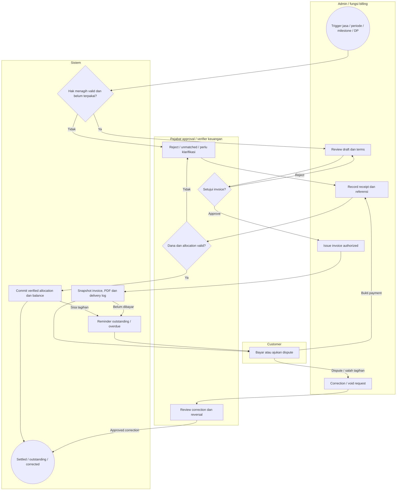
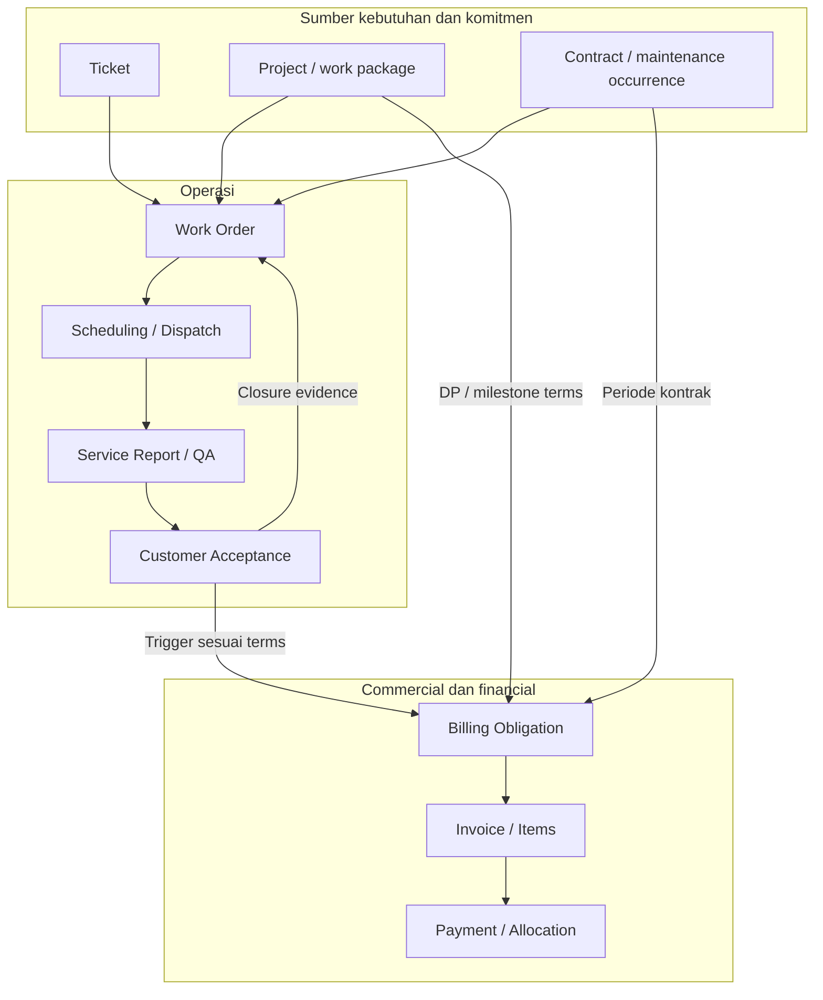

# Business Process Blueprint v0.2
## Integrated Field Service & Maintenance Management System — PT Nusalogi

**Phase:** 0A — Business Process & Enterprise Architecture Design  
**Tanggal:** 10 November 2026, WIB  
**Status:** INTERNAL PROPOSAL — BELUM DISETUJUI STAKEHOLDER  
**Baseline repository:** `main` pada `9df13b6952a88d4e396a21e95dda83e66c55d801`  
**Deliverables:** A Blueprint, B Process Diagrams, C Domain Model, D Business Rules Matrix, E Automation Matrix, F MVP Scope, G Architecture Decision Proposals, H Open Business Questions.

> **PROPOSED — NEEDS VALIDATION.** Seluruh proses, kewenangan bisnis baru, approval, SLA, ketentuan kontrak, BAST, dan billing dalam desain ini adalah usulan internal. Pernyataan implementasi hanya berlaku pada bukti baseline yang disebutkan. Dokumen ini tidak menyatakan SOP resmi PT Nusalogi, persetujuan komersial, atau kesiapan produksi.

## 1. Executive summary

v0.2 menghubungkan sumber permintaan, pengambilan keputusan, pekerjaan lapangan, bukti hasil, penerimaan customer, hak menagih, dan penerimaan dana. WO tetap menjadi instruksi kerja operasional. Ticket menjelaskan alasan kebutuhan; project mengoordinasikan deliverables; contract menetapkan coverage dan commercial terms. Laporan membuktikan pelaksanaan, BAST membuktikan penerimaan dalam scope tertentu, invoice membuktikan tagihan, dan payment membuktikan dana yang sudah diverifikasi.

Ada dua value stream: **Service-to-Cash** untuk corrective/on-demand service dan **Project-to-Service** untuk instalasi sampai handover, garansi, serta layanan lanjutan. Preventive Maintenance (PM) merupakan sumber pekerjaan berkala dari contract/maintenance plan; jadwal kunjungan dan jadwal penagihan berjalan terpisah.

Pertahankan modular monolith Laravel, React/Inertia, MySQL, dan database queue. Gunakan application services untuk keputusan/transaksi, Events untuk pemberitahuan fakta, Jobs untuk pekerjaan tertunda, Scheduler untuk pekerjaan berbasis waktu, serta Notifications untuk menyampaikan tugas. Tidak dibutuhkan microservices, bahasa baru, Redis, atau n8n untuk scope awal.

**Rekomendasi release:** selesaikan satu vertical slice corrective service dari intake sampai BAST; perluas ke one-time billing dan payment verification; baru masukkan project/contract serta recurring automation. Blueprint mendesain keseluruhan target tanpa menjadikan seluruh target syarat MVP pertama.

### 1.1 Baseline dan koreksi checkpoint

Checkpoint yang diunggah dibaca sebagai handoff, lalu dibandingkan dengan GitHub. Repository telah maju satu merge dari checkpoint.

| Kategori | Temuan dan batas bukti |
|---|---|
| **ALREADY IMPLEMENTED / MERGED** | Authentication/User, Customer/Site/Asset, WO-01 listing, WO-02 creation. WO-03 assignment juga sudah merged melalui PR #14, 10 November 2026 **04:45:17 WIB**. `main` menunjuk `9df13b6…` [R1–R3]. |
| **MERGED FOUNDATION, BELUM WORKFLOW LENGKAP** | Model/schema service report, foto, invoice/items/payments; services kalkulasi/penerbitan/pencatatan payment. Route bisnis aktif yang ditinjau belum menyediakan end-to-end report/BAST/billing/payment [R8–R12]. |
| **LOCAL DEVELOPMENT / UNDER REVIEW** | Tidak ada checkout WSL pengguna di sesi ini; `git status`, perubahan uncommitted, dan browser QA pengguna tidak dapat diverifikasi. Klaim checkpoint bahwa WO-03 masih lokal sudah digantikan bukti merge. Merge bukan bukti UAT atau deployment produksi. |
| **PROPOSED ARCHITECTURE** | Ticket, project/contract, recurring PM, scheduling interval, review report lengkap, BAST, billing obligations, payment verification, automasi dan KPI di bawah ini. |
| **ASSUMPTIONS REQUIRING BUSINESS VALIDATION** | Sumber permintaan sebenarnya, pejabat approval, otoritas PIC customer, SLA, coverage, harga, termin, pajak, cancellation, acceptance exception, hosting dan retensi. Register terdapat pada bagian 16. |

**Sumber yang ditinjau:** checkpoint unggahan; `AGENTS.md`; `docs/01-requirements.md`, `02-business-process.md`, `03-database-design.md`, `04-scope-access-matrix.md`; routes, WorkOrderStatusService, ServiceReport model/schema, invoice/payment services/schema, dan queue config pada commit baseline. Ini review terarah untuk desain, bukan audit seluruh kode atau pengujian ulang aplikasi. Tidak ada kode aplikasi, migration, atau dokumen repository yang diubah.

### 1.2 Perubahan terhadap rancangan v0.1

| Topik | Baseline v0.1 | Proposal v0.2 |
|---|---|---|
| Asal WO | Koordinator membuat langsung | Ticket, maintenance occurrence, work package project, atau manual exception beralasan |
| Assignment | Multi-teknisi, pending → assigned sudah merged | Tetap; tambah booking interval, pemeriksaan bentrok dan riwayat reschedule |
| Penutupan | Draft dokumen lama: report approved → closed | Report approved → awaiting acceptance → closed berdasarkan acceptance scope |
| Billing | Draft kebijakan: maksimal satu invoice aktif per WO; schema invoice wajib satu WO | Tagihan dari hak menagih jasa/periode/milestone; konsolidasi dan termin tanpa duplikasi |
| Payment | Service awal langsung menjumlah record pembayaran | Record, bukti, verifikasi dana, allocation dan reversal terpisah |
| Teknologi dokumen | Sebagian docs menyebut Blade | Frontend aktif React/Inertia; perbaikan docs harus melalui review tersendiri |

Service status yang ditemukan baru mendefinisikan `pending → assigned → in_progress`; route review yang ditinjau hanya mengekspos create/list/assign. Jadi adanya transisi di service tidak membuktikan fitur eksekusi dan state machine lengkap sudah tersedia [R8–R9].

## 2. Proposed Service-to-Cash workflow

**PROPOSED — NEEDS VALIDATION.** Awal: keluhan, insiden, service request atau temuan operasional. Akhir operasional: hasil diterima atau penyelesaian alternatif yang diotorisasi. Akhir keuangan: seluruh kewajiban tagihan terkait sudah diselesaikan atau dikoreksi secara sah. Kedua akhir tersebut dapat terjadi pada waktu berbeda.

| ID | Langkah dan pemilik keputusan | Input → output/dokumen | Otomasi dan approval | Exception, rejection dan audit |
|---|---|---|---|---|
| S01 | Admin/fungsi intake mencatat permintaan dari customer | Kanal, waktu diterima, kontak, customer/site, gejala, asset opsional, lampiran → Ticket bernomor | Nomor dan waktu pencatatan otomatis; kanal WhatsApp/telepon/email dicatat manual pada MVP | Kontak/customer belum jelas → antrean klarifikasi; simpan `received_at` terpisah dari waktu input. Dilarang membuat identitas palsu demi lolos validasi. |
| S02 | Koordinator melakukan triage | Dampak, urgency, lokasi, keselamatan, duplikat, coverage → klasifikasi dan keputusan penanganan | Sistem membantu cari histori dan kandidat duplikat; prioritas/SLA diputuskan manusia | Duplikat ditautkan ke ticket asli; di luar layanan → rejection beralasan; informasi kurang → waiting_information. Catat alasan dan pengambil keputusan. |
| S03 | Koordinator menentukan remote resolution atau kunjungan | Diagnosis awal → catatan remote atau kebutuhan WO | Remote resolution memerlukan hasil tindakan dan konfirmasi customer sesuai kebijakan | Remote gagal → kembali triage/WO; customer tidak merespons → reminder/escalation, tidak auto-resolved. Remote berbayar tetap membutuhkan dasar commercial/billing yang sah. |
| S04 | Pemilik kewenangan komersial memeriksa coverage dan biaya | Contract/warranty, pengecualian coverage, scope, estimasi, quotation/PO → authorization baseline | Coverage dapat disarankan sistem; manusia menyetujui biaya/pengecualian; customer menerima quotation jika diperlukan | Tidak covered atau tambahan biaya → quotation; ditolak → revisi atau ticket rejected/cancelled. Emergency hanya boleh bypass gate sesuai pengecualian tertulis. Coverage belum diketahui → on hold, bukan dianggap gratis. |
| S05 | Koordinator menyetujui dan membuat satu/lebih WO | Ticket approved, site, scope, checklist, asset, commercial reference → WO pending | Isi dari ticket dan tautan asal otomatis; pembuatan WO tetap keputusan Koordinator | Satu ticket boleh membutuhkan beberapa kunjungan/WO. Klik ulang tidak menggandakan WO yang sama. WO manual existing dipertahankan; asal legacy tidak direkayasa menjadi ticket. |
| S06 | Koordinator merencanakan dan dispatch | Kebutuhan skill, interval, teknisi aktif/approved, lokasi, material, akses site → booking dan assignment | Sistem memeriksa kelayakan/bentrok; Koordinator mengesahkan; notifikasi sesudah commit | Tidak ada teknisi/material/akses → rencana ulang, alasan dan tindak lanjut. Bentrok tidak diterima diam-diam. |
| S07 | Teknisi yang ditugaskan menjalankan pekerjaan | WO, checklist, izin site, material → diagnosis, tindakan, waktu, foto dan usage | Timestamp, validasi kelengkapan, histori | Site inaccessible/no-show, bahaya, material kurang → hold. Scope/biaya tambahan → approval ulang sebelum pekerjaan tambahan; kondisi darurat mengikuti exception policy yang disahkan. |
| S08 | Teknisi submit Service Report | Job sheet, hasil test, foto, material actual, rekomendasi → report revision submitted; WO pending_review | Freeze revisi saat submit; notifikasi reviewer | Laporan tidak lengkap ditolak validasi tanpa mengubah WO; bukti upload gagal tidak dianggap tersimpan. |
| S09 | Koordinator review kualitas dan kesesuaian scope | Report revision dan evidence → approved atau needs_revision/rework | Sistem cek checklist/evidence; keputusan kualitas oleh manusia | Kesalahan dokumen → revisi report; kegagalan teknis → WO rework. Semua penolakan memerlukan alasan; perubahan pasca-approval harus membuat revisi baru. |
| S10 | Koordinator menyiapkan BAST; PIC customer memutuskan acceptance | Approved reports, scope, daftar asset/deliverables → BAST version issued, accepted/rejected | Draft dan PDF dapat dibuat otomatis; identitas/otoritas penerima dan pengiriman diverifikasi manusia | Rejection → klasifikasi defect/rework atau change request. Tidak merespons → escalation, bukan acceptance otomatis. Dokumen salah → supersede, jangan menimpa bukti lama. |
| S11 | Koordinator menutup WO; sistem memperbarui service history | Acceptance valid yang mencakup WO atau approved exception → closed WO; ticket resolved jika scope seluruhnya selesai | Gate server memeriksa report dan scope acceptance; histori status, asset dan closure reason dicatat atomik | Satu WO selesai tidak otomatis menyelesaikan ticket multi-WO. Riwayat asset mencatat aktivitas sejak eksekusi dengan label verified setelah QA; tidak menunggu pembayaran. |
| S12 | Admin/fungsi billing menilai hak menagih | Commercial baseline, approved charge/material, acceptance atau trigger kontraktual → billing obligations atau no-charge disposition | Draft invoice dapat disiapkan; manusia memastikan eligibility dan non-duplikasi | Covered/warranty → tandai covered/no_charge dengan dasar, tidak membuat tagihan kedua. Dispute commercial tidak menghapus hasil kerja. |
| S13 | Pejabat invoice mengesahkan; Admin menerbitkan | Billing obligations, bill-to, rincian, tax configuration tervalidasi, due date → issued invoice dan PDF snapshot | Kalkulasi ulang server, nomor unik, audit; issuance memerlukan kewenangan manusia | Draft gagal/salah → revisi; setelah issued → correction/void terkendali. Kegagalan PDF/send tidak menciptakan invoice baru. |
| S14 | Admin mencatat; verifier keuangan memeriksa dana | Bukti, tanggal diterima, referensi, rekening/metode → payment submitted lalu verified/rejected | Outstanding dihitung hanya dari verified allocations; upload bukan verifikasi | Kurang bayar → partial; salah referensi → unmatched; kelebihan → unapplied, jangan dipaksa masuk invoice; dana belum masuk → pending/rejected. |
| S15 | Fungsi keuangan merekonsiliasi; Koordinator memantau layanan | Invoice/allocations, dispute, asset history → receivable queue dan KPI | Reminder, dashboard, repeat-failure flag otomatis; follow-up ditugaskan manusia | Reversal/refund butuh kontrol tersendiri. Lunas tidak menutup WO yang belum diterima; closed WO boleh memiliki outstanding. |

### 2.1 Swimlane Service-to-Cash

Diagram adalah **swimlane konseptual**, bukan BPMN XML executable. Lingkaran menandai awal/akhir; diamond adalah keputusan; kotak ganda merujuk subprocess di bagian 5. Lane merupakan fungsi bisnis, bukan jabatan perusahaan yang sudah dikonfirmasi. Label Sistem menunjukkan otomatisasi; aktor lain menjalankan user task.

Pembatalan sebelum/saat WO mengikuti subprocess cancellation pada bagian 5.1; menunggu respons BAST merupakan wait state dengan reminder, bukan penerbitan BAST baru berulang. Proses billing dapat mulai dari resolution remote berbayar dengan evidence yang relevan, tanpa WO fiktif. Detail payment dan akhir keuangannya terdapat pada diagram 5.7.

## 3. Proposed Project-to-Service workflow

**PROPOSED — NEEDS VALIDATION.** Awal: permintaan instalasi/penawaran. Akhir: deliverables diterima, dokumen/aset diserahkan dan warranty/service entitlement dicatat; settlement komersial dipantau terpisah. Survey adalah pekerjaan pra-penjualan jika diperlukan dan bukan alasan mewajibkan project approved sebelum scope diketahui.

| ID | Langkah dan pemilik keputusan | Input → output/dokumen | Otomasi dan approval | Exception dan audit |
|---|---|---|---|---|
| P01 | Admin/fungsi komersial mencatat installation request | Customer, site, kebutuhan, tanggal target → installation ticket/opportunity reference | Nomor, pencatatan kanal dan duplikat | Scope belum jelas → klarifikasi; permintaan di luar kompetensi → tolak beralasan. Tidak wajib membangun CRM sales lengkap. |
| P02 | Koordinator menentukan kebutuhan survey | Kebutuhan awal, akses site → survey scope/appointment | WO survey dapat bersumber ticket sebelum project aktif, jika survey diotorisasi | Survey berbayar memerlukan biaya disetujui; survey dibatalkan/no-access → reschedule. Report survey tidak menandakan instalasi selesai. |
| P03 | Teknisi melakukan survey; Koordinator menetapkan scope teknis | Ukuran/site condition, asset existing, risiko → survey report, SoW, BoQ/estimasi, acceptance criteria | Template checklist dan estimasi dapat membantu; keputusan scope oleh manusia | Kebutuhan berubah → versi scope; site belum siap → hold dengan dependency owner fungsional. |
| P04 | Pemilik kewenangan komersial menyetujui penawaran | SoW, estimasi jasa/material, milestone, terms → quotation revision approved/sent | Kalkulasi dan versi otomatis; harga/margin/termin bukan keputusan scheduler | Internal reject → revise; penawaran expired harus direview ulang, tidak otomatis berlaku. |
| P05 | Customer memberi persetujuan; fungsi komersial memeriksa PO/kontrak | Quote revision, PO/kontrak bila diwajibkan → commercial baseline accepted | Capture bukti, identitas, waktu dan versi persetujuan | PO berbeda dengan quote → discrepancy review; tidak boleh menyatukan dua versi diam-diam. Ditolak → revisi atau tutup permintaan. |
| P06 | Koordinator/fungsi project menginisiasi project | Baseline scope, budget/terms, site, dependencies → project planning; work packages dan milestone | Snapshot versi quote/terms; penomoran project | Persetujuan awal bukan otomatis izin mulai jika ada gate DP, izin site atau material. |
| P07 | Fungsi billing mengelola DP bila diperjanjikan | Billing schedule DP dan commercial authorization → invoice DP, payment verified | Dapat berjalan sebelum instalasi dan BAST; tidak memerlukan WO closed | DP kurang/belum diterima → start hold hanya jika terms mensyaratkan; override harus diotorisasi. DP tidak mengubah WO menjadi selesai. |
| P08 | Koordinator merencanakan deliverables dan pekerjaan | Work packages, dependency, material plan, booking → satu/lebih WO per paket | Template WO membantu; resource/dispatch approval oleh Koordinator | Material belum ada → hold/rencana pembelian di luar stok MVP; perubahan scope → change request. Tidak perlu CPM atau resource optimization engine pada awal. |
| P09 | Teknisi melakukan instalasi dan testing | WO, checklist, material, metode test → reports, asset terpasang, hasil commissioning | Catat usage dan serial terverifikasi; histori test | Test gagal → rework; tambahan scope di luar kontrak → change approval, bukan langsung billable. |
| P10 | Koordinator review kualitas dan bukti milestone | Approved WO reports, test results, punch list → technical readiness milestone | Agregasi evidence otomatis; technical readiness diputuskan manusia | Jangan mensyaratkan WO closed untuk membuat BAST: approved report + technical readiness menjadi prasyarat agar tidak ada circular dependency. |
| P11 | PIC customer menerima milestone/project | Paket evidence, scope, as-built bila relevan → BAST accepted/rejected | BAST dapat meliputi beberapa WO; subset harus eksplisit | Reject → defect correction dalam scope; tambahan permintaan → change request. Partial acceptance dibuat per scope/milestone terpisah, bukan menandai seluruh project diterima. |
| P12 | Fungsi billing memproses termin | Milestone accepted/trigger lain sesuai kontrak → obligation eligible → invoice approved/issued | Draft dapat dibuat otomatis; issuance oleh pihak berwenang | DP/termin yang sudah ditagih tidak ditagih ulang pada final. Retention hanya jika kontrak nyata mengharuskan. |
| P13 | Verifier keuangan memeriksa dan mengalokasikan dana | Receipt, invoice/termin, bank evidence → verified payment, outstanding | Reconciliation support dan overdue queue | Dispute atau kurang bayar tidak menghapus BAST; perubahan tagihan menggunakan correction trail. |
| P14 | Koordinator dan PIC customer melakukan handover | Final acceptance, as-built/config handover, asset register, warranty baseline → project operationally completed | Asset-service history dan warranty reminder dapat diperbarui otomatis | Kredensial/perangkat sensitif diserahkan lewat mekanisme akses terkendali; punch list belum selesai menghalangi acceptance penuh kecuali pengecualian disahkan. |
| P15 | Fungsi komersial/Koordinator menyiapkan layanan lanjutan | Warranty terms dan maintenance agreement opsional → entitlement/maintenance plan | Scheduler PM hanya aktif setelah contract/plan disetujui | Garansi bukan kontrak berbayar otomatis. Klaim garansi tetap melalui triage; tidak membuat contract fiktif. |

### 3.1 Swimlane Project-to-Service

Penerbitan DP sebelum BAST diperbolehkan hanya jika terms menyatakan demikian. Milestone billing tidak berarti setiap milestone harus menunggu termin sebelumnya lunas; dependency tersebut berasal dari kontrak, bukan aturan universal. Pembatalan proyek menghentikan pekerjaan mendatang sesuai kewenangan, mempertahankan biaya dan bukti existing, serta membutuhkan settlement review terpisah.

## 4. Keputusan utama dan asumsi yang belum terselesaikan

| ID | Proposal keputusan | Alasan dan dampak | Validasi penentu |
|---|---|---|---|
| D01 | Modular monolith, domain boundaries logis | Satu deployment/DB; tidak menambah beban distribusi | Tidak ada kebutuhan deployment independen yang teridentifikasi |
| D02 | Ticket = intake; WO = instruksi eksekusi | Satu ticket bisa remote-only atau memerlukan banyak WO | Siapa melakukan intake dan apa klasifikasi service aktual? |
| D03 | Assignment dipisahkan dari booking | Banyak teknisi dan kunjungan tanpa menjadikan `scheduled_at` kalender lengkap | Jam kerja, bentrok, durasi, skill minimum dan emergency override |
| D04 | QA, acceptance, operations dan finance punya state sendiri | Menghindari closed WO dianggap paid | Pekerjaan apa wajib BAST dan pengecualian siapa yang sah? |
| D05 | Billing berdasarkan obligation, bukan wajib satu WO satu invoice | Mendukung konsolidasi, recurring, DP/termin | Praktik quotation, kontrak, PO, due date dan koreksi sebenarnya |
| D06 | Tiga role tetap; approval sebagai capability dan batas record | Tidak menambah role perusahaan yang belum diketahui | Pemegang otorisasi komersial dan verifier keuangan |
| D07 | Automasi menyiapkan dan mengingatkan; manusia menyetujui komitmen | Mencegah tagihan/dispatch/acceptance tanpa otorisasi | Batas auto-generation dari plan yang sudah disetujui |
| D08 | Migrasi bertahap dan sumber legacy eksplisit | Menjaga CRUD/WO-01/02/03, tidak mengarang approval historis | Kualitas data dan keberadaan transaksi nyata pada database pengguna |

**Asumsi paling kritis:** kewajiban BAST pada alur normal, pemegang approval biaya, coverage contract/warranty, aturan start DP, serta bukti dana yang sah belum dikonfirmasi. Desain dapat direview sekarang; gate bisnis ini harus ditetapkan sebelum fitur terkait digunakan dalam operasi nyata.

## 5. Supporting workflows dan swimlane

Semua diagram pada bagian ini **PROPOSED — NEEDS VALIDATION**. Event awal, hasil, approval dan audit dirinci di tabel penutup setiap workflow. Cancellation adalah keputusan bisnis dengan alasan; tidak menghapus record turunan. Panah looping berarti tugas kembali ke antrean, bukan proses sinkron tanpa batas.

### 5.1 Corrective Maintenance

| Aspek | Aturan |
|---|---|
| Trigger/owner | Keluhan; intake mencatat, Koordinator memutuskan triage dan operasi, customer menyetujui hasil/biaya terkait |
| Input/output | Keluhan/site/asset/coverage → WO atau remote resolution, approved report, acceptance, history, eligibility |
| Human gate | Biaya baru, dispatch, QA, customer acceptance, cancellation |
| Automated | Penomoran, histori, validasi scope, notifikasi, reminder, draft dokumen |
| Exception | Duplicate ticket tetap linked; no access atau material kurang → hold; bahaya → stop; biaya baru → approval ulang; rejected work → rework |
| Audit | received time, triage rationale, basis coverage, assignment, status before/after, evidence revisions, hold/resume, approval dan cancellation |

### 5.2 Preventive Maintenance

| Aspek | Aturan |
|---|---|
| Trigger/input | Approved maintenance plan dengan contract/authorization valid, site, asset scope, recurrence, timezone, checklist |
| Output | Occurrence tercatat; WO atau alasan skipped/deferred; approved report/BAST; corrective ticket bila perlu |
| Approval | Aktivasi plan/contract dan dispatch oleh manusia; auto-create WO hanya delegasi dari plan approved. Perubahan frekuensi/coverage perlu versi dan approval. |
| Automation | Scheduler memilih occurrence; service membuat WO + link + history secara atomik; belum menugaskan teknisi otomatis |
| Exception | Contract suspended/expired menghentikan generation mendatang; existing WO direview, tidak dihapus massal. Occurrence terlewat masuk recovery queue; tidak otomatis membuat backlog besar. |
| Audit | Plan version, planned occurrence asli, actual date, generation key, skipped/deferred reason, initiator system dan approval source |

Jadwal diikat ke tanggal rencana, bukan tanggal WO terakhir selesai, agar tidak bergeser tanpa keputusan. Aturan akhir bulan, hari libur, lead time generation, serta catch-up membutuhkan validasi. Temuan corrective tidak otomatis billable: cek coverage dan approval tambahan. Tidak mengasumsikan PM wajib ditagih per kunjungan.

### 5.3 Project Installation

| Aspek | Aturan |
|---|---|
| Trigger/input | Installation request, survey bila perlu, quote dan PO/contract baseline |
| Output | Project/work packages, WO, installed asset dan test evidence, milestone/final acceptance, billing schedule, warranty |
| Approval | Commercial terms, change request, start gate override, dispatch, technical QA, customer acceptance, cancellation |
| Automation | Version trace, agregasi evidence, draft DP/termin, reminders dan asset-service linkage |
| Exception | Tidak dapat mulai → hold; test gagal → rework; change scope bukan defect; partial acceptance hanya scope terdefinisi; cancellation perlu menghitung sisa pekerjaan/biaya/settlement sesuai terms |
| Audit | Scope/quote/PO versions, baseline change, dependencies, test results, milestone sign-off dan approved commercial adjustments |

### 5.4 Technician Assignment and Scheduling

| Aspek | Aturan |
|---|---|
| Baseline preserved | WO-03 tetap menugaskan satu/lebih teknisi aktif approved ke WO pending dan mencatat pivot/status/history atomik. Advanced availability belum diklaim ada. |
| Proposed interval | `start < end`, timezone site; booking per teknisi/kunjungan. Assignment bukan otomatis jadwal yang valid. WO boleh assigned tetapi belum memiliki slot confirmed; tampilkan kelengkapan schedule terpisah. |
| Conflict | Dua booking confirmed untuk teknisi sama tidak overlap; rentang `[start,end)` memperbolehkan batas bersinggungan. Travel buffer/skill hard gate hanya jika aturan disahkan. |
| Atomicity | Lock teknisi secara berurutan, periksa overlap ulang dalam transaksi lalu simpan; unique key saja tidak mencegah interval overlap. Revalidasi bila availability berubah. |
| Exception | Teknisi unavailable melapor, tidak menugaskan pengganti sendiri. Reschedule membatalkan/supersede slot lama secara terlacak, tidak otomatis cancel WO. Reassignment menjaga akses terhadap bukti yang telah dibuat tanpa membuka semua WO. |
| Audit | Siapa menugaskan, teknisi sebelum/sesudah, interval, conflict result, override approval jika diizinkan, alasan perubahan dan notification delivery status |

Tidak perlu persetujuan teknisi sebagai status wajib pada MVP; acknowledgement/decline workflow merupakan enhancement yang perlu validasi. Untuk multi-teknisi, harus ada satu report author/responsible technician yang ditetapkan Koordinator atau aturan yang disahkan; teknisi lain mengisi kontribusi, bukan berlomba menutup WO.

### 5.5 Service Report Review

| Aspek | Aturan |
|---|---|
| Trigger/output | Report submitted → approved snapshot atau needs_revision; submitted time dan review time berbeda |
| Approval | Koordinator memverifikasi hasil dan evidence; reviewer tidak menyetujui report buatannya sendiri jika kebijakan segregation disahkan |
| Rejection | Alasan wajib dan kategori document_fix/technical_rework; technical rework mengubah WO ke rework, document fix dapat tetap pending_review |
| Revision | Setiap submit memiliki version; approval menunjuk version tertentu. Perubahan pada report approved membuat revision baru dan menahan closure/acceptance baru sampai direview. |
| Exception | Withdrawal hanya sebelum keputusan dan diaudit. WO cancellation tidak menghapus report; void revision harus memiliki alasan. Report yang sudah menjadi dasar BAST/invoice tidak boleh di-void tanpa impact review. |
| Audit | Author, revision/hash evidence, timestamps, reviewer, keputusan, catatan, superseded relation; data sensitif di foto tetap private |

### 5.6 BAST / Customer Acceptance

| Aspek | Aturan |
|---|---|
| Trigger/input | Approved reports + readiness scope; dapat satu WO atau beberapa WO untuk milestone/project |
| Actor | Koordinator menyusun/menerbitkan; PIC customer berotoritas menerima; Admin hanya merekam bukti eksternal jika diberi capability |
| MVP mechanism | Upload BAST bertanda tangan/dokumen acceptance yang disepakati; rekam external signer serta internal recorder sebagai identitas berbeda. Tidak membuat akun customer baru dan tidak mengklaim tanda tangan tersertifikasi. |
| Token option | Later: tautan terbatas, expiry, sekali pakai, terikat versi/scope, dicabut saat supersede. Token bukan jaminan sendiri bahwa pemegangnya berwenang. |
| Rejection | Defect → rework dan QA ulang sebelum issue versi baru. Scope baru → change request. Partial acceptance dibuat dokumen scope subset yang jelas; sisanya tetap outstanding. |
| No response | Pending + reminder/escalation; tidak berubah menjadi accepted lewat timeout. Exception closure memerlukan otorisasi dan alasan tersendiri; status BAST tetap bukan accepted. |
| Audit | Nomor/versi/hash dokumen, scope items, approved-report version, penerbit, signer/customer capacity, recorder, evidence channel, signed/recorded times, rejection dan superseded chain |

Penerimaan untuk milestone tidak harus menunggu seluruh project selesai. Acceptance lama tetap immutable. Jika ada defect baru setelah accepted/closed, buat follow-up ticket/WO yang merujuk pekerjaan sebelumnya; jangan mengubah acceptance historis agar seolah tidak pernah diterima.

### 5.7 Invoice and Payment Processing

| Aspek | Aturan |
|---|---|
| Trigger/input | Approved service charge/accepted scope, recurring contract period, approved DP/milestone trigger; bukan hanya WO closed |
| Output | Issued immutable invoice, receipt dan verified payment/allocations, outstanding, audit correction |
| Approval | Billing preparer, invoice approver/issuer, payment recorder dan verifier merupakan capability; pemegangnya perlu ditetapkan perusahaan |
| Failure | Draft validasi gagal → revisi; PDF/delivery gagal → retry terhadap invoice ID/versi yang sama. Failed job tidak mengubah issued menjadi draft. |
| Payment | Dana harus cocok bukti independen yang disepakati. Duplicate bank reference di-review; tidak mengasumsikan reference selalu unik secara global. |
| Correction | Invoice issued belum ada payment dapat di-void oleh pihak berwenang dengan alasan dan replacement link; yang sudah punya verified allocation memerlukan reversal/credit workflow sebelum koreksi. Tidak menghapus dana. |
| Audit | Commercial source dan version, perhitungan server, approver/issuer, waktu issued/sent, PDF hash, recorder/verifier, receipt date, allocation dan reversal links |

## 6. Process discovery register

Tabel ini melengkapi value streams dengan proses pendukung yang diperlukan untuk operasi. **PROPOSED — NEEDS VALIDATION.** Fungsi adalah pemilik keputusan bisnis sementara, tanpa menyatakan struktur divisi PT Nusalogi.

| Proses | Trigger dan owner | Input → output / dokumen | Approval / otomatisasi | Exception dan minimum audit |
|---|---|---|---|---|
| Identity lifecycle | Join/change/leave; Admin | Identitas, role, approval → akun authorized atau disabled | Approval akun manual; revoke akses segera | Assignment/review queue milik akun nonaktif direassign oleh Koordinator; histori user tidak dihapus |
| Master data stewardship | Customer/site/asset baru atau berubah; Admin | Identitas customer/PIC/site/device → master valid | Uniqueness/site validation otomatis | Merge duplikat dan asset move perlu review; snapshot transaksi lama tetap |
| Intake dan triage | Request/complaint/incident; intake + Koordinator | Keluhan → klasifikasi, coverage dan routing | Penomoran/search otomatis; keputusan manusia | Spam/duplikat/out-of-scope tercatat, bukan dihapus; lampiran private |
| Commercial authorization | Biaya baru/change request; pejabat komersial | Scope/quote/PO → versi authorized | Backend totals; approval manual | Reject/expired/different PO kembali revisi; perubahan harga tercatat |
| Contract dan entitlement | Agreement accepted/renewed; fungsi kontrak | Dates, sites/assets, exclusions → active coverage | Aktivasi manual; expiry reminder otomatis | Suspend/terminate tidak menghapus kewajiban periode lama; effective-date history |
| Maintenance planning | Active contract/plan; Koordinator | Recurrence/checklist → occurrences | Plan approval lalu generation terdelegasi | Skip/defer/catch-up perlu rationale dan history |
| Project governance | Quote/PO accepted; fungsi project | SoW/terms → packages/milestones/change log | Baseline approval manual | Scope creep, dependencies, cancellation settlement; version trail |
| Scheduling/dispatch | Approved WO; Koordinator | Resource/time/material readiness → confirmed booking | Eligibility/conflict otomatis, dispatch manual | Bentrok/no-resource/absence → replan dan audit override |
| Material preparation/usage | Planned/actual need; Koordinator + Teknisi | Rencana/receipt/usage/return → usage actual dan biaya/billable basis | Usage validation; tambahan biaya approval | Stock gudang/procurement lengkap di luar MVP; return/waste tidak ditagih otomatis |
| Field execution/safety | Dispatch; Teknisi assigned | Checklist/access/tools → evidence/time/result | Timestamp otomatis; stop/hold manusia | Site access, bahaya, kerusakan tambahan; alasan, waktu dan escalation |
| Internal QA | Report submitted; Koordinator | Evidence revision → approved/revision/rework | Checklist gate otomatis, quality decision manusia | Reviewer conflict of interest, report withdrawal; audit keputusan |
| Customer acceptance | Ready scope; PIC customer | QA + deliverable → BAST | Draft otomatis, acceptance manusia | Reject/no response/partial/supersede; signer dan recorder berbeda |
| Billing/receivables | Eligible obligation; fungsi billing | Scope/terms → invoice dan outstanding | Draft otomatis; issue/adjust manual | Duplicate billing, dispute/void/correction; immutable financial trail |
| Cash verification | Receipt; verifier keuangan | Receipt/bank evidence → verified/rejected payment | Matching support; verification manusia | Unmatched/overpaid/reversal; reason dan evidence |
| Warranty/aftercare | Handover atau failure; Koordinator | Warranty baseline dan claim → entitlement/ticket | Reminder otomatis; coverage decision manusia | Defect vs out-of-scope; linked history tanpa mengubah acceptance lama |
| Monitoring/escalation | Timer/event; pemilik antrean terkait | Operational/financial facts → queues dan KPI | Perhitungan otomatis; tindak lanjut manusia | SLA hanya berlaku jika clock/target disahkan; threshold dan tindakan diaudit |
| Document control/retention | Evidence dibuat/diakses; owner domain | Private attachments/versions → evidence retrievable | Access checks, size/type checks, backup | File hilang/kebocoran → incident; review retensi dan akses, tidak hard delete sembarang |
| Operational continuity | Worker gagal/backup/restore; operator berwenang | Jobs, failure log, backups → recovered process | Health checks otomatis; recovery decision manusia | Replay tetap idempotent; restore drill dan recovery window tervalidasi |

### 6.1 Audit contract lintas proses

Setiap keputusan penting menyimpan: entity ID/type, action, state sebelum/sesudah, actor internal atau `system`, external decision maker bila ada, timestamp UTC, effective/business time bila berbeda, reason, approval reference, entity/document version, correlation ID, dan idempotency key bila relevan. Catat perubahan assignment, jadwal, harga, coverage, approval, cancellation, acceptance, payment dan reversal. Akses unduh dokumen sensitif dicatat sesuai kebutuhan retensi yang disahkan.

Audit record tidak dapat diedit melalui alur bisnis biasa. Correction dibuat sebagai event/record baru yang merujuk record lama. Log aplikasi biasa bukan pengganti history domain. Hindari menyimpan secret/token atau isi bukti pribadi yang tidak diperlukan pada log. Kebutuhan audit ini bukan event sourcing dan tidak mensyaratkan blockchain atau logging service baru.

## 7. Domain Model dan module interactions

**PROPOSED ARCHITECTURE.** Bounded module berarti kepemilikan tanggung jawab dan aturan, bukan microservice atau database terpisah. Jangan menambah folder/framework DDD hanya untuk meniru istilah enterprise; gunakan struktur aplikasi existing dan application services yang memiliki tanggung jawab jelas.

### 7.1 Bounded modules

| Modul | Entitas utama / tanggung jawab | Invariant dan interaksi | Status baseline |
|---|---|---|---|
| Identity & Access | User, role, capability/Policy, approval | Auth, account active/approved, least privilege dan record scope; semua modul memeriksa di server | Foundation merged; capability baru proposed |
| Customer, Site & Asset | Customer, CustomerSite, Asset, AssetServiceHistory | Asset/site konsisten; installed asset berbeda dengan inventory; history mengikuti report/WO | CRUD merged; history enhancement proposed |
| Service Request / Ticket | ServiceRequest, TicketHistory, duplicate link | Sumber kebutuhan, triage, resolution; satu ticket bisa beberapa WO atau remote-only | Proposed |
| Project & Contract | Project, WorkPackage, ProjectMilestone, Contract, ContractVersion, Coverage, MaintenancePlan, QuotationRevision, ChangeRequest | Project mengelola scope; contract mengelola hak/kewajiban. Quote accepted menjadi baseline immutable | Proposed |
| Work Order | WorkOrder, WorkOrderOrigin, assigned technicians, WorkOrderUpdate | Instruksi kerja site tertentu, transitions dan closure gate; sumber dapat ditelusuri | List/create/assignment merged; lifecycle lengkap proposed |
| Scheduling & Dispatch | Visit/Booking, Availability, SkillRequirement | Booking per resource dan interval; assignment dan availability tidak dicampur dengan status WO | Proposed; `scheduled_at` existing belum cukup |
| Field Service / Service Report | ServiceReport, ReportRevision, ChecklistResult, TimeEntry, ServicePhoto | Author assigned; revision freeze saat submit/approved; review menyatakan technical readiness | Model/schema foundation merged; workflow proposed |
| BAST / Customer Acceptance | CustomerAcceptance, AcceptanceVersion, AcceptanceScopeItem, AcceptanceEvidence | Menerima scope dan versi evidence; external signer bukan internal recorder; acceptance bukan payment | Proposed |
| Material Usage | MaterialUsage, PlannedMaterial, Return/adjustment reference | Actual quantity/unit/cost/billable basis; usage tidak otomatis stock ledger atau invoice | Proposed |
| Billing & Payment | BillingObligation, BillingSchedule, Invoice + existing InvoiceItem, InvoiceSourceAllocation, Payment, PaymentAllocation, Reversal/Correction | Hak menagih terpisah dari WO; issuance immutable; hanya verified allocations memengaruhi settlement | Existing schema/service perlu evolusi |
| Monitoring & Reporting | Read queries/projections, KPI definitions | Membaca fakta dan scope permission; tidak mengubah status sumber demi cocok dashboard | Dashboard basic merged, scope perlu audit |
| Notification & Automation | Delivery record, automation run, recovery queue | Menjalankan pekerjaan terdelegasi, retry dan dedup; tidak menjadi pemilik approval bisnis | Database queue config tersedia; workflow proposed |

**Glossary:** Request adalah kebutuhan customer; incident adalah gangguan; complaint adalah keluhan kualitas layanan. Ketiganya dapat menjadi kategori ticket awal tanpa tiga modul baru. Work package adalah bagian deliverable project; milestone adalah checkpoint acceptance atau commercial trigger, tidak selalu satu pekerjaan. Contract adalah agreement/terms, bukan kumpulan WO. Entitlement adalah coverage yang boleh dipakai. BAST adalah dokumen acceptance; service report adalah evidence teknis internal. Receipt adalah catatan penerimaan dana; Payment adalah transaksi dana yang status verifikasinya eksplisit.

### 7.2 Hubungan konseptual untuk ERD berikutnya

| Hubungan | Cardinality dan keputusan integritas |
|---|---|
| Customer → Site → Asset | 1:N, 1:N seperti existing; transaksi menyimpan snapshot bila perubahan master memengaruhi histori |
| ServiceRequest → WorkOrder | 1:0..N; satu request dapat resolved tanpa WO. Duplikat ticket ditautkan, bukan digabung dengan menghapus audit. |
| Contract → MaintenancePlan → Occurrence | 1:N dan 1:N; occurrence punya identity stabil walau actual visit di-reschedule |
| Occurrence → WorkOrder | 1:0..N agar satu occurrence dapat memerlukan follow-up; initial generation dibatasi satu primary WO dengan unique business key. Follow-up memakai purpose/sequence berbeda dan explicit authorization. |
| Project → WorkPackage → WorkOrder | 1:N dan 1:0..N; project multi-site lewat packages/WO; satu WO tetap satu site |
| Project → Milestone | 1:N; hubungan milestone dan deliverable/WO bisa M:N melalui scope items; tidak wajib 1 milestone = 1 WO |
| WorkOrderOrigin | Logical exactly-one primary source: ticket ATAU occurrence ATAU project work package ATAU manual/legacy beralasan. Contract coverage adalah konteks terpisah, bukan source kedua yang bersaing. |
| Source implementation | Utamakan typed nullable FKs dengan invariant XOR di service dan constraint yang didukung setelah desain ERD. Hindari `source_type/source_id` bebas yang kehilangan FK tanpa kebutuhan nyata. Belum memilih tabel/migration fisik. |
| WO ↔ User teknisi | M:N existing dipertahankan; pivot assignment bukan pengganti booking history |
| WO → Booking | 1:N; booking resource memuat start/end, status confirmed/in_progress/completed/cancelled; beberapa kunjungan tidak berarti beberapa invoice |
| WO → Report → Revision | 1:N reports historis; tentukan satu authoritative completion report version per WO/scope. Revision tidak menghapus report lama atau foto referenced. |
| Acceptance → ScopeItem | 1:N item eksplisit, setiap item menunjuk WO/report version/deliverable/milestone sesuai scope; acceptance satu customer dan agreement context yang konsisten |
| WO/ContractPeriod/ProjectMilestone/DP → BillingObligation | Source typed ke hak menagih dengan currency, approved amount/qty, trigger evidence dan coverage/billing mode |
| BillingObligation ↔ InvoiceItem | M:N secara logis lewat amount/quantity allocations: gabungan beberapa sumber dan split/termin dimungkinkan; invariant jumlah billed tidak melebihi entitlement bersih |
| Invoice → InvoiceItem | 1:N existing direuse. Jangan membuat `invoice_lines` paralel jika `invoice_items` dapat dievolusi. Snapshot deskripsi/harga/tax/bill-to saat issue. |
| Payment ↔ Invoice | M:N melalui PaymentAllocation: partial payment, beberapa receipt satu invoice, atau satu transfer beberapa invoice. Allocation bukan penerimaan uang baru. |
| Payment → Reversal/Refund | Linked compensating record, bukan delete. Refund dan bank integration bukan mandatory MVP, tetapi saldo tidak boleh dihancurkan saat correction. |

**Contoh sumber:** WO corrective bersumber ticket dan memiliki contract coverage; WO PM bersumber occurrence; WO instalasi bersumber work package yang project-nya merujuk installation ticket. Tidak perlu menyimpan tiga primary origins pada WO instalasi yang sama. Sumber sekunder ditelusuri lewat relasi parent; related-ticket links dapat ditambahkan bila kebutuhan nyata membuktikannya.

### 7.3 Context map

Identity memberi Policy ke semua modul. Customer/Site/Asset menyediakan identitas dan histori, tanpa menjadi owner proses invoice. Monitoring membaca scoped data dari modul owner. Notifications menerima fakta domain; kegagalan pengiriman tidak membatalkan keputusan bisnis yang sudah committed.

### 7.4 Candidate business events

Nama berikut **candidate event names**, bukan instruksi membuat code/class. Event menyatakan fakta setelah transaksi berhasil. Handler tidak boleh mengartikan event sebagai approval tambahan.

| Candidate event | Publisher → consumer | Makna dan batas efek |
|---|---|---|
| ServiceRequestCreated | Ticket → Notifications, Monitoring | Request tersimpan; belum approved dan belum ada WO otomatis |
| ServiceRequestApproved | Ticket → WO preparation, Monitoring | Operational authorization sah; auto-create hanya jika rule approved mengizinkan dan purpose unik |
| WorkOrderCreated | WO → Dispatch queue, Monitoring | WO pending; belum assigned/accepted |
| TechnicianAssigned | Dispatch/WO → Notifications | Assignment committed; bukan bukti teknisi sudah mulai |
| BookingRescheduled | Scheduling → Notifications, Monitoring | Slot lama superseded dan slot baru valid |
| MaintenanceOccurrenceDue | Plan → Generation service | Perlu evaluasi eligibility; worker wajib recheck contract version/status |
| ServiceReportSubmitted | Field → Review queue | Versi report frozen dan menunggu manusia |
| ServiceReportApproved | QA → Acceptance preparation, Asset history | Technical readiness; belum customer acceptance atau hak menagih universal |
| CustomerAcceptanceCompleted | Acceptance → WO/Project gate, Billing eligibility | Scope/version accepted; consumer hanya menyelesaikan scope yang tercakup |
| WorkOrderClosed | WO → History/KPI | Closed operasional; jangan otomatis menganggap invoice paid |
| BillingObligationEligible | Billing → Draft preparation | Trigger komersial terpenuhi; belum invoice issued |
| InvoiceIssued | Billing → PDF/delivery, Receivables | Tagihan diterbitkan; bukan uang diterima |
| PaymentVerified | Payment → Allocation balance, Receivables | Dana diverifikasi; efek saldo berdasarkan allocation valid dalam transaksi |
| PaymentReversed | Payment → Receivables, Review queue | Efek allocation dikompensasi; WO/BAST tidak berubah |

Event payload minimal: event ID, aggregate ID/version, occurred_at UTC, actor/approval reference, correlation ID. Simpan state/history authoritative pada database. Tidak perlu event bus eksternal atau event-sourced aggregates.

## 8. Lifecycle states dan allowed transitions

**PROPOSED — NEEDS VALIDATION.** Ini target lifecycle, bukan daftar endpoint yang sudah ada. Semua transisi memerlukan akun/capability valid, scope record, expected version, precondition bisnis, timestamp dan history. Perintah stale/concurrent harus ditolak atau diretry aman, tidak last-write-wins diam-diam.

### 8.1 Service Request — operational intake

| From | To | Actor dan guard |
|---|---|---|
| new | triaged | Koordinator; site/kontak/gejala cukup dan hasil triage tersimpan |
| new / triaged | waiting_information | Intake/Koordinator; informasi yang kurang, owner follow-up dan reason jelas |
| waiting_information | triaged | Koordinator; informasi baru diperiksa; tidak bypass coverage |
| triaged | awaiting_authorization | Koordinator; biaya/coverage/scope belum sah |
| awaiting_authorization | approved | Koordinator setelah keputusan pejabat komersial/customer bila diperlukan; simpan bukti |
| triaged | approved | Koordinator; covered atau authorization sah, penanganan memerlukan WO |
| approved | in_fulfillment | Koordinator/service; setidaknya satu WO authorized dibuat dan linked |
| triaged | resolved | Koordinator; remote resolution tercatat, hasil terkonfirmasi dan disposition biaya jelas |
| in_fulfillment | resolved | Koordinator; seluruh scope obligation operasional selesai/accepted atau approved disposition; bukan WO pertama saja |
| new / triaged / awaiting_authorization | rejected | Koordinator; out-of-scope atau authorization ditolak, reason wajib |
| nonterminal | cancelled | Koordinator sesuai capability; dependent WO/charges direview; reason dan customer communication |
| new / triaged | duplicate | Koordinator; tautan ticket canonical wajib; histori tetap |
| resolved | triaged | Hanya koreksi administratif terkendali sebelum downstream finalized, dengan approval; kejadian baru biasanya follow-up ticket |

`converted_to_wo` dijadikan relasi/fakta konversi, bukan terminal state: ticket multi-WO harus tetap bisa dimonitor sampai masalah selesai. Terminal rejected/cancelled/duplicate tidak dapat dibuka kembali sembarang; buat linked follow-up atau koreksi terotorisasi yang mempertahankan history.

### 8.2 Work Order — operational execution

Usulan mempertahankan delapan label draft v0.1 dan menambahkan **`awaiting_acceptance`** untuk memisahkan QA dari customer acceptance. `closed` tetap istilah completion existing; jangan menambah `paid` pada WO.

| From | To | Actor dan guard |
|---|---|---|
| pending | assigned | Koordinator aktif approved; ≥1 teknisi eligible; assignment + status + history atomik. **Sudah merged untuk assignment awal.** |
| assigned | in_progress | Teknisi assigned aktif approved; start evidence; service foundation ada, workflow eksekusi lengkap belum terverifikasi |
| assigned / in_progress / rework | on_hold | Teknisi assigned/Koordinator sesuai capability; reason, blocker, waktu dan target follow-up |
| on_hold | assigned / in_progress / rework | Koordinator atau teknisi sesuai previous-state rule; blocker teratasi; kembali ke state asal yang valid, tidak memilih bebas |
| in_progress | pending_review | Report submit berhasil; minimum evidence/checklist; hanya satu authoritative submission per completion scope |
| pending_review | rework | Koordinator; technical rejection dengan alasan; revision-only request dapat tetap pending_review |
| rework | in_progress | Teknisi assigned; corrective action/revision plan jelas |
| pending_review | awaiting_acceptance | Koordinator; authoritative report version approved dan test/readiness memenuhi scope |
| awaiting_acceptance | rework | Koordinator; customer rejection berupa defect; rework tidak mengubah accepted version lama |
| awaiting_acceptance | closed | Koordinator/service terotorisasi; acceptance valid mencakup scope WO, atau closure exception approved dan reason tersendiri |
| pending / assigned / on_hold | cancelled | Koordinator dengan capability; reason, booking cancellation, dependent scope dan charge review |
| in_progress / pending_review / rework / awaiting_acceptance | cancelled | Exceptional cancellation approval; simpan completed partial work, report, material dan settlement obligations |

Closed/cancelled tidak punya transisi normal keluar. Kebutuhan lanjutan → linked follow-up WO/ticket. Koreksi terminal hanya lewat prosedur khusus yang disahkan setelah impact assessment. `completed_at` perlu definisi jelas terhadap waktu selesai teknis vs `closed_at`; jangan menafsirkan ulang data historis tanpa mapping. Rekomendasi baru: bedakan execution_finished_at, report approved_at, accepted_at dan closed_at secara konseptual; ERD menetapkan kolom final nanti.

`awaiting_acceptance` tidak mensyaratkan booking tetap in_progress. Booking dapat completed sementara WO menunggu QA/acceptance; status kunjungan, WO dan invoice berbeda.

### 8.3 Service Report — technical review

| From | To | Actor dan guard |
|---|---|---|
| draft | submitted | Assigned author; evidence/checklist valid, revision frozen |
| submitted | approved | Koordinator/reviewer authorized; revision sama, test dan scope sesuai |
| submitted | needs_revision | Reviewer; reason dan document_fix/technical_rework wajib |
| needs_revision | draft | Author membuat working revision baru; submitted version lama dipertahankan |
| submitted | withdrawn | Author request disetujui sesuai rule, hanya sebelum keputusan; timestamp dan reason |
| withdrawn | draft | Author membuat revision baru; tidak menghapus snapshot submitted |
| approved | superseded | Koordinator saat revision pengganti diotorisasi; downstream acceptance/billing impact dicek; revisi baru kembali draft → submitted → approved |
| draft / submitted / needs_revision | void | Koordinator; WO cancellation atau invalid report, reason dan impact review |

Approval bukan boolean yang dapat diubah bebas. Rejection bukan menghapus report. Foto dan referensi material yang telah menjadi evidence tidak ditimpa oleh revisi berikutnya.

Submit revisi document_fix ketika WO sudah `pending_review` tidak mengulangi transisi WO dari `in_progress`; WO tetap `pending_review` dan submitted-report version diperbarui secara terkendali. Technical rework mengikuti `rework → in_progress → pending_review`.

### 8.4 BAST / Customer Acceptance — external acceptance

| From | To | Actor dan guard |
|---|---|---|
| draft | pending | Koordinator menerbitkan immutable version; scope, report versions dan PIC diperiksa |
| pending | accepted | PIC customer authorized melalui bukti sah; internal recorder mencatat evidence sesuai mechanism, kedua identitas disimpan |
| pending | rejected | PIC customer; reason dan scope defect/dispute tercatat |
| pending | superseded | Koordinator; versi salah/diperbarui, reason, revoke token/versi lama, pengganti linked |
| rejected | superseded | Setelah corrective evidence direview, buat BAST baru; rejected version tidak diedit menjadi accepted |
| draft / pending | cancelled | Koordinator authorized; scope dibatalkan dan dependencies direview |

Accepted adalah terminal untuk versi tersebut. Amendment dibuat dokumen baru dengan hubungan eksplisit; tidak menghapus acceptance legal/evidence sebelumnya. `acceptance_required`, `exception_approved` dan `exception_reason` merupakan kebijakan closure tersendiri; jangan menyebut exception sebagai customer accepted. Partial acceptance direpresentasikan scope subset, bukan state samar yang memungkinkan seluruh WO/project ditutup.

### 8.5 Project — delivery governance

| From | To | Actor dan guard |
|---|---|---|
| draft | planning | Fungsi project/Koordinator; quote/PO/terms authorized dan scope baseline |
| planning | active | Koordinator; start gates sesuai terms, resource/site readiness dan scope disahkan |
| planning / active | on_hold | Koordinator authorized; blocker dan reason, dependencies/notifications tercatat |
| on_hold | planning / active | Kembali ke previous valid state setelah blocker dan start gates direcheck |
| active | awaiting_acceptance | Koordinator; final scope technically ready, approved reports, punch list disposition |
| awaiting_acceptance | active | Customer menolak defect atau authorized scope change; rework/change trail |
| awaiting_acceptance | completed | Koordinator; final scope accepted dan handover evidence lengkap |
| draft / planning / active / on_hold / awaiting_acceptance | cancelled | Pejabat authorized; cancellation terms, WO/charges/receivable impact dan reason |
| completed / cancelled | archived | Administratif setelah retention/access policy; tidak menghapus outstanding financial visibility |

Milestone operasional memiliki `planned → in_progress → ready_for_acceptance → accepted`, dengan rework dan cancelled beralasan. Billing milestone/DP dapat berbeda dengan milestone operasional; definisikan trigger kontraktualnya. Project completed tidak berarti paid; financial_summary adalah proyeksi terpisah.

### 8.6 Contract — agreement dan coverage

| From | To | Actor dan guard |
|---|---|---|
| draft | pending_approval | Fungsi kontrak; dates, scope, coverage/exclusions, billing/PM terms lengkap |
| pending_approval | draft | Pejabat approval meminta revisi dengan reason |
| pending_approval | active | Pejabat komersial authorized; customer agreement evidence sah, effective date telah tiba |
| pending_approval | scheduled | Agreement approved tetapi effective date belum tiba |
| scheduled | active | Scheduler/service pada effective date; approval dan eligibility direcheck |
| active | suspended | Authorized human decision; reason, effective time dan treatment ongoing WO/billing jelas |
| suspended | active | Authorized resume, masih dalam validity dan terms memenuhi |
| active / suspended / scheduled | expired | Akhir validity sesuai tanggal/terms; timer merekam expiry, obligations lama dipertahankan |
| active / suspended / scheduled | terminated | Authorized termination, evidence dan settlement review |
| draft / pending_approval / scheduled | cancelled | Authorized cancellation sebelum efektif; record dan reason tetap |

Renewal membuat versi/term baru yang terkait, tidak mengedit tanggal lama seolah coverage selalu berlaku. Expiry menghentikan generation baru, bukan menghapus tagihan periode yang sudah earned. Penentuan tanggal berakhir inklusif/eksklusif dan timezone harus disepakati.

### 8.7 Quotation — commercial authorization

| From | To | Actor dan guard |
|---|---|---|
| draft | pending_approval | Preparer; scope, harga, validity dan terms lengkap |
| pending_approval | approved | Pejabat komersial; authority threshold terpenuhi |
| pending_approval | draft | Reject internal/revise; reason wajib |
| approved | sent | Authorized sender; revision frozen dan delivery evidence |
| sent | accepted | Customer authorized; bukti dan versi accepted, PO discrepancy resolved |
| sent | rejected | Customer menolak; reason dicatat bila tersedia |
| sent / approved | expired | Validity terlewati, belum accepted; scheduler hanya menandai expiry |
| draft / pending_approval / approved / sent | withdrawn | Authorized withdrawal dan reason; customer diberi tahu bila sudah sent |
| sent / rejected / expired | superseded | Revision pengganti dibuat; old version dipertahankan |

Quote accepted tidak ditimpa/superseded secara sepihak. Perubahan setelah acceptance melalui ChangeRequest/amendment yang disetujui kedua pihak yang relevan. Customer tidak memiliki akun pada MVP; acceptance dapat direkam dari dokumen eksternal tervalidasi.

### 8.8 Invoice — document issuance, bukan settlement

| From | To | Actor dan guard |
|---|---|---|
| draft | pending_approval | Admin/preparer; bill-to dan eligible obligations, totals server valid |
| pending_approval | approved | Invoice approver dengan capability/limit; version dan allocation basis dikunci |
| pending_approval | draft | Rejected/revise dengan reason |
| approved | draft | Jika isi berubah sebelum issue, approval invalidated dan harus review ulang |
| approved | issued | Authorized issuer; revalidate basis, totals, approval version, unique number, period dan due date |
| draft / pending_approval / approved | cancelled | Authorized human cancellation; release draft reservation, reason |
| issued | void | Authorized correction; belum ada verified allocation atau prosedur reversal/credit sah telah diselesaikan; reason dan replacement link |

Invoice issued immutable. `unpaid`, `partially_paid`, `paid` adalah **settlement projection**, bukan status document. `overdue` adalah flag dari outstanding > 0 dan due date terlewati pada business timezone; invoice partial dapat sekaligus overdue. `disputed` adalah hold/flag terpisah, tidak menghilangkan outstanding. Reminder saat dispute mengikuti kebijakan perusahaan.

### 8.9 Payment — verification dana

| From | To | Actor dan guard |
|---|---|---|
| draft | submitted | Recorder authorized; amount/currency/date/reference/evidence lengkap |
| submitted | verified | Verifier authorized; bukti independen, duplikasi, currency, amount dan allocations diperiksa; atomic verification + allocations |
| submitted | rejected | Verifier; dana tidak terbukti/data tidak cocok, reason wajib |
| rejected | draft | Correction sebagai revision/resubmission; bukti sebelumnya dipertahankan |
| draft / submitted | cancelled | Authorized human; belum verified, reason |
| verified | reversed | Compensating reversal authorized, reason/bank evidence; linked reversal mengurangi allocation net, bukan edit/delete uang historis |

`unmatched`/`partially_allocated`/`fully_allocated` adalah allocation condition, bukan status verification. Dana verified boleh unapplied jika perusahaan mengizinkan; kelebihan tidak boleh dialokasikan melebihi outstanding. Refund aktual berbeda dari reversal administratif dan memerlukan prosedur company-approved; tidak otomatis dijalankan MVP.

### 8.10 Cross-state invariants

1. WO closed tidak menerbitkan invoice atau memverifikasi payment secara otomatis.
2. Invoice paid tidak menyetujui report/BAST dan tidak menutup WO/project.
3. Report approved tidak sama dengan customer accepted; BAST pending tidak dapat dianggap accepted akibat waktu habis.
4. Contract billing period bisa eligible walau tidak ada visit, apabila terms flat-rate menyatakannya. Service yang covered tidak ditagih lagi per WO.
5. DP dapat issued sebelum report/BAST jika terms mengizinkan; instalasi hanya mulai setelah gate yang diperjanjikan terpenuhi.
6. Cancellation menghentikan pekerjaan mendatang sesuai scope, tetapi tidak menghapus usage, acceptance, invoice, verified payment, atau hak menagih yang sudah timbul.
7. Perubahan scope/report/quote version setelah approval mengharuskan reevaluation downstream; tidak mengubah bukti yang sudah final secara diam-diam.
8. Semua transisi yang belum tercantum dilarang pada alur normal; penambahan memerlukan keputusan desain yang dicatat.

## 9. Business Rules Matrix dan authorization

**PROPOSED — NEEDS VALIDATION.** Tiga role existing dipertahankan. Fungsi komersial/keuangan merupakan capability kepada akun yang ditetapkan perusahaan, bukan penambahan role `finance`/`manager`. Admin tidak otomatis boleh menyetujui semua keputusan hanya karena mengelola akun.

### 9.1 Matriks siapa, kondisi, approval dan failure

| Rule | Aksi / siapa | Kondisi dan validasi server | Approval dan audit | Failure response |
|---|---|---|---|---|
| BR01 | Admin kelola akun | Account policy, tidak mempromosikan diri tanpa rule sah | Account approval dan perubahan role/status dicatat | Unauthorized ditolak; histori assignment user nonaktif tetap |
| BR02 | Admin intake; Koordinator triage | Kontak/site benar, primary request cukup, duplicate check | Intake identity dan triage rationale | Incomplete → waiting_information |
| BR03 | Koordinator approve request/WO | Coverage atau commercial authorization valid | Human operational decision; biaya baru ke pejabat komersial | Tanpa authorization → awaiting_authorization |
| BR04 | Koordinator create WO | Site valid, asset satu site, scope dan primary source sesuai; nomor unik | Existing creator dari login; manual exception reason proposed | Invalid site/source/asset ditolak tanpa WO parsial |
| BR05 | Koordinator assign/reassign | Aktif approved; eligible technician; status sesuai; lock dan recheck | Multi-tech initial assignment existing; reassign proposed dan audited | Stale/duplicate/conflict ditolak; tidak duplicate pivot/history |
| BR06 | Koordinator confirm schedule | Interval valid, resource eligible, overlap diperiksa ulang | Conflict override hanya bila company policy secara eksplisit mengizinkan, reason/approver | Default block conflict, replan |
| BR07 | Teknisi assigned start/hold/update | Account valid dan membership current; state allowed | Waktu, reason hold, author history | Teknisi lain/terminal state ditolak |
| BR08 | Teknisi assigned submit report | Diagnosis/tindakan/hasil/checklist/evidence sesuai scope | Freeze version dan audit author | Missing evidence → no submission/state change |
| BR09 | Koordinator QA | Current submitted version; operational authority; self-review rule | Approve/reject beralasan; report version reference | Conflict/stale version → review ulang |
| BR10 | Teknisi catat material; Koordinator approve charge basis | Qty/unit positif, item description, usage actual, return/adjustment jelas | Additional commercial charge needs separate approval | Usage ≠ otomatis billable; no unapproved charge |
| BR11 | Koordinator issue BAST | Approved report versions, explicit scope, PIC authorized | Customer decision terpisah; signer dan recorder disimpan | No response → pending; reject → rework/change |
| BR12 | Koordinator close WO | Report approved + scope acceptance valid, atau authorized exception | Exception authority/reason dan affected scope | Belum lengkap → closure denied; tetap awaiting_acceptance |
| BR13 | Pemilik kewenangan komersial approve quote/change/contract | Authority limit, immutable version, customer terms/bukti | Human approval dan effective version | Pending/expired quote tidak bisa jadi basis commitment |
| BR14 | Admin billing prepare draft | Eligible obligations, customer/currency/terms kompatibel, anti-double-bill | Draft boleh otomatis disiapkan; belum issued | Conflicting customer/period/amount → review |
| BR15 | Authorized invoice approver/issuer | Current approved version, totals server, tax/due-date data tervalidasi | Approval action terpisah dari edit; immutable issue snapshot | Isi berubah → approval invalidated; retry pakai ID sama |
| BR16 | Admin record receipt | Amount/date/reference/evidence; belum memengaruhi settlement | Recorder dicatat | Duplicate candidate → review; upload bukan verified |
| BR17 | Authorized payment verifier | Independent receipt evidence dan current balances; lock payment/invoices | Verified + allocations + history atomik | Reject/clarify; tidak silent over-allocation |
| BR18 | Authorized financial approver correction/reversal | Dependency dan net balances diperiksa | Reason, evidence, compensating entries dan linked replacement | Dilarang delete issued invoice/verified payment |
| BR19 | Koordinator cancel WO; pejabat terkait cancel commercial commitment | Record nonterminal atau controlled exception; review dependent records | Alasan, effective time dan settlement disposition | Tidak cascade cancel ke invoice/payment |
| BR20 | System recurring generation | Approved plan, contract eligible, occurrence unique, source version valid | Delegation approval reference + system actor | Retry idempotent; ineligible skipped/review queue |
| BR21 | Semua read/download sesuai scope | Query scope server untuk list/detail/export/dashboard/file | Sensitive access log sesuai kebijakan | UI link tersembunyi bukan kontrol akses; direct URL tetap ditolak |

### 9.2 Segregation of duties yang realistis

Proposal default: payment recorder dan verifier adalah **dua user berbeda** yang memiliki capability sesuai; approver komersial/invoice tidak menyetujui perubahan di luar limitnya. Jika jumlah staf tidak memungkinkan, perusahaan harus mengesahkan compensating control, misalnya periodic independent review dengan evidence. Sistem tidak boleh memberi kesan four-eyes approval jika satu orang memakai dua tombol. Selama pemegang kontrol belum ditetapkan, verification/issuance gate terkait belum layak diaktifkan untuk transaksi nyata.

Koordinator dapat memiliki capability tambahan hanya jika perusahaan menetapkannya; jangan mengubah rule existing bahwa Admin/Teknisi tidak membuat atau menugaskan WO. Pemberian capability sensitif sendiri memerlukan authority policy; mengelola akun bukan hak bypass approval.

### 9.3 Scope pembacaan dan audit dashboard

Admin/Koordinator: WO sesuai cakupan existing yang telah diimplementasikan; data keuangan hanya jika capability diberikan. Teknisi: assigned WO dan minimum Customer/Site/Asset/evidence yang terkait. Customer/Site/Asset read terkait untuk teknisi merupakan proposal, bukan hak existing yang diasumsikan sudah tersedia. Dashboard, export, search dan download harus memakai aturan scope yang sama dengan detail/list. Temuan checkpoint tentang scope DashboardSummary tetap backlog audit sampai dibuktikan selesai.

Private photos, BAST, PO dan payment evidence tidak dipublikasikan sebagai public URL. Authorization per record, file size/type validation dan download terkendali diperlukan. Kebutuhan antivirus/provider tanda tangan/retensi harus dibuktikan sebelum menambah dependency.

## 10. Commercial and financial workflow

**PROPOSED — NEEDS VALIDATION.** Bagian ini merancang pencatatan operasional penagihan dan dana, bukan general ledger, kebijakan pengakuan pendapatan, atau peraturan pajak. Tax treatment, invoice resmi, rekening, jatuh tempo, discount authority, retention dan refund procedure wajib berasal dari perusahaan/penasihat berwenang. Tidak ada angka tarif pajak atau tenggat standar perusahaan yang diasumsikan.

### 10.1 Tiga skenario billing

| Skenario | Dasar hak menagih | Hubungan dengan acceptance dan WO | Invoice/payment behavior | Kontrol anti-duplikasi |
|---|---|---|---|---|
| **One-Time Service** | Jasa/material yang disetujui, actual/flat price sesuai quotation/authorization | Default proposal: setelah acceptance scope terkait. Remote paid service dapat memakai bukti resolution yang disahkan tanpa WO fiktif. | Satu invoice dapat menggabungkan beberapa WO/charges untuk bill-to dan terms yang sama; partial payment didukung. | Usage bukan billable otomatis; setiap charge punya coverage disposition dan billed allocation; warranty/included items tidak ditagih ulang. |
| **Maintenance Contract** | Billing schedule per periode dari approved contract version | Invoice dapat timbul terlepas dari jumlah visit jika flat-rate terms menyatakan demikian. PM/corrective WO tetap terkait contract sebagai delivery evidence. | Draft recurring per periode; Admin review dan pejabat issue. Layanan di luar coverage memerlukan quote/authorization tambahan. | Unique contract billing occurrence, periode, komponen fee dan version-effective rule; perubahan kontrak tidak menggandakan periode yang sama. |
| **Project Installation** | DP, milestone, delivery/acceptance trigger atau termin lain dalam commercial baseline | DP bisa sebelum pelaksanaan; milestone dapat menggabungkan beberapa WO. Technical readiness dan customer acceptance dibuktikan sesuai terms. | Beberapa invoice pada satu project; satu invoice dapat mencakup beberapa milestone yang sudah eligible. Payment dapat dialokasikan ke beberapa invoice sesuai bukti dan terms. | Billing schedule authoritative, nominal cumulative tidak melebihi approved commitment net adjustments. DP tidak menjadi tagihan tambahan di luar harga kontrak. |

**Contoh aritmetika ilustratif, bukan kebijakan Nusalogi:** nilai project Rp100 juta dengan tiga billing obligations Rp20 juta DP, Rp50 juta milestone, Rp30 juta final menghasilkan total invoice Rp100 juta. Jangan menerbitkan final Rp100 juta lagi setelah dua invoice pertama. Jika perusahaan memakai invoice final bruto dengan pengurangan uang muka, desain advance/credit application yang ekuivalen harus disepakati dahulu; jangan mencampur kedua metode dalam transaksi yang sama.

**Contoh contract:** fee periode yang disetujui tetap satu obligation periode walau ada nol, satu atau beberapa visit. Tidak berarti visit boleh dilewatkan: kewajiban delivery, missed-visit handling dan billing adjustment tetap mengikuti terms. Tidak boleh otomatis menganggap PM yang tertunda menghapus seluruh fee atau sebaliknya tidak pernah memengaruhi fee.

**Contoh one-time:** dua WO untuk diagnosis dan perbaikan masalah yang sama dapat masuk satu invoice. Satu WO yang menghasilkan dua charge approved dapat dibagi ke dua termin hanya bila commercial terms mengizinkan. Uniqueness bukan pada `work_order_id`, tetapi pada sumber hak menagih beserta jumlah/kuantitas yang sudah dialokasikan.

### 10.2 Billing obligation dan document controls

BillingObligation adalah kandidat entitas untuk **apa yang berhak ditagih, kapan, berapa, kepada siapa dan berdasarkan bukti apa**. Atribut konseptual: source kind/typed reference, bill-to/customer, currency, approved amount/quantity, source version/effective date, billing trigger, acceptance reference bila wajib, coverage mode, period/milestone/DP reference, state dan reason. Bukan invoice otomatis.

Lifecycle konseptual obligation: `planned → eligible → reserved_in_draft → invoiced`, dengan cancelled/disputed adjustment yang sah. Split dapat menyebabkan kondisi partially_invoiced sebagai projection jumlah, bukan kehilangan sisa entitlement. Draft reservation harus dibebaskan saat draft dibatalkan; abandoned reservations masuk review queue. Issued invoice memakai allocation permanen sampai correction sah.

Grouping invoice hanya jika customer/bill-to, currency, contractual invoicing rules dan tax context kompatibel. Jangan menggabungkan project/customer berbeda hanya karena tanggal sama. Billing record mempertahankan snapshot source/terms, bukan membaca harga master terbaru untuk mengubah invoice lama.

### 10.3 Payment, allocation dan reconciliation

1. Recorder memasukkan receipt dan bukti; status submitted tidak menambah saldo lunas.
2. Verifier memeriksa bahwa dana benar-benar diterima sesuai bukti independen yang disepakati, referensi, tanggal, amount dan currency; candidate duplicate ditandai.
3. Di dalam transaksi, lock payment dan invoices yang terdampak dengan urutan konsisten; recheck outstanding dan allocations; simpan verification, allocations dan history secara atomik.
4. Verified receipt dapat dialokasikan sebagian/seluruhnya ke beberapa invoice **customer dan currency yang sama**. Cross-customer/currency tidak didukung pada MVP; koreksi salah customer melalui approval, bukan memaksa allocation.
5. Sisa receipt menjadi unapplied jika perusahaan mengizinkan; tidak dianggap potongan invoice lain otomatis. Kelebihan dana nyata tetap harus tercatat tanpa over-allocation.
6. Reversal menggunakan linked compensating record dan mengembalikan outstanding terkait; refund aktual memerlukan prosedur terpisah. Tidak mengubah report/BAST/WO.

Untuk invoice issued: **net outstanding = effective invoice amount setelah koreksi sah − net verified allocations**. Settlement `unpaid` bila allocation net nol; `partially_paid` bila di antara nol dan tagihan; `paid` bila sama. Allocation melebihi tagihan ditolak; receipt excess tetap unapplied. Jangan menjumlah semua uploaded receipt. Total menggunakan decimal/string decimal, bukan floating point; currency scale dan aturan pembulatan/tax treatment harus ditetapkan, tanpa menganggap semua currency sama.

### 10.4 Implikasi ERD dan migrasi existing

| Kondisi existing yang ditinjau | Dampak desain | Proposal perubahan bertahap, belum migration |
|---|---|---|
| `invoices.work_order_id` wajib dan FK ke satu WO | Tidak cukup untuk invoice periode tanpa visit, DP pra-WO, dan konsolidasi multi-WO | Tambah sumber tagihan terstruktur dan invoice source allocations; izinkan invoice tanpa primary WO setelah compatibility layer siap. Jangan hapus FK/kolom sekarang. |
| Docs membatasi satu invoice aktif per WO; migration invoice yang ditinjau tidak punya unique WO constraint | Ini target business rule lama, bukan bukti database sudah menegakkannya | ADR mengganti rule untuk model baru; audit pemanggil/test/data sebelum mengubah constraint atau service |
| `invoice_items` sudah ada | Membuat `invoice_lines` baru akan menduplikasi konsep | Evolusi existing InvoiceItem, snapshot dan source allocations |
| `invoice_payments` langsung belongs-to satu invoice, belum status verified | Tidak mewakili submitted vs verified, transfer multi-invoice, unapplied receipt | Rancang canonical Payment dan allocation bridge; tentukan apakah tabel existing dievolusi atau dipakai adapter historis, tanpa dual source of truth |
| InvoiceIssuanceService sementara memeriksa creator, bukan matriks approval baru | Existing service bukan otorisasi enterprise yang siap pakai | Tambahkan Policy/capability dan approval version pada fase implementasi; endpoint baru tidak boleh hanya mempercayai creator |
| InvoicePaymentService menjumlah semua record payment pada invoice | Import record lama sebagai verified tanpa bukti berisiko menciptakan kepastian palsu | Klasifikasi data nyata, legacy verification provenance, dan rekonsiliasi manusia; jangan memberi label verified otomatis hanya dari keberadaan row |
| Historical WO mungkin tidak punya ticket/contract/project | Wajib source baru bisa memblokir data lama | Tandai legacy/manual origin dengan sumber bukti yang ada; jangan mengarang ticket, BAST atau approval masa lalu |

Rencana migrasi lebih lanjut: inventaris data dan pemanggil → mapping yang direview → backup + restore rehearsal → additive schema proposal → backfill dengan provenance dan review ambiguity → compatibility/read parity → cutover terkontrol → constraint tightening setelah data bersih. Phase 0A tidak menjalankan tahapan tersebut dan tidak menyatakan database development kosong atau aman di-reset.

## 11. Automation Opportunity Matrix

**PROPOSED ARCHITECTURE.** Events bukan tempat menyembunyikan approval. Domain-critical mutation dilakukan application service di dalam transaction. Jobs/Notifications eksternal dijalankan setelah commit. Database queue existing cukup untuk awal; worker dan Scheduler tetap perlu deployment serta health monitoring yang belum dibuktikan tersedia.

| ID | Trigger → action | Processing method | Human authorization | Idempotency / retry / failure handling |
|---|---|---|---|---|
| AU01 | Ticket tersimpan → nomor, histori, inbox triage | Transaction-safe service; Event sesudah commit; queued Notification bila channel tersedia | Intake manusia; belum approve/WO otomatis | Unique nomor, request key; retry delivery pakai event/recipient key, failure tampil di antrean |
| AU02 | Ticket approved → prefill/create WO terdelegasi | Application service; optional Job setelah commit | Koordinator approve; default MVP create WO manual dengan prefill | Key ticket + work purpose/sequence; bukan unique ticket tunggal karena multi-WO sah |
| AU03 | Approved PM occurrence due → WO pending | Scheduler memilih due records; Job → transaction service | Contract/plan approved memberi delegasi; assignment tetap manual | Unique stable plan-occurrence-purpose; lock/recheck eligibility; retry transient bounded, ineligible dicatat skipped/review |
| AU04 | TechnicianAssigned / rescheduled → pemberitahuan tugas | Event → queued Notification setelah commit | Assignment/schedule sudah disetujui Koordinator | Event/version + recipient + channel; kegagalan email tidak rollback assignment; replay aman |
| AU05 | Waktu booking mendekat / teknisi unavailable → reminder dan dispatch queue | Scheduler + Notification | Reassignment oleh Koordinator | Reminder level/window key; dedup; current schedule dicek ulang, stale reminder dibatalkan |
| AU06 | SLA threshold mendekat/terlewati → reminder/escalation | Scheduler terfilter + Job/Notification | Target, clock, recipients disahkan; perubahan priority/penalty tetap manusia | Ticket + SLA metric + threshold; recalculation saat approved pause; last escalation logged |
| AU07 | Asset maintenance due / warranty hampir habis → reminder | Scheduler + Job/Notification | Tidak otomatis menjual renewal atau membuat kontrak | Asset/plan + due occurrence + reminder level; invalid asset/site → review, jangan spam |
| AU08 | Report submitted → review task dan notification | Event → Notification; authoritative review queue dari database | QA tetap Koordinator | Report ID/version/reviewer; disabled reviewer → reassignment queue; retry delivery bukan auto-approve |
| AU09 | Report approved → draft BAST/PDF preparation | Event → Job, Filesystem private | Koordinator cek scope/PIC sebelum issue | Report scope/version + document kind; temp-file cleanup; render failure retry tanpa mengubah approval |
| AU10 | BAST pending melewati reminder window → follow-up | Scheduler + Notification | Penerimaan/exception closure tetap manusia | Acceptance version + level; accepted/superseded direcheck; no timeout acceptance |
| AU11 | CustomerAcceptanceCompleted → evaluate closure/billing | Event atau synchronous service gate; recovery scan pending actions | Human closure/financial approval sesuai matrix; gate deterministic dapat service-executed atas perintah sah | Unique acceptance scope action; transaksi recheck reports/terms; gagal masuk action-needed, bukan dianggap closed |
| AU12 | Contract billing period / DP / milestone eligible → draft invoice | Scheduler untuk periode, Event untuk milestone, transaction service | Commercial baseline approved; manusia approve/issue invoice | Stable obligation/period key, reserve allocation atomik; amended contract tidak menciptakan periode duplikat |
| AU13 | InvoiceIssued → PDF dan delivery | Event → Job + Notification/private document | Issuance manusia; channel/penerima diverifikasi | Invoice ID/issued version; PDF immutable/hash, retry send tidak issue ulang. Ambiguous delivery ditandai unknown agar tidak spam |
| AU14 | Due date lewat dengan outstanding → overdue reminder | Scheduler + scoped receivable query + Notification | Window/escalation/dispute policy disetujui | Invoice + reminder level/date window; latest balance checked; tidak menerapkan denda otomatis |
| AU15 | PaymentVerified/Reversed → balance, history, receipt draft | Transaction-safe service untuk verification/allocation; Event untuk follow-up | Verifier/reversal approver manusia | Payment request key + allocation constraints; recheck under lock; rollback semua mutation bila history/allocations gagal |
| AU16 | Job gagal / worker heartbeat stale / missed occurrence → operator queue | Scheduler health check + failed job log + recovery command | Operator authorized menilai replay business failures | Retry transient dengan backoff/batas; permanent validation tidak loop; replay mempertahankan business key dan approval source |

### 11.1 Reliability rules

1. **After commit:** queue config baseline memiliki `after_commit=false`; jangan berasumsi semua Job/Event/Notification aman dari race. Proposal: tentukan kebijakan after-commit eksplisit bagi side effect transaksi. Laravel menyediakan pengaturan koneksi dan per-dispatch; implementasi nanti memverifikasi API versi terpasang [E4].
2. **Business idempotency:** unique database business keys dan locked state checks menjadi pengaman utama. Queue uniqueness/cache lock membantu, tetapi tidak menggantikan constraint bisnis. Retry request yang sama tidak menciptakan invoice/WO/payment kedua.
3. **Commit-to-dispatch gap:** after-commit mencegah pembacaan transaksi yang belum committed, tetapi tidak sendiri menjamin tidak ada kehilangan dispatch saat process crash. Untuk generation/billing penting, simpan occurrence/obligation/action marker yang durable dalam transaksi, lalu Scheduler recovery mencari yang belum diproses. Notification noncritical punya delivery record. Transactional outbox generik baru dipertimbangkan bila beberapa integrasi kritis membuktikan perlu; bukan prasyarat MVP.
4. **Retries:** retry transient connection/deadlock/provider timeout secara terbatas dengan backoff. Failed validation, permission revoked atau contract ineligible masuk review/skipped dengan reason, bukan retry tanpa batas. Worker memeriksa ulang state dan approval version saat eksekusi.
5. **No exactly-once promise:** queue dapat memproses ulang. Mutasi bisnis harus menghasilkan efek tunggal dengan idempotency. Provider dapat menerima notifikasi lalu timeout; delivery eksternal mungkin ambigu. Simpan attempt/result, gunakan provider idempotency jika tersedia, dan bedakan unknown vs failed.
6. **Transactions:** critical state + child records + audit harus all-or-nothing. Jangan melakukan email/PDF/network call di dalam lock transaksi yang panjang. Gunakan urutan lock deterministik dan retry aman.
7. **Scheduler:** satu Scheduler instance awal cukup; overlap prevention dan lock yang didukung deployment, plus unique DB key. Laravel mendukung pengamanan overlap, tetapi itu tidak menggantikan dedup pada domain [E5]. Tidak menambah Redis hanya untuk lock.
8. **Operation:** worker restart/monitoring, failed-job review, queue latency, last successful recurrence run dan manual recovery harus ada sebelum mengandalkan auto-generation. Jika automasi belum siap, antrean due manual tetap menyediakan operasi yang dapat ditelusuri.

### 11.2 Timezone, SLA dan KPI

Canonical timestamp disimpan UTC; input/display menggunakan timezone site, default usulan `Asia/Jakarta` untuk operasi Indonesia. Business dates seperti invoice due date dan contract period disimpan dengan makna lokal yang eksplisit, bukan dikonversi sembarang seperti timestamp. Label timezone ditampilkan pada jadwal dan export; test melintasi pergantian tanggal.

SLA target belum ditentukan. Definisikan `received_at`, first human response, dispatch, actual visit, technically_restored_at, accepted_at dan closed_at secara terpisah. Automatic acknowledgement bukan selalu first-response SLA; waiting acceptance bukan durasi repair teknis. `on_hold` tidak otomatis menghentikan SLA tanpa approved pause reason dan business calendar. Jam kerja, hari libur, pause/exclusions dan escalation recipients harus divalidasi.

| KPI kandidat | Definisi awal dan prasyarat |
|---|---|
| Response time | first qualifying response − received_at, memakai clock/kalender SLA yang disahkan |
| Repair/restoration duration | technically_restored_at − valid incident start, dipisahkan dari QA/BAST delay |
| Acceptance backlog | Ready scope yang belum accepted, umur antrean dan reason |
| PM compliance | Occurrences completed sesuai agreed window ÷ eligible occurrences; skip/defer/contract termination dilaporkan terpisah |
| First-time fix | Eligible corrective cases selesai tanpa linked unplanned revisit dalam window yang disepakati; tidak mengarang angka window |
| Repeat failure | Temuan ulang asset/symptom dalam definisi window yang disepakati; bukan menganggap semua follow-up failure |
| Receivables | Outstanding dan overdue dari issued invoices/net verified allocations; scope keuangan dibatasi |
| Cost/profitability | Hanya ditampilkan jika cost material/waktu dan allocation rules tersedia; invoice total bukan laba |

## 12. Proposed MVP Scope dan dependencies

**PROPOSED — NEEDS VALIDATION.** MVP awal berfokus pada layanan corrective yang dapat diselesaikan operasional. Untuk menghormati target invoice/payment v0.1, commercial slice one-time mengikuti sebagai release gate terpisah sebelum menyebut produk Service-to-Cash lengkap. Project/contract/automation tidak dibebankan sekaligus pada MVP operasional.

### 12.1 Must-have / should-have / later

| Prioritas / release | Scope dan dependencies | Acceptance criteria yang dapat dibuktikan |
|---|---|---|
| **Must — M0 baseline protection** | WO-01/02/03 dan Customer/Site/Asset tetap; selesaikan evidence QA WO-03, scope dashboard dan keputusan timezone | Tidak ada regresi list/create/assignment; unauthorized direct URL ditolak; assigned-only technician scope sama di dashboard/list/export/file; input/display WIB konsisten dengan storage UTC |
| **Must — M1 MVP operasional** | Intake manual, triage/coverage reference, ticket→WO, source legacy/manual, state service, assignment existing, schedule interval sederhana, field job sheet/foto/material actual, QA, BAST upload dan closure | Satu request normal mencapai closed dengan report approved dan accepted BAST; rejection/rework/hold/cancel/no-response berjalan; history lengkap; no customer login required |
| **Must — M1 authorization/document reliability** | Server Policies, active/approved checks, private evidence, immutable versions, scoped queries, transaction-safe mutations | Pengguna tidak terkait gagal baca/edit/download; stale submissions tidak overwrite; kegagalan child/history rollback; acceptance version tidak berubah setelah accepted |
| **Must — M2 commercial one-time** | Setelah M1 + approved finance policy: charge eligibility, quotation/reference minimal, invoice/items PDF, approval, payment submitted/verified, partial allocation, correction control | Beberapa WO dapat ditagih tanpa duplicate charge; issued immutable; unverified receipt tidak mengurangi outstanding; over-allocation blocked; payment paid tidak menutup WO |
| **Must untuk go-live slice terkait** | UAT stakeholder, operational runbook, deployment checks, backup-restore drill, approval owners, queue recovery jika background jobs diaktifkan | Bukti UAT lintas role, restore dan retrieval dokumen, failures recoverable; workflow belum ditandai production-ready hanya karena tests pass |
| **Should — Phase 2 project dasar** | Survey ticket/WO, quote version, PO/terms, project/packages, milestone acceptance, DP/termin schedule | Project dengan beberapa WO dan minimal dua trigger billing dapat ditelusuri; approved change tidak double-bill; final handover tidak menunggu settlement kecuali terms |
| **Should — Phase 2 contract/PM dasar** | Contract/version/coverage, recurrence/occurrence, billing periods; operasi due-list manual dahulu | PM dan invoice periode independen; contract suspended tidak generate baru; reschedule tidak membuat occurrence kedua |
| **Should — Phase 2 automation** | Setelah domain record dan approval stabil: queued notifications, PM generation, SLA reminders, recurring draft | Simulasi retry/outage tidak duplicate WO/invoice; failed delivery/recovery terlihat; tidak auto-approve QA/BAST/payment |
| **Later — enterprise expansion** | Skills matrix lengkap, kapasitas, travel optimization, inventory/purchasing, portal customer, secure sign-off link/provider, offline/PWA, integrations | Hanya masuk roadmap setelah volume/bottleneck/policy membuktikan value; acceptance criteria terpisah |
| **Later — financial depth** | Credit note/refund/retention/advanced reconciliation, accounting integration dan multi-currency | Perlu kebijakan keuangan nyata; MVP tidak dipasarkan sebagai accounting system |

Minimal contract/quote reference pada M1 dapat berupa dokumen dan approved disposition, tanpa langsung membangun contract engine. M2 perlu desain billing sources yang tidak mengunci ke satu WO; tidak wajib UI recurring/project lengkap saat one-time dirilis. Jika stakeholder mensyaratkan instalasi sebagai use case pertama, project slice dapat diprioritaskan dengan mengurangi scope lain secara eksplisit; jangan menyebut target itu telah disepakati.

### 12.2 Urutan dependensi

| Slice | Wajib tersedia sebelumnya | Dapat ditunda |
|---|---|---|
| Intake/triage | Identity + Customer/Site | Integrasi WhatsApp/email/portal |
| WO dan scheduling | Intake/source decision + existing WO-01/02/03 | Kalender visual canggih, optimizer, GPS |
| Execution/review | Assigned WO + private evidence + lifecycle | Offline mobile, time-cost engine |
| Acceptance/closure | Approved report versions + scope readiness | E-sign provider dan customer account |
| One-time invoice | Commercial authorization + obligation eligibility + acceptance rule | Recurring billing dan general ledger |
| Payment verification | Issued invoice + approved verifier controls | Bank API/payment gateway dan automatic matching |
| Project | Quote/PO baseline + WO/review/acceptance | CPM/Gantt kompleks, resource leveling |
| Contract/PM | Coverage/version + occurrences + WO | Auto-generation dapat diganti due-list manual dahulu |
| Automation | Authoritative records + idempotency + operational recovery | Redis, workflow engine, integrasi eksternal |

### 12.3 End-to-end acceptance scenarios

| ID | Skenario | Hasil yang harus teramati |
|---|---|---|
| AC01 | Request → triage → authorized WO → assignment dua teknisi → report → QA → BAST → close | Sumber, scope, pelaku dan evidence dapat ditelusuri; teknisi lain tidak melihat WO; invoice/payment state independen |
| AC02 | Customer menolak hasil; teknisi rework dan submit ulang | Rejected BAST/report version tetap; revisi baru direview; closure belum diizinkan sampai acceptance valid |
| AC03 | BAST tidak direspons | Tetap pending; follow-up/escalation; tidak auto-accepted/paid |
| AC04 | WO dibatalkan saat ada actual material dan draft charge | Booking mendatang dibatalkan; usage/history tetap; charge disposition direview, tidak delete invoice/payment |
| AC05 | Dua coordinator memberi booking overlap bersamaan | Hanya satu conflicting confirmation berhasil atau conflict masuk flow override yang disahkan; tidak double-book silent |
| AC06 | Double-submit assignment/report/invoice/payment | Tidak ada duplicate mutation; version/key tercatat; response konsisten tanpa histori palsu |
| AC07 | Invoice partial paid dengan bukti lain belum verified | Outstanding hanya berubah oleh verified allocation; partial dan overdue dapat tampil bersamaan |
| AC08 | Dua WO/service charges dalam satu invoice | Sumber dan total dapat direkonsiliasi; attempt invoice kedua tidak menggunakan charge sama lagi |
| AC09 | Project DP + milestone + final | Sum invoice sesuai approved schedule; DP tidak ditagih dua kali; WO tidak harus closed untuk menyiapkan BAST milestone |
| AC10 | Contract flat-rate dengan beberapa PM visits | Satu fee periode sesuai terms; visits tetap dilacak; covered usage tidak tertagih lagi |
| AC11 | Scheduler/worker mati lalu recovery/retry | Occurrence/obligation tetap diketahui dan dihasilkan sekali; notification gagal tidak merusak transaksi utama |
| AC12 | User dinonaktifkan sebelum job/transisi berjalan | Authorization/eligibility diperiksa ulang; unauthorized mutation ditolak, antrean punya owner pengganti |
| AC13 | Jadwal atau due date melintasi pergantian tanggal UTC/WIB | Waktu lokal, reminder, due-date flag dan export konsisten; business date tidak bergeser tanpa alasan |
| AC14 | Backup dikembalikan pada staging | Record dan private document dapat dicocokkan; bukti acceptance/invoice retrievable; recovery tidak duplicate mutation |

Skenario ini acceptance plan, **belum test yang dijalankan pada sesi desain**. Gunakan regression suites existing dan tests bermakna saat implementasi; konkurensi multiproses nyata perlu dibuktikan untuk booking/allocation, tidak cukup simulasi state berurutan.

### 12.4 Risiko utama dan mitigasi

| Risiko | Dampak | Mitigasi / gate |
|---|---|---|
| SOP/approval authority belum diketahui | Workflow salah atau approval semu | Validasi pertanyaan bisnis kritis; capability sensitif default deny |
| Scope creep dua value streams sekaligus | MVP tidak selesai | M1 operasional, M2 one-time commercial, lalu Phase 2 project/PM |
| Legacy invoice berpusat WO | DP/periode dipaksa menjadi WO fiktif | ADR billing source dan mapping data sebelum endpoint baru |
| BAST menjadi bottleneck | WO menumpuk menunggu respons | Antrean acceptance, reminder, partial scope jelas; exception policy explicit, tidak auto-accept |
| Satu orang merekam dan memverifikasi dana | Kontrol keuangan tidak independen | Dua-user default atau approved compensating review yang tidak disamarkan |
| Race/double billing/double booking | Data dan komitmen tidak benar | Transactional recheck, stable business keys, allocation/interval invariants |
| Dokumen private hilang/terbuka | Bukti layanan dan data customer tidak terlindungi | Private storage, record authorization, backup/restore drill dan controlled downloads |
| Worker/config tidak beroperasi | Recurring/reminders tidak berjalan | Durable due records, health checks, failed queue dan recovery runbook |
| KPI memakai clock salah | SLA/laporan menyesatkan | Definisi metric dan timezone eksplisit, pisahkan technical/acceptance/financial time |
| Merge dianggap siap produksi | QA/UAT/deployment terlewati | Evidence tiap gate, production readiness tidak disimpulkan dari PR merge |

## 13. Architecture Decision Proposals

Semua ADR berikut **PROPOSED**, belum accepted dan belum mengubah repository. Persetujuan blueprint tidak otomatis menyetujui instalasi paket, migration, atau perubahan hak akses produksi.

| ADR | Proposal dan alternatives | Rationale | Risiko dan migration impact |
|---|---|---|---|
| ADR-01 Boundary modular monolith | Satu Laravel app/MySQL dengan ownership modul; alternatif microservices/full workflow engine | Kompleksitas operasi rendah, transaction boundaries mudah, sesuai stack existing | Coupling harus dijaga dengan service contracts/Policy; tidak perlu deployment baru |
| ADR-02 Request dan origin WO | Ticket terpisah dan exactly-one typed primary origin; alternatif WO langsung untuk semua atau loose polymorphic source | Bisa remote-only/multi-WO, FK/traceability jelas | Additive references dan legacy/manual mapping; jangan paksa existing WO punya ticket fiktif |
| ADR-03 Assignment vs booking | Preserve pivot multi-tech; booking/resource interval terpisah; alternatif satu `scheduled_at` atau optimizer sejak awal | Mendukung kunjungan ulang, overlap dan reschedule dengan biaya wajar | Data `scheduled_at` lama hanya known point, jangan mengarang end/duration; revalidate existing assignments |
| ADR-04 Separate states dan closure gate | Tambah awaiting_acceptance; lifecycle report/BAST/finance terpisah; alternatif closed saat QA lalu acceptance flag | Antrean pending customer jelas dan tidak bercampur payment | Status addition perlu update filters/history/tests; closed legacy tidak dipaksa memiliki BAST palsu. Rule final menunggu bisnis. |
| ADR-05 Versioned acceptance | Immutable scope/report-version snapshot, signed document upload awal; alternatif akun customer/provider e-sign | Biaya MVP rendah, bukti bisa direview, tidak mengklaim legal signature | Private evidence dan signer authority wajib; package PDF/provider belum dipilih |
| ADR-06 Source-based billing | Billing obligations + InvoiceItem source allocation; alternatif maksimal satu invoice per WO atau invoice hanya project | Melayani jasa/periode/DP/milestone tanpa double-charge | Existing `invoices.work_order_id` mandatory perlu evolusi dan compatibility; rule lama diganti lewat ADR/SRS review |
| ADR-07 Payment verification dan allocations | Receipt/Payment terpisah verifikasi, M:N allocations; alternatif langsung catat lunas pada invoice | Bukti upload bukan dana verified; partial/multi-invoice realistis | Existing invoice_payments perlu mapping provenance; legacy evidence ambiguous wajib direkonsiliasi |
| ADR-08 Permissions dan human authority | Tiga role + narrowly scoped capabilities/Policies; alternatif banyak role baru atau admin-all-powerful | Tidak mengarang struktur perusahaan, kontrol per record/approval lebih jelas | Capability grant governance dan separation of duties harus disahkan; paket permission belum diperlukan |
| ADR-09 Reliable native automation | Events/Jobs/Scheduler/Notifications + DB queue, durable business markers/recovery; alternatif synchronous side effects/n8n/Redis | Memakai stack tersedia, retry dan anti-duplicate terukur | Config after_commit saat ini false; worker/cron/failed job recovery wajib sebelum reliance; tidak ada janji exactly-once external delivery |
| ADR-10 Time model | UTC timestamps, site timezone input/display, local business dates; alternatif semua waktu WIB atau membiarkan browser timezone | Audit konsisten dan penjadwalan lintas hari benar | Existing timestamp semantics perlu audit sebelum convert; jangan double-convert UTC yang sudah benar |
| ADR-11 Asset vs inventory vs usage | Existing Asset = installed customer device; MaterialUsage sederhana; alternatif satu tabel asset untuk stok dan perangkat | Batas konsep jelas, tidak membangun ERP gudang prematur | Data material perlu unit/return/cost; inventory procurement lengkap later |
| ADR-12 Additive migration / evidence | Freeze baseline, additive plan, versioned docs dan reviewed backfill; alternatif rewrite/drop-recreate | Mempertahankan functionality dan histori | Data quality dan adapters perlu biaya sementara; tidak ada migration dijalankan di Phase 0A |

## 14. Migration dan compatibility principles

Ini impact assessment, bukan skrip migration atau perintah perubahan.

1. **Preserve baseline:** Customer/Site/Asset dan WO listing/create/assignment tetap dapat dipakai. Bug scope dashboard/timezone ditangani sebagai perubahan tersendiri dengan regresi.
2. **Add before restrict:** sumber baru dan state baru diajukan additive; existing manual WO tetap diizinkan dengan provenance/exception rule baru untuk pekerjaan baru. Legacy rows tidak diblokir diam-diam.
3. **Do not fabricate evidence:** data closed tanpa BAST ditandai legacy closure; invoice/payments existing tidak otomatis dianggap memiliki approval/verification v0.2.
4. **Reuse domain names:** service_reports, service_photos, invoices, invoice_items tetap kandidat canonical; hindari tabel paralel yang sama makna. Pilihan Payment migration membutuhkan ERD dan data inventory tersendiri.
5. **Financial cutover:** audit data nyata, reconcile totals/status, map source allocations, gunakan guarded adapter sementara, compare read results; cutover hanya setelah review. Selama itu jangan membuat dua writable sources of truth.
6. **Rollback:** state/schema/data compatibility dirancang sebelum release; reversible deployment tidak berarti transaksi bisnis issued/accepted boleh dihapus untuk rollback.
7. **Documents:** buat proposal v0.2 sebagai dokumen baru; docs v0.1 hanya direvisi setelah approval. Simpan superseded decisions dan source baselines agar chat/model berikutnya dapat melanjutkan.

## 15. Approval milestone dan definition of done

**Milestone pertama: approved Business Process Blueprint v0.2.** Dokumen saat ini adalah paket usulan siap review, bukan approval tersirat.

| Gate | Kriteria selesai | Evidence |
|---|---|---|
| G0 Baseline | Implemented/merged vs proposed terpisah; WO-03 status dikoreksi | PR #14/main SHA; sumber docs/code yang ditinjau |
| G1 Business process | Service-to-Cash, Project-to-Service dan tujuh supporting workflows diterima sebagai baseline internal | Catatan keputusan atas exception, acceptance dan coverage |
| G2 Business authority | Pemilik keputusan, customer signatory, commercial/payment authorization dan unresolved constraints ditetapkan atau jelas ditunda | Validasi stakeholder/decision log, tanpa mengarang job assignments |
| G3 Scope | M1/M2/Phase 2 dan exclusions disetujui; use case pertama dipilih | Scope baseline + acceptance scenarios selected |
| G4 Architecture | ADR accepted/rejected/amended, lifecycle dan billing semantics konsisten | ADR decision log dan open-question disposition |
| G5 Ready for detailed design | ERD v0.2 dan migration impact akan dirancang dari blueprint yang disetujui | Tidak ada coding/migration baru sebelum gate desain terkait disepakati |

Internal design approval dapat diberikan sebelum seluruh detail komersial diketahui, tetapi unknown kritis untuk use case yang akan diimplementasikan harus resolved atau fitur terkait explicitly deferred. Approval dicatat dengan pihak, tanggal, scope dan versi; tidak menganggap diam/tidak merespons sebagai persetujuan.

## 16. Open Business Questions — hanya validasi perusahaan

Semua butir **PROPOSED — NEEDS VALIDATION**. Kolom fungsi yang perlu menjawab adalah kategori pihak berwenang, bukan penunjukan anggota tim pengembang.

| ID | Pertanyaan untuk pihak Nusalogi | Mengapa memengaruhi desain / gate |
|---|---|---|
| BQ01 | Pekerjaan dominan saat ini: on-demand corrective, PM contract, instalasi, atau kombinasi? Kanal permintaan dan pencatat resminya siapa? | Menentukan prioritas release dan intake; sebelum G3 |
| BQ02 | Siapa yang berhak memutuskan priority, menerima/menolak pekerjaan, membuat/assign/cancel WO, serta emergency exceptions? Adakah limit otorisasi? | Final access/approval matrix; sebelum operasi M1 |
| BQ03 | Data minimum ticket dan klasifikasi layanan yang dipakai apa? Kapan keluhan dianggap terselesaikan, termasuk remote resolution? | Intake/resolution dan SLA clock; M1 |
| BQ04 | SLA yang benar-benar dijanjikan apa, jam kerja/hari libur/area timezone mana, apa pause reasons dan escalation authority? | Reminder, SLA reports dan schedule constraints; sebelum klaim SLA |
| BQ05 | Bagaimana mengecek coverage contract/warranty, exclusions, kunjungan di luar coverage, dan biaya emergency? | Commercial gate; M1 untuk coverage disposition, M2 untuk billing |
| BQ06 | Siapa menyetujui harga/discount/tambahan material, quotation, PO discrepancy, dan scope change? | Approval thresholds/version baseline; sebelum M2/project |
| BQ07 | Kapan survey diperlukan, apakah berbayar, dan otorisasi apa yang cukup sebelum survey/instalasi dimulai? | Menghindari survey tanpa hak atau project gate circular; project slice |
| BQ08 | Aturan jadwal teknisi, durasi kunjungan, skill wajib, perjalanan, konflik dan penunjukan report author pada tim multi-teknisi bagaimana? | Scheduling/dispatch dan mobile execution; M1 |
| BQ09 | Bukti kerja/checklist/test apa yang wajib per kategori layanan? Siapa reviewer dan apakah self-review dilarang? | Report QA/rework; M1 |
| BQ10 | Apakah BAST wajib untuk semua pekerjaan, cukup job sheet untuk layanan tertentu, atau bisa per milestone/kumpulan WO? | Closure policy dan scope model; M1 |
| BQ11 | Siapa PIC customer yang berhak menerima; format BAST yang dipakai; bukti tanda tangan basah/digital/email apa yang dianggap sah? | Acceptance mechanism, identity dan private document controls; M1 |
| BQ12 | Apa prosedur jika customer menolak, menerima sebagian, tidak merespons, atau pekerjaan dibatalkan setelah ada biaya? Siapa menyetujui exception closure? | Rework/change/dispute/exception; M1/M2 |
| BQ13 | Untuk layanan sekali jalan: apa saja charge basis, apakah boleh konsolidasi beberapa WO, dan kapan invoice boleh diterbitkan? | Billing eligibility/grouping; M2 |
| BQ14 | Untuk kontrak: fee per periode atau per visit, included materials/visits, renewal, suspension/termination, missed visits, prorata dan overdue service treatment bagaimana? | Contract delivery vs billing independence; Phase 2 |
| BQ15 | Untuk project: DP/termin berdasarkan apa, start gate apa, milestone acceptance bagaimana, apakah ada retention dan metode pengurangan DP? | Billing schedule dan anti-double-counting; project slice |
| BQ16 | Format/nomor invoice, mata uang, pajak, rounding, discount rules, due date dan rekening/metode resmi yang digunakan apa? | Financial document configuration; sebelum issuance nyata |
| BQ17 | Siapa recorder dan verifier dana, bukti bank independen apa yang dipakai, apakah dua orang tersedia, bagaimana unmatched/overpayment/refund/reversal ditangani? | Payment control dan compensating review; M2 |
| BQ18 | Apakah procurement/gudang formal sudah ada; material dicatat sebagai usage, stok, return atau customer-supplied? Siapa menyetujui biaya tambahan? | Scope MaterialUsage vs inventory dan charge eligibility |
| BQ19 | Kapan garansi mulai, coverage/durasi per jenis asset/pekerjaan, dan dokumen handover/as-built apa yang wajib diserahkan? | Project-to-Service handover dan entitlement |
| BQ20 | Berapa perkiraan jumlah site, teknisi, WO/visit dan dokumen; kondisi internet teknisi; target hosting, recovery/retention, akses customer data dan kriteria UAT/handover? | Kapasitas nyata, storage, offline need, go-live gates; tidak memilih teknologi baru tanpa bukti |

Tidak ada permintaan memilih framework, nama library, atau pembagian kerja developer dalam daftar bisnis ini. Keputusan teknis dapat disiapkan secara internal setelah jawaban mengunci behavior bisnis.

## 17. Source and evidence register

### 17.1 Sumber proyek

- **R0:** `Nusalogi_Master_Checkpoint_v0.2_2026-11-10(1).md`, unggahan pengguna. Handoff historis, bukan pengganti bukti GitHub terbaru.
- **R1:** [Repository main pada commit baseline](https://github.com/fathxvn/nusalogi-maintenance-system/tree/9df13b6952a88d4e396a21e95dda83e66c55d801).
- **R2:** [PR #14 — technician assignment, merged](https://github.com/fathxvn/nusalogi-maintenance-system/pull/14).
- **R3:** [PR #13 — WO creation](https://github.com/fathxvn/nusalogi-maintenance-system/pull/13), [PR #12 — secure listing](https://github.com/fathxvn/nusalogi-maintenance-system/pull/12).
- **R4:** [SRS v0.1](https://github.com/fathxvn/nusalogi-maintenance-system/blob/9df13b6952a88d4e396a21e95dda83e66c55d801/docs/01-requirements.md).
- **R5:** [Business Process v0.1](https://github.com/fathxvn/nusalogi-maintenance-system/blob/9df13b6952a88d4e396a21e95dda83e66c55d801/docs/02-business-process.md).
- **R6:** [Database Design v0.1](https://github.com/fathxvn/nusalogi-maintenance-system/blob/9df13b6952a88d4e396a21e95dda83e66c55d801/docs/03-database-design.md).
- **R7:** [Scope & Access Matrix v0.1](https://github.com/fathxvn/nusalogi-maintenance-system/blob/9df13b6952a88d4e396a21e95dda83e66c55d801/docs/04-scope-access-matrix.md).
- **R8:** [Routes baseline](https://github.com/fathxvn/nusalogi-maintenance-system/blob/9df13b6952a88d4e396a21e95dda83e66c55d801/routes/web.php).
- **R9:** [WorkOrderStatusService baseline](https://github.com/fathxvn/nusalogi-maintenance-system/blob/9df13b6952a88d4e396a21e95dda83e66c55d801/app/Services/WorkOrderStatusService.php).
- **R10:** [Service report schema](https://github.com/fathxvn/nusalogi-maintenance-system/blob/9df13b6952a88d4e396a21e95dda83e66c55d801/database/migrations/2026_10_20_180327_create_service_reports_table.php), [ServiceReport model](https://github.com/fathxvn/nusalogi-maintenance-system/blob/9df13b6952a88d4e396a21e95dda83e66c55d801/app/Models/ServiceReport.php).
- **R11:** [Invoice schema](https://github.com/fathxvn/nusalogi-maintenance-system/blob/9df13b6952a88d4e396a21e95dda83e66c55d801/database/migrations/2026_10_20_185452_create_invoices_table.php), [InvoiceIssuanceService](https://github.com/fathxvn/nusalogi-maintenance-system/blob/9df13b6952a88d4e396a21e95dda83e66c55d801/app/Services/InvoiceIssuanceService.php).
- **R12:** [Payment schema](https://github.com/fathxvn/nusalogi-maintenance-system/blob/9df13b6952a88d4e396a21e95dda83e66c55d801/database/migrations/2026_10_20_191614_create_invoice_payments_table.php), [InvoicePaymentService](https://github.com/fathxvn/nusalogi-maintenance-system/blob/9df13b6952a88d4e396a21e95dda83e66c55d801/app/Services/InvoicePaymentService.php).
- **R13:** [Queue config](https://github.com/fathxvn/nusalogi-maintenance-system/blob/9df13b6952a88d4e396a21e95dda83e66c55d801/config/queue.php).
- **R14:** [AGENTS.md](https://github.com/fathxvn/nusalogi-maintenance-system/blob/9df13b6952a88d4e396a21e95dda83e66c55d801/AGENTS.md); tree baseline tidak memiliki `.ai/rules`.

### 17.2 Benchmark dan dokumentasi resmi

Pola enterprise berikut dipakai sebagai inspirasi terbatas. Blueprint merupakan **inferensi/usulan desain Nusalogi**, bukan salinan konfigurasi platform tersebut atau bukti SOP perusahaan. Tidak mengadopsi otomatisasi invoice/booking platform lain secara mentah.

- **E1:** [Microsoft Dynamics 365 Field Service — Work order lifecycle](https://learn.microsoft.com/en-us/dynamics365/field-service/work-order-status-booking-status). Referensi pemisahan lifecycle work order/booking dan tahap create/schedule/dispatch/service/review. Nusalogi tetap memakai vocabulary existing dan menambah gate acceptance sesuai proposal.
- **E2:** [Microsoft Dynamics 365 Field Service — Customer agreements overview](https://learn.microsoft.com/en-us/dynamics365/field-service/agreements-overview). Referensi recurrence WO dan invoice dari agreement; mendukung alasan memisahkan delivery schedule dan billing schedule serta menghindari tagihan ganda.
- **E3:** [Microsoft Project Operations — Invoice schedules on contract lines](https://learn.microsoft.com/en-us/dynamics365/project-operations/sales/invoice-schedules-contract-line), [Invoicing process overview](https://learn.microsoft.com/en-us/dynamics365/project-operations/invoicing/post-project-invoices). Referensi milestone billing dan backlog ready-to-invoice; bukan instruksi mengintegrasikan ERP.
- **E4:** [Laravel 13 — Queues](https://laravel.com/docs/13.x/queues). Referensi database queue, transaction/after-commit, retry dan failed jobs; API terpasang perlu diperiksa sebelum implementasi.
- **E5:** [Laravel 13 — Task Scheduling](https://laravel.com/docs/13.x/scheduling). Referensi Scheduler dan overlap prevention; invariant domain tetap dijaga database/application service.

## 18. Design consistency review

Checklist penelaahan dokumen, bukan hasil test aplikasi:

- Deliverable A: bagian 1–6 menjelaskan proses, input/output, pemilik keputusan, exception, dokumen dan audit.
- Deliverable B: 2 swimlane value streams + 7 swimlane supporting workflows tersedia; diagram dinyatakan konseptual.
- Deliverable C: 12 bounded modules, entitas/cardinality, context map dan 14 candidate events di bagian 7.
- Deliverable D: 9 entity lifecycles di bagian 8 dan 21 business rules/authorization di bagian 9.
- Deliverable E: 16 opportunities, approval boundary, retry/idempotency/recovery dan observability di bagian 11.
- Deliverable F: must/should/later, dependencies, 14 acceptance scenarios dan risks di bagian 12.
- Deliverable G: 12 ADR proposals dengan alternatives/rationale/risk/migration impact di bagian 13–14.
- Deliverable H: 20 pertanyaan validasi nyata perusahaan di bagian 16.
- Tidak ada kewajiban BAST→closed-WO→BAST yang circular; BAST bersumber approved reports dan scope readiness.
- Tidak ada WO closed = invoice paid, customer silence = acceptance, atau receipt upload = verified payment.
- Tidak ada rewrite aplikasi, migration database, perubahan repository documentation, instalasi paket atau pembagian tugas developer pada pekerjaan Phase 0A ini.

**Status akhir dokumen: DRAFT UNTUK REVIEW INTERNAL DAN VALIDASI STAKEHOLDER.**
