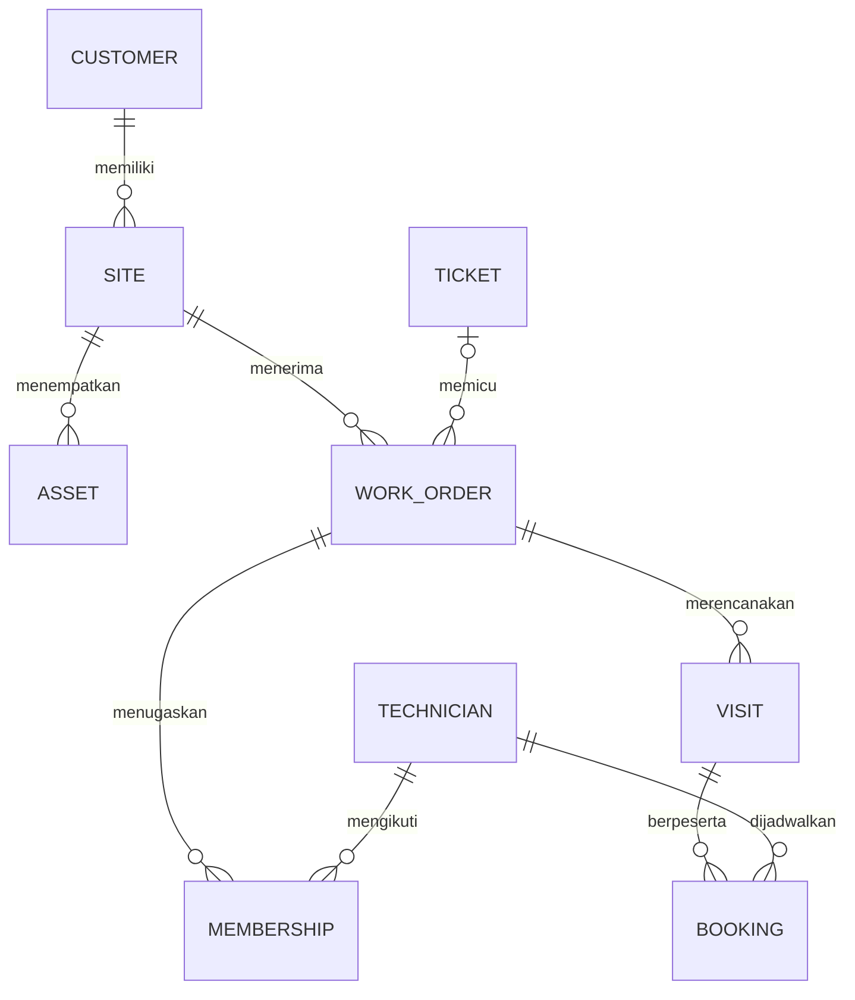
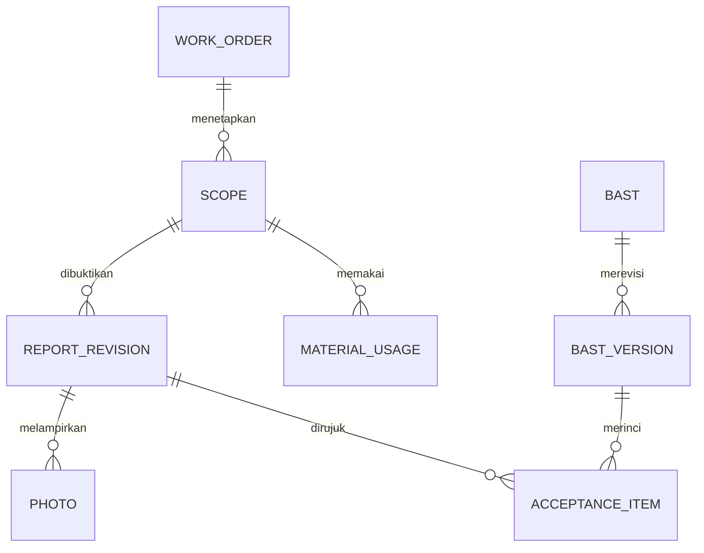
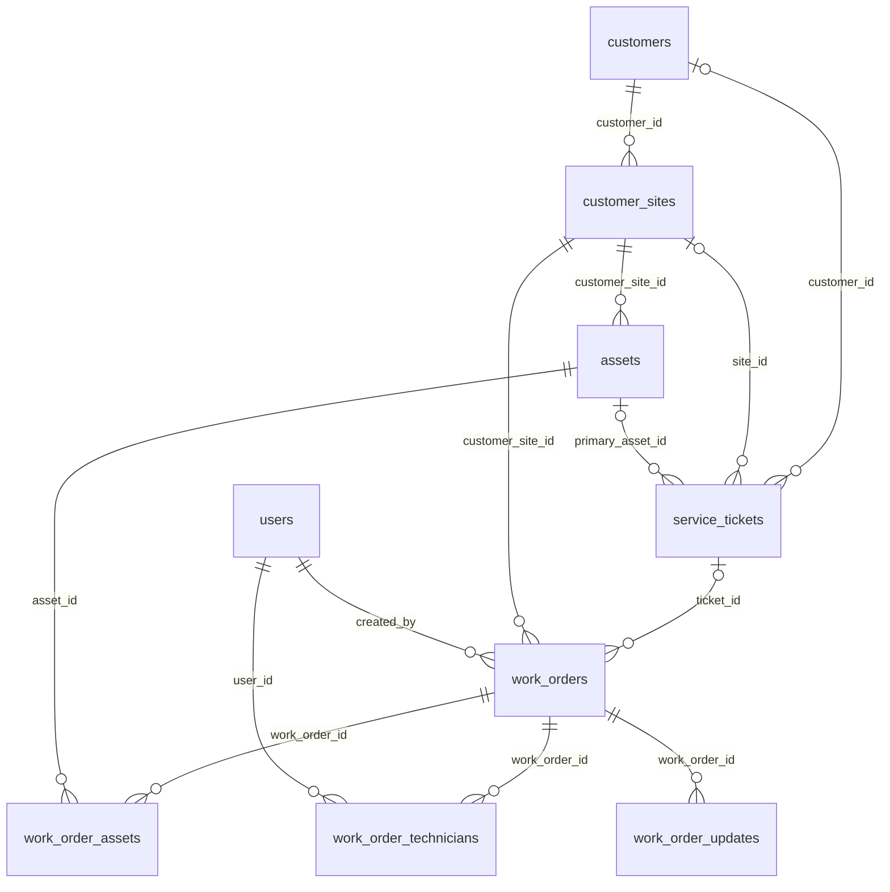
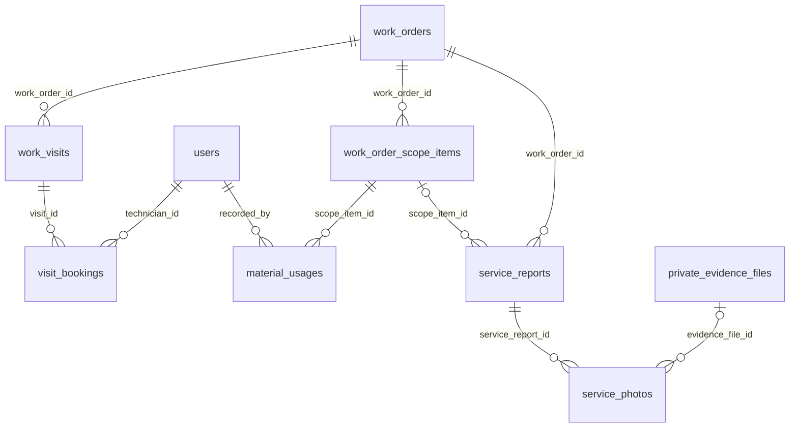
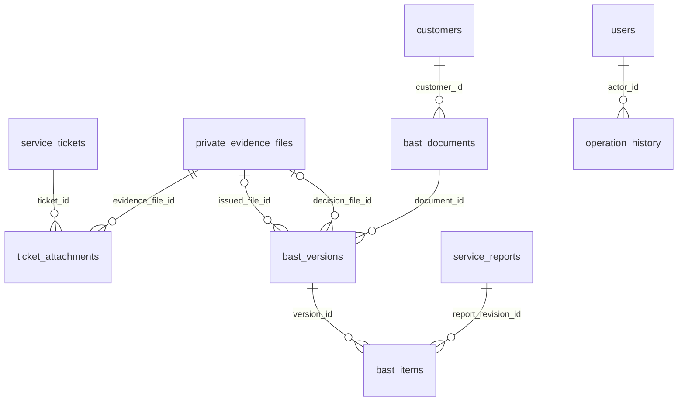

# Nusalogi v0.2 · Domain Model & Database Design M1
**Phase 0D | 10 November 2026 WIB | Revisi desain A1–A6 setelah technical feasibility review NEEDS AMENDMENTS**

**Mandat.** Muhammad Fathan meratifikasi baseline arsitektur M1 pada 10 November 2026. Keputusan internal mencakup ADR-01/02/03/04/05/08/10/11/12. Rancangan fisik, nama tabel baru, batas panjang kolom dan pilihan implementasi di dokumen ini adalah usulan 0D. Kebijakan kantor, identitas penanda tangan, retensi, dan kewenangan khusus masih memerlukan validasi PT Nusalogi. Closure exception nonaktif. ERD finance M2 berada di luar dokumen.

**Status revisi.** Dokumen ini menjadi sumber utama Phase 0D. Salinan Phase 0D di docs/archive/Nusalogi_Handoff_Codex_M1.md adalah arsip lokal sebelum amendment, tidak termasuk sumber normatif PR baseline, dan tidak menimpa revisi ini. A1–A6 diterapkan pada kamus, lifecycle, transaksi, akses, rollout dan acceptance criteria. Review ulang ini menilai desain, bukan bukti implementasi: F01 dan F03 tetap NOT YET VERIFIED; hasil runtime seluruh skenario tetap terbuka. Tidak ada perubahan kode, migration, dependency, commit atau push dalam pekerjaan revisi ini.

**Batas keputusan.** Sembilan ADR M1 yang sudah diratifikasi dipertahankan; jumlah tabel tetap 21. Perubahan di sini memperjelas enforcement keputusan tersebut. Usulan interupsi booking yang sudah berjalan, pengurangan scope, perluasan hak baca, retensi/penghapusan evidence yang pernah ready, atau aktivasi exception harus diputuskan Fathan dan, bila menyangkut kewenangan operasional, divalidasi PT Nusalogi sebelum diaktifkan. Default aman dan daftar keputusan ada di §9.2. Finance M2 dan aktivasi automasi tetap di luar scope.

**Cara membaca.** Bagian 1–3 memberi dasar pembanding dan gambar. Bagian 4–6 menentukan field, relasi, aturan dan transaksi. Bagian 7–9 memuat izin, urutan perubahan yang kompatibel dan skenario yang harus dipatahkan/dibuktikan saat review. Semua nama tabel menggambarkan target akhir masa transisi, kecuali ditandai legacy.

## 1. Dasar repository dan klasifikasi tabel

Baseline desain historis tetap `9df13b6952a88d4e396a21e95dda83e66c55d801` (merge PR #14). Baseline repository untuk persiapan M1 diperbarui ke `e736ba913ed9f556ccaf2038595af61ef7643410` (merge M0 PR #15), sesudah fetch origin dan fast-forward main pada 10 November 2026. Delta hanya scope visibilitas WO, route Dashboard dan regression tests M0; tidak ada perubahan migration. Sembilan ADR dan revisi A1–A6 tetap berlaku. Catatan historis pada 0A/0C tidak ditafsirkan sebagai status implementasi terkini. [Index baseline dokumentasi](README.md) membedakan sumber utama dan arsip lokal. [F01 awal](m1-schema-baseline-f01.md) memisahkan bukti repository/development/staging; staging tetap NOT YET VERIFIED. Tabel operasional adalah `customer_sites`, bukan drift `customers_sites`.

| Status | Tabel domain M1 | Konsekuensi |
|---|---|---|
| EXISTING | users, customers, assets, work_order_technicians, work_order_assets, work_order_updates | Gunakan struktur dan identitas existing. Perluasan Policy, scope query atau operasi bisnis bisa dilakukan tanpa menambah kolom keenam tabel ini. |
| EXTEND | customer_sites, work_orders, service_reports, service_photos | Kolom baru ditambahkan secara kompatibel. Baris lama dan pemanggil lama memiliki jalur baca eksplisit. |
| NEW · intake dan operasi | service_tickets, ticket_attachments, work_order_scope_items, work_visits, visit_bookings, material_usages | Menyimpan kebutuhan customer, scope yang harus diterima, kunjungan, peserta dan pemakaian aktual. |
| NEW · penerimaan dan audit | private_evidence_files, bast_documents, bast_versions, bast_items, operation_history | Menyimpan bukti privat, dokumen dan revisi, cakupan penerimaan, serta catatan perintah/keputusan yang mengubah keadaan. |

Total batas domain gambar dan kamus: **6 EXISTING, 4 EXTEND, 11 NEW**. Tabel autentikasi pendukung seperti sessions, password_reset_tokens dan passkeys, serta tabel cache/jobs tetap infrastruktur. Tabel invoice, invoice_items dan invoice_payments yang ada hanya merupakan dependency FK/pembaca historis. Desain M1 tidak menambah bentuk hubungan, posting ataupun saldo keuangan.

**Kontrak lama yang terpenting.** WO-01 menerapkan scope sebelum pagination. WO-02 menghasilkan nomor WO-ULID dan created_by di server, menerima satu site dan beberapa asset yang valid, serta jadwal opsional. WO-03 hanya initial assignment dari pending oleh Koordinator aktif/approved, melalui pivot, status dan history dalam satu transaksi. WorkOrderStatusService juga mengenal assigned → in_progress. Keberadaan transisi di service belum membuktikan route lapangan tersedia. M0 PR #15 sudah menyatukan DashboardSummary dan WO-01 melalui WorkOrder::visibleTo(), dengan route allowlist role dan pemeriksaan akun; filter creator-or-assignee bukan lagi perilaku main. Tanggal/range tetap memakai timezone aplikasi. Ini tidak membuktikan flow booking/report/BAST M1 sudah tersedia.

## 2. Conceptual ERD

Dua gambar menyambung di Work Order dan Scope. Scope adalah bagian hasil kerja yang dapat diterima customer. Untuk pekerjaan sederhana, satu WO mendapat satu scope default sehingga teknisi tidak perlu memecah pekerjaan saat input.

Ticket remote dapat selesai dengan nol WO. Ticket yang disetujui dapat memicu beberapa WO. WO M1 baru mempunyai ≥1 scope wajib sebelum eksekusi dan penutupan. Kardinalitas gambar 0..N mengakomodasi staging dan historical rows. BAST draft dapat kosong, versi issued minimal memiliki satu item. BAST menerima sebagian pekerjaan dengan menyebut scope yang sudah siap.

## 3. Logical ERD

Gambar dipisahkan agar FK yang perlu direview terbaca. Nama kolom FK, uniqueness, optionality dan pembatasan lintas-parent terdapat pada kamus. Tabel yang muncul di lebih dari satu gambar adalah tabel yang sama.

**Asal WO, master dan pelaksana**

**Jadwal, eksekusi dan laporan**

**BAST, bukti customer dan audit**

Satu bast_item menunjuk satu revisi report yang dapat ditelusuri melalui scope_item → WO → site → customer. Scope tidak perlu disalin sebagai FK independen pada item. FK audit actor/signer, pointers revisi sebelumnya dan hubungan opsional lain dijabarkan di kamus. Membership menentukan siapa berhak ditugaskan saat booking dikonfirmasi. Booking menyimpan technician_id langsung agar histori tetap terbaca sesudah membership berubah.

## 4. Data dictionary

**Notasi field.** ID = BIGINT UNSIGNED, sesuai `id/foreignId` Laravel. PK id pada tabel baru adalah surrogate ID unik. FK baru bertipe ID, target kolom id kecuali dinyatakan lain. Vn = VARCHAR(n), T = TEXT, D = DATE, DT = DATETIME(6) UTC, TS = timestamp existing, J = JSON tervalidasi, U = unsigned integer. Tanda ? berarti nullable, field lain wajib pada target aktif. UK = UNIQUE, IX = indeks pencarian. Relasi baru memakai RESTRICT saat delete dan ID domain tetap. File final, item issued, histori dan revisi yang sudah submitted tidak boleh dihapus lewat alur normal. Atribut DB existing tetap menurut migration asli. Rancangan menghindari ENUM status agar perubahan status dapat disebarkan bertahap. Daftar nilai di bawah adalah domain yang diizinkan.

### 4.1 EXISTING · kamus kolom yang digunakan M1

| Tabel | Identitas, field dan relasi | Pemakaian M1 |
|---|---|---|
| users | id PK, name/email V255 (email UK), role V32?, is_active boolean default true, approval_status V20 default approved dengan IX, google_id V255? UK, timestamps. Kolom kredensial/Fortify mengikuti migration auth. | Actor dan teknisi berasal dari users. Policy memeriksa status akun dan role aktual. Nama/role saat keputusan penting dapat dibekukan dalam audit. |
| customers | id PK, name V150, pic_name V150?, phone V30?, email V150?, billing_address T?, timestamps. Migration awal diberi nama costumers lalu direname menjadi customers. | Identitas customer ticket, site dan dokumen. PIC pada master hanya kontak. Otoritas signer membutuhkan bukti pada BAST. |
| assets | id PK, customer_site_id FK→customer_sites, asset_code V50 UK, category V100, brand/model V100?, serial_number V150?, status V30 default active, installed_at D?, timestamps. | Perangkat terpasang. Aturan akses dan pembatasan perubahan site pada asset yang terkait WO dipertahankan. |
| work_order_technicians | id PK, work_order_id FK→work_orders, user_id FK→users, assigned_at TS default current, timestamps, UK(work_order_id,user_id). | Satu membership per WO/teknisi. Bukan satu membership per kunjungan. |
| work_order_assets | PK(work_order_id,asset_id), masing-masing FK→work_orders/assets. | M:N WO–asset. Service WO memeriksa kesesuaian site. Histori aset dapat ditelusuri lewat WO/report; tidak mengatribusi tiap tindakan ke semua aset bila belum ada bukti spesifik. |
| work_order_updates | id PK, work_order_id FK→work_orders, changed_by FK→users, from_status V30?, to_status V30, notes T?, timestamps, IX(work_order_id,created_at). | Histori otoritatif perubahan status WO. Penugasan existing tetap menulis satu perubahan. Catatan operation_history menyimpan perintah dan referensi hasil jika diperlukan. |

### 4.2 EXTEND · bidang existing dan delta additive

| Tabel | Baseline nyata | Tambahan M1 dan nullability |
|---|---|---|
| customer_sites | id PK, customer_id FK→customers, site_name V150, address T, pic_name V150?, pic_phone V30?, timestamps. | timezone_name V64? berisi nama zona IANA. Jika belum ada, tampilkan default operasional Asia/Jakarta secara eksplisit saat konfirmasi slot. Visit menyimpan zona efektifnya sendiri. |
| work_orders | id PK, wo_number V50 UK, customer_site_id FK→customer_sites, created_by FK→users, verified_by FK→users? (SET NULL saat delete), title V150, description T, service_type V30, category V50, priority V20 default medium, status V30 default pending, scheduled_at/completed_at DATETIME?, timestamps, IX(status,scheduled_at). | origin_kind V20?, ticket_id FK→service_tickets?, manual_reason T?, acceptance_context_ref V150?, started_at DT?, field_finished_at DT?, closed_at DT?, lock_version U default 0. origin_kind dan context wajib via service untuk perintah create M1. origin_kind nullable hanya selama transisi. IX(ticket_id,status), IX(customer_site_id,status). Histori closure mengikat actor dan scope pada command. |
| service_reports | id PK, work_order_id FK→work_orders, created_by FK→users, reviewed_by FK→users?, diagnosis/action_taken/result/recommendation T?, review_status V30 default draft, review_notes T?, submitted_at/reviewed_at TS?, timestamps, IX(work_order_id,review_status). | Setiap baris M1 adalah satu revisi untuk satu scope. scope_item_id FK→work_order_scope_items?, revision_no U?, previous_revision_id FK→service_reports?, checklist_snapshot J?, usage_snapshot J?, asset_results J?, lock_version U default 0. UK(scope_item_id,revision_no), UK(previous_revision_id). Field versi boleh kosong pada legacy. Di baris M1 scope dan revision_no wajib, revision_no mulai 1. A2: head adalah revision_no tertinggi per scope, termasuk draft/submitted/needs_revision; hanya head approved yang berlaku (§5.1). |
| service_photos | id PK, service_report_id FK→service_reports, uploaded_by FK→users, phase V20, storage_path V255, caption T?, timestamps, IX(service_report_id,phase). | evidence_file_id FK→private_evidence_files?, UK(service_report_id,evidence_file_id) untuk foto M1. Pada penambahan baru path lama diisi dari storage_key resmi untuk pembaca existing. Metadata belum diverifikasi pada foto lama boleh NULL. Tahap foto diusulkan before/after/other, nilai historis tetap terbaca. |

**Makna kolom lama.** scheduled_at adalah waktu rencana opsional, bukan reservasi interval. Pada M1 UI memisahkan historical plan dan confirmed visit. completed_at dan verified_by tetap dapat dibaca sesuai kontrak lama. Fakta M1 bersumber dari field_finished_at, approved report version, keputusan BAST dan closed_at masing-masing. Sebelum dual-write ke kolom lama, reviewer harus mengidentifikasi konsumen dan makna lamanya. Pengisian massal waktu dari data historis yang ambigu akan merusak provenance.

### 4.3 NEW · intake, scope dan kunjungan

| Tabel | Fields target | Kunci dan arti |
|---|---|---|
| service_tickets | id PK, ticket_number V50, kind V24, channel V30, contact_label V150, received_at DT, created_at DT, created_by FK→users, customer_id FK→customers?, site_id FK→customer_sites?, primary_asset_id FK→assets?, description T, priority V20?, status V30 default new, authorization_ref V180?, coverage_disposition V24?, resolution_note T?, resolved_at DT?, duplicate_of_id FK→service_tickets?, lock_version U default 0 | UK(ticket_number), IX(status,received_at), IX(customer_id,received_at). Jenis request/incident/complaint, disposition covered/authorized/no_charge/unknown. Sumber biaya dapat berupa reference eksternal yang diaudit. Customer/site boleh belum diketahui di intake. Sebelum approved untuk kunjungan, keduanya valid dan konsisten. |
| ticket_attachments | id PK, ticket_id FK→service_tickets, evidence_file_id FK→private_evidence_files, purpose V30, attached_by FK→users, attached_at DT | UK(ticket_id,evidence_file_id). purpose antara lain complaint, authorization dan resolution. Dokumen menjadi bagian dari scope akses ticket. |
| work_order_scope_items | id PK, work_order_id FK→work_orders, scope_no U, description T, acceptance_criteria T, is_required boolean default true, disposition V20 default active, created_by FK→users, created_at DT, retired_at DT?, retirement_reason T? | UK(work_order_id,scope_no). Satu scope = satu hasil terukur pada WO. Contoh “kamera loading dock menampilkan live feed pada NVR”. M1 membuat satu scope default eksplisit, dapat menambah scope sebelum baseline pekerjaan disepakati. Perubahan setelah submit mempertahankan isi lama melalui item pengganti dan history. |
| work_visits | id PK, work_order_id FK→work_orders, visit_no U, starts_at DT, ends_at DT, zone_name V64, status V20, previous_visit_id FK→work_visits?, reason T?, created_by FK→users, created_at DT, lock_version U default 0 | UK(work_order_id,visit_no), UK(previous_visit_id), IX(work_order_id,status,starts_at). Interval rencana tunggal per visit. Status draft/confirmed/in_progress/completed/cancelled/superseded. Waktu start/end aktual per peserta dicatat di booking. A3: confirmed memerlukan peserta confirmed; status akhir diturunkan dari seluruh booking di bawah lock, bukan jumlah row historis (§5.2). |
| visit_bookings | id PK, visit_id FK→work_visits, technician_id FK→users, status V20, confirmed_by FK→users, confirmed_at DT, actual_start_at DT?, actual_end_at DT?, ended_reason T? | UK(visit_id,technician_id), IX(technician_id,status,visit_id). Row dibuat saat confirm; confirmed visit memiliki minimal satu booking confirmed yang belum mulai. Booking aktif = confirmed/in_progress. A3 mengatur pembatalan peserta terakhir dan race start (§5.2). Status confirmed/in_progress/completed/cancelled. Interval mengikuti visit, tidak diduplikasi ke booking. Reschedule hanya sebelum peserta mana pun mulai: booking confirmed lama dicancel dan visit lama superseded; riwayat actual tidak ditimpa. |
| material_usages | id PK, scope_item_id FK→work_order_scope_items, item_description V180, unit_code V24, quantity DECIMAL(15,3), movement_kind V16, adjusts_usage_id FK→material_usages?, supply_source V24, disposition V24, recorded_by FK→users, recorded_at DT, reason T? | IX(scope_item_id,recorded_at), IX(adjusts_usage_id). quantity selalu positif. consume menambah pemakaian, return/reversal mengurangi pemakaian asal. supply_source company/customer/unknown. disposition pending/covered/customer_supplied/authorized_extra bersifat operasional. Jumlah bersih dihitung dari ledger, bukan salinan report. |

**Isi evidence terstruktur.** checklist_snapshot adalah array item berisi kode/label, outcome, catatan, dan waktu bila diperlukan. usage_snapshot memuat ID movement, jumlah, satuan dan deskripsi yang berlaku ketika report disubmit. asset_results bersifat opsional dan menyimpan asset_id terpilih beserta hasil pemeriksaan; service memastikan asset termasuk dalam work_order_assets dan site yang sesuai. Ketiganya dibekukan saat submit. JSON ini menyimpan bukti historis. Operator menghitung penggunaan aktual dari material_usages.

### 4.4 NEW · BAST dan audit

| Tabel | Fields target | Kunci dan arti |
|---|---|---|
| private_evidence_files | id PK, storage_disk V32, storage_key V255, original_name V255, media_type V100, size_bytes ID, sha256 CHAR(64), uploaded_by FK→users, uploaded_at DT, state V16 | UK(storage_disk,storage_key), IX(state,uploaded_at). state staged/ready/quarantined. Hanya ready boleh dilampirkan atau diterbitkan. A5: row file adalah mutex promosi/attach/cleanup; cleanup claim memakai quarantined dan history, tanpa state/tabel baru (§6.2). Hash mendeteksi perubahan. Kunci object final tidak boleh ditimpa. |
| bast_documents | id PK, document_number V50, customer_id FK→customers, acceptance_context_ref V150, created_by FK→users, created_at DT | UK(document_number), IX(customer_id,created_at). Header untuk satu rangkaian versi BAST dalam satu customer dan konteks acceptance. |
| bast_versions | id PK, document_id FK→bast_documents, version_no U, previous_version_id FK→bast_versions?, status V20 default draft, issued_by FK→users?, issued_at DT?, issued_file_id FK→private_evidence_files?, scope_snapshot J?, decided_at DT?, signer_name V150?, signer_capacity V150?, authority_ref V180?, decision_file_id FK→private_evidence_files?, recorded_by FK→users?, recorded_at DT?, reason T?, lock_version U default 0 | UK(document_id,version_no), UK(previous_version_id), IX(status,issued_at). scope_snapshot dibekukan saat issued dan memuat nomor WO, scope, kriteria, revisi, identitas customer/site dan konteks. issued_file_id menyimpan dokumen yang diajukan. decision_file_id menyimpan bukti persetujuan/penolakan. Dua waktu keputusan dan perekaman dibedakan. |
| bast_items | id PK, version_id FK→bast_versions, report_revision_id FK→service_reports, ordinal U | UK(version_id,report_revision_id), UK(version_id,ordinal), IX(report_revision_id). Item hanya valid untuk revisi M1 yang approved, mutakhir, dan terikat scope. Satu versi maksimal satu item untuk setiap scope, diperiksa saat draft berubah dan saat issue. |
| operation_history | id PK, actor_id FK→users, command_key CHAR(36), action V64, subject_type V40, subject_id ID, from_state V30?, to_state V30?, actor_role V32, occurred_at DT, reason T?, request_digest CHAR(64), facts J | UK(actor_id,command_key), IX(subject_type,subject_id,occurred_at,id). Satu command berhasil menyimpan satu catatan root. facts memuat ID/versi root dan seluruh efek terkait, expected version dan bukti keputusan seperlunya. subject adalah indeks pencarian audit dengan allowlist, bukan FK relasi bisnis. Relasi utama tetap memakai typed FK. |

**Bukti privat.** Hak download berasal dari parent yang sah (ticket, report atau BAST). ID file dan pengetahuan storage_key tidak memberi izin. Penggunaan kembali file antar-revisi hanya diizinkan dalam scope akses yang sama dan direkam. Untuk file berisi data lebih luas daripada scope penerima, gunakan berkas versi terpisah. Hindari token, kredensial dan isi sensitif dalam audit. Promosi staged→ready dan setiap penautan mengikuti mutex file di §6.2. Cleanup hanya boleh mengklaim staged yang belum pernah ready, tanpa referensi, setelah grace period disahkan. File ready yang menjadi orphan akibat transaksi domain gagal tetap dipertahankan dan direkonsiliasi; penghapusan file yang pernah ready belum diaktifkan. Tidak ada pembersihan hanya berdasarkan umur/path atau hasil scan lama.

## 5. Cardinality, integritas dan lifecycle

| Hubungan | Cardinality target | Penegakan |
|---|---|---|
| Customer–Site–Asset/WO | Satu site memiliki tepat satu customer. Asset dan WO masing-masing tepat satu site. Satu WO dapat memuat 0..N asset dan satu asset dapat berada pada banyak WO. | FK existing, PK ganda pivot. Perintah menolak asset di site lain, termasuk ketika master berubah bersamaan. |
| Ticket–WO | Ticket 0..N WO. WO baru tepat satu origin. `ticket` ⇒ ticket_id wajib dan manual_reason NULL. `manual` ⇒ ticket_id NULL dan alasan nonblank. `legacy_unknown` ⇒ ticket_id NULL, hanya klasifikasi histori. | FK ticket untuk referensi. Validasi kombinasi di writer, periksa kandidat CHECK terhadap migration aktual. Legacy_unknown ditolak di endpoint create. Pada tahap expand origin NULL berarti belum diklasifikasi. |
| WO–Scope–Report | WO baru ≥1 scope wajib. Scope 0..N revisi report. Setiap report M1 tepat satu scope dengan WO sama. | FK sederhana + service cross-parent. UK(scope,revision_no) dan UK(previous_revision_id); successor selalu menunjuk head sebelumnya dalam scope/WO sama. Satu working revision per scope dijaga di bawah lock WO/scope. Seleksi head dan koreksi pasca-QA mengikuti A2 (§5.1), bukan pencarian approved terakhir. |
| WO–teknisi–visit | Membership M:N existing. WO 0..N visit. Visit draft 0..N peserta, confirmed ≥1 booking confirmed dan belum pernah mulai; in_progress pernah mulai dan masih ≥1 booking aktif (§5.2). User 0..N booking. | FK dan UK pada kamus. Kelayakan, membership saat confirm serta interval lintas visit diperiksa di transaksi. Membership historis tidak diciptakan kembali untuk booking lama. |
| Report–file | Report 0..N foto. Setiap foto milik satu report. Metadata file boleh kosong untuk legacy. | FK service_report_id existing. UK/report-file, private access per parent, foto frozen setelah submission. |
| Scope–usage | Scope 0..N movement. Return/reversal mengacu tepat satu consume yang sama scope, unit dan itemnya. | FK dan quantity > 0. Akumulasi return/reversal ≤ jumlah consume dengan lock record asal. Koreksi qty bertambah memakai consume baru yang diaudit. |
| BAST–versi–item | BAST 0..N versi saat staging, versi issued ≥1 item unik per scope. Satu item tepat satu approved report revision. Banyak WO dapat tercakup. Satu WO dapat diterima lewat beberapa dokumen untuk scope berbeda. | FK/UK, periksa scope, customer dan acceptance_context_ref saat issue serta decision. Parent version sebelumnya harus dalam dokumen sama. |
| Keputusan dan closure | Satu versi pending menerima satu keputusan terminal. Satu scope diterima maksimal sekali secara efektif dalam M1. Closure WO memerlukan seluruh scope wajib aktif tercakup dalam versi accepted. | Lock WO/scope/version + recheck coverage. Keputusan per versi, bukan per item. Customer menerima sebagian → simpan penolakan/permintaan subset, terbitkan versi/dokumen baru untuk subset yang jelas. |

**Penjagaan scope wajib.** Perintah close harus menemukan sedikitnya satu scope wajib yang aktif dan memeriksa setiap itemnya. Setelah submit, penerbitan BAST, atau acceptance, perubahan is_required, penonaktifan item, maupun penggantian isi tidak boleh dipakai untuk melewati acceptance. Perubahan scope memerlukan otorisasi yang terdokumentasi, alasan, referensi item pengganti pada history, dan peninjauan semua paket pending. Jika wewenang pengurangan scope belum ditetapkan, pertahankan item wajib dan biarkan WO terbuka. Closure mengunci parent WO, lalu membaca ulang himpunan scope untuk mencegah penambahan atau pengurangan scope bersamaan.

**Kompatibilitas BAST multi-WO.** Default konteks WO berticket mengikuti reference ticket. Manual memakai referensi per-WO. Penggabungan antar-ticket, antar-site customer yang sama atau antar-WO manual mensyaratkan referensi konteks bersama yang eksplisit, scope yang disetujui dan PIC yang berhak atas semua site. Blokir jika ada customer berbeda, context kosong/berbeda atau otoritas PIC ambigu. Ref bukan FK ke kontrak atau entitas finance. Begitu paket dokumen pending, scope dan context terkunci terhadap perubahan diam-diam. Pembatalan/supersede paket diperlukan sebelum rework atas item yang terkena; satu WO yang dibatalkan tidak menghapus bukti WO lain.

**Status per objek.**
- Ticket: new → triaged → approved → in_fulfillment → resolved. waiting_information kembali ke triage; awaiting_authorization → approved setelah referensi sah. Triaged dapat resolved secara remote dengan bukti. duplicate/rejected/cancelled terminal dengan alasan dan tautan jika relevan.
- WO: pending → assigned → in_progress → pending_review → awaiting_acceptance → closed. Dari assigned/in_progress/rework dapat on_hold dengan alasan dan asal pada work_order_updates. Resume hanya ke state asal yang valid. Rejection teknis di review/acceptance → rework → in_progress. Pembatalan nonterminal memerlukan reason, penanganan visit, scope terbuka dan usage. Closed/cancelled terminal. Tidak ada command exception closure pada M1.
- Report: draft → submitted → approved atau needs_revision. Narasi, checklist, foto dan usage snapshot immutable sejak submit; metadata keputusan review diisi sekali. Revisi pengganti adalah baris baru, approval lama tetap menjadi histori. Hanya head approved yang berlaku. Document fix pada pending_review tidak mengulang status; bila dimulai setelah QA pada awaiting_acceptance, WO kembali pending_review melalui perintah koreksi terotorisasi di §5.1. Technical rework memakai rework → in_progress. Scope accepted tetap dipertahankan saat scope lain dirework.
- BAST version: draft → pending → accepted/rejected. Draft/pending dapat cancelled atau superseded dengan alasan dan history. Versi rejected tetap menyimpan penolakan meski ada versi pengganti; previous_version_id menautkan rantai. Versi accepted beserta item final bersifat immutable. Temuan baru setelah acceptance menjadi ticket/WO lanjutan.
- Status visit dan booking berjalan terpisah dari WO (§5.2). Menyelesaikan visit/booking tidak menutup WO. Hanya booking confirmed/in_progress pada visit confirmed/in_progress yang memblokir interval rencana; ketidakcocokan state adalah anomaly yang menahan dispatch terkait sampai direkonsiliasi, bukan alasan mengabaikan reservasi. Pertimbangkan kesiapan site bila waktu aktual melampaui akhir rencana; tindak lanjut Koordinator tanpa booking otomatis.

### 5.1 A2 / F06 · Revisi report yang berlaku dan koreksi setelah QA

Untuk setiap scope M1, head adalah baris dengan revision_no tertinggi dari **seluruh** revisi scope itu. Head draft, submitted atau needs_revision membuat scope belum eligible untuk acceptance/closure; sistem tidak boleh kembali memilih approval lama. Legacy dengan scope/revision NULL hanya dibaca melalui adapter, bukan dimasukkan ke seleksi head M1. WorkOrder::reports() tetap HasMany seluruh histori; jumlah hasil pekerjaan dihitung per scope/head, bukan COUNT seluruh baris revisi. Pembaca baru harus menyebut apakah membaca histori, head, atau head approved secara eksplisit.

- Revision pertama bernomor 1 dan previous_revision_id NULL. Successor bernomor head+1 dengan previous_revision_id = head.id; previous wajib scope dan WO yang sama. WO pada report harus sama dengan WO scope. Tidak boleh ada fork, nomor ulang, atau draft baru selama head draft/submitted masih menunggu edit/keputusan. Perubahan author memerlukan otorisasi yang diaudit.
- Create successor, edit draft, submit dan QA mengunci WO, scope dan revisi sesuai §6.1; memakai current locking read, expected head ID dan expected lock_version. Dua creator/submitter tidak dapat sama-sama memajukan head. Review hanya untuk head submitted yang diminta, dengan reviewer aktif/approved dan bukan author; bukan model yang dibaca sebelum transaksi.
- Sejak submitted, narasi, checklist, usage_snapshot, asset_results, foto, caption dan referensi/bytes evidence immutable. Keputusan QA hanya diisi sekali. Koreksi selalu membuat baris baru; tidak mengubah approval atau snapshot lama. Menghapus draft baru agar approval lama berlaku lagi bukan command M1.

| Trigger koreksi | Efek atomik dan state WO | Guard |
|---|---|---|
| QA needs_revision kategori document_fix | Buat successor saat author mulai koreksi. WO pending_review tetap pending_review; submit ulang tidak mengulang transisi in_progress → pending_review. | Head lama tetap menyimpan keputusan. Head baru memblokir acceptance sampai QA baru. |
| Koordinator membuka document_fix atas head approved sebelum scope accepted | Supersede semua versi BAST pending yang memuat scope tersebut, simpan alasan dan successor draft. WO awaiting_acceptance → pending_review; bila WO masih in_progress/rework karena scope lain, jangan menghapus kewajiban lapangannya. | Lock seluruh parent paket multi-WO terlebih dahulu (§6.1). Simpan kategori, head lama/baru, versi BAST terdampak dan expected versions di history. Paket draft dengan referensi lama ditolak saat issue sampai disusun ulang. |
| Technical rejection / koreksi yang membutuhkan kerja lapangan | Invalidasi paket pending terdampak, catat defect scope dan successor; WO relevan menuju rework → in_progress sebelum submit ulang. | Kategori document_fix tidak boleh dipakai untuk melewati QA atau menyamarkan technical rework. |
| Scope sudah accepted atau WO closed | Tolak koreksi in-place; buat follow-up ticket/WO melalui alur origin yang sah dan tautkan konteks historis pada history. | Accepted version, item, head report dan file yang menjadi dasarnya tetap immutable. |

Pembukaan koreksi setelah QA adalah perincian ADR-04/05 yang diminta dalam A2, bukan hak untuk membuka kembali acceptance final. Saat seluruh required active scope kembali memiliki head approved, WO pending_review → awaiting_acceptance melalui service yang sama. Scope accepted dari bagian lain tetap dihitung dari bukti finalnya dan tidak direvisi. Perubahan status, successor, invalidasi pending dan history harus satu commit; jika parent set berubah setelah discovery, rollback dan ulang discovery sebelum mengambil lock tambahan.

### 5.2 A3 / F05 · Lifecycle booking dan pembatalan peserta terakhir

Semua confirm, start, complete, cancel dan reschedule memakai protokol A1 dengan lock WO, seluruh teknisi peserta visit, lalu visit/booking. Version visit meningkat pada setiap perubahan booking; perintah membawa expected visit version dan expected booking state. Recheck akun, membership, state WO/visit/booking dan actual timestamps setelah lock. Assignment WO tanpa booking tetap sah; start booking adalah tindakan tersendiri dan tidak boleh menciptakan booking fiktif dari scheduled_at.

| Perintah / keadaan | Transisi atomik | Fakta yang dipertahankan |
|---|---|---|
| Confirm draft dengan ≥1 peserta eligible | Visit draft → confirmed; seluruh booking confirmed dibuat bersama. | Interval start < end, zona, membership dan anti-overlap lolos; tidak ada grup parsial. |
| Start booking confirmed | Booking confirmed → in_progress dan actual_start_at diisi sekali; start pertama mengubah visit confirmed → in_progress. Start berikutnya boleh saat visit in_progress. | Teknisi hanya memulai booking sendiri. WO harus dapat dieksekusi; transisi WO assigned/rework → in_progress bila diperlukan ditulis bersama history, bukan closure. |
| Cancel booking confirmed, masih ada booking aktif lain | Booking → cancelled dengan ended_reason; visit tetap in_progress bila pernah ada start dan masih ada peserta aktif, selain itu confirmed. | Tidak mengisi actual_start/end untuk peserta yang tidak pernah mulai; membership, WO dan bukti tetap ada. |
| Cancel booking confirmed terakhir, belum ada peserta yang pernah mulai/selesai | Booking → cancelled dan visit confirmed → cancelled dalam commit sama. | Cancel tidak menghapus visit/booking dan tidak membatalkan WO. |
| Cancel sisa booking confirmed; peserta lain sudah completed dan tidak ada yang in_progress | Booking → cancelled; visit in_progress → completed karena seluruh peserta kini terminal dan setidaknya satu telah completed. | Completed visit berarti kunjungan berakhir, bukan seluruh scope/WO selesai; waktu peserta cancelled tidak direkayasa. |
| Complete booking in_progress | Isi actual_end_at ≥ actual_start_at, booking → completed; visit tetap in_progress selama masih ada peserta aktif, termasuk confirmed yang belum mulai; completed bila semua terminal serta ≥1 completed. | Actual evidence immutable; histori peserta cancelled tetap terbaca. |
| Cancel booking in_progress; reschedule visit yang pernah mulai | Default **tolak** interupsi/reschedule in-place. Koordinator dapat merencanakan visit lanjutan tanpa menimpa visit lama. | Kebijakan interupsi kerja berjalan memerlukan keputusan §9.2; jangan mengarang actual_end atau menyebut interrupted sebagai completed. |

Reschedule hanya menerima source visit confirmed dengan expected version yang cocok; edit jadwal draft tidak mengubahnya menjadi reservasi. Cancelled/completed/superseded tidak mempunyai transisi normal keluar. Sesudah start pertama, visit tetap in_progress selama ada booking aktif, termasuk peserta confirmed yang belum mulai; karena itu invariant in_progress adalah pernah mulai dan masih ada ≥1 booking confirmed/in_progress. Confirmed berarti belum ada start dan ≥1 booking confirmed. Completed berarti tidak ada booking aktif dan ≥1 completed; cancelled berarti tidak ada booking aktif dan tidak ada yang pernah mulai. Superseded hanya untuk reschedule sebelum start, seluruh booking lama cancelled dan visit pengganti ditautkan dalam satu transaksi.

**Race start versus cancel peserta terakhir.** Keduanya menunggu lock WO/users/visit yang sama. Jika cancel commit lebih dahulu, start melihat cancelled atau version mismatch dan ditolak. Jika start commit lebih dahulu, cancel melihat in_progress atau version mismatch dan ditolak oleh default interupsi; actual_start tetap ada dan tidak dibuat actual_end palsu. Tidak ada hasil confirmed tanpa peserta aktif. Callback completion/cancellation ulang dengan key yang sama mengikuti idempotency; key berbeda atas state terminal ditolak.

Revocation eligibility ikut menunggu lock user. Jika revocation lebih dahulu, confirm/start ditolak; jika confirm/start sudah commit lebih dahulu, revocation tidak menghapus fakta itu. Setelah revocation, start baru diblokir dan booking masuk worklist review Koordinator; slot tidak dilepas otomatis. Jika removal membership kelak dibuka, seluruh booking terdampak ditangani atomik di bawah lock WO/resource, bukan sync pivot bebas. Penghentian peserta yang sedang berjalan tetap tunduk pada keputusan interupsi yang belum aktif.

**Enforcement untuk review.** PK/FK/UK memastikan identitas dan referensi. CHECK kandidat untuk ends_at > starts_at, quantity > 0, revision/version > 0 dan kombinasi scalar yang dibolehkan. Pastikan NULL pada fase transisi tidak lolos guard target. Validasi kombinasi FK/aksi referensial terhadap MySQL 8.4 saat memilih CHECK fisik. “Semua scope accepted”, “teknisi aktif”, kompatibilitas antar-parent, linearitas versi, jumlah baris anak minimum, anti-overlap dan immutability melalui semua write paths memerlukan application service terotorisasi dengan transaksi/lock. Unique key biasa tidak dapat sendirian mencegah interval overlap.

## 6. Transaction boundaries dan concurrent writes

Gunakan expected version pada aggregate mutable dan command_key stabil per aksi retry M1. Replay committed diperiksa sebelum stale-version guard, setelah otorisasi baca. Jika dua request memasukkan UK(actor_id,command_key) bersamaan, loser harus rollback seluruh efek lalu membaca hasil committed dalam transaksi baru; digest berbeda menjadi conflict. Tidak ada side effect eksternal sebelum commit. request_digest mencakup aksi, objek, versi dan payload canonical. Pengulangan key oleh actor yang sama dengan digest identik mengembalikan hasil committed yang dirujuk facts setelah policy baca diperiksa. Key yang sama dengan digest berbeda ditolak. Operasi lama WO-02/03 tetap memenuhi kontrak error/duplicate submission saat ini sampai antarmuka perintah baru digunakan. Command baru tidak boleh secara implisit mengubah hasil submit ulang WO-03 yang sebelumnya ditolak.

| Perintah dan pemilik | Atomic write set | Yang dikunci, diperiksa kembali, atau dipulihkan |
|---|---|---|
| Intake, triage, remote resolution atau duplicate · Ticket | Ticket + tautan bukti ready bila ada + history. Resolve ticket multi-WO hanya jika tidak ada scope operasional yang tersisa. | Lock ticket/canonical ticket berurutan untuk duplicate. Tolak self-link/siklus. Ticket terminal tidak lagi boleh menghasilkan WO. Actor, site/customer serta coverage diperiksa ketika approve. |
| Generate WO dari ticket / buat manual · WO | WO dengan nomor server + origin + scope wajib awal + pivot asset + history. Untuk ticket, perbarui status fulfillment dalam transaksi yang sama. | Lock ticket jika ada serta site/asset terkait. Validasi state ticket, site, origin dan aktor. Kunci command membedakan retry dari pembuatan WO kedua yang sah. History gagal → seluruh perubahan gagal. Manual reason tidak disintesis oleh server. |
| Initial assignment · WO-03 | Pivot membership 1..N, assigned_at, pending→assigned dan work_order_updates. Tambahan history perintah baru bila interface M1 dipakai. | Pertahankan lock/recheck Koordinator, WO dan assignees seperti jalur existing. Reject akun invalid, perubahan status bersamaan, dan duplikat. Assignment tanpa jadwal tetap sah. |
| Confirm visit / reschedule · Dispatch | Confirm visit dan semua booking dalam satu commit. Reschedule sebelum start membatalkan semua booking confirmed lama, menandai visit lama superseded, membuat visit dan booking pengganti dengan link ke lama. Bila pernah mulai, tolak reschedule in-place (§5.2). | Ikuti A1 (§6.1): lock parent WO/scope, actor non-teknisi lalu **seluruh gabungan teknisi lama, baru dan peserta visit terdampak**, urut ID, sebelum visit/booking. Setelah itu lakukan current locking read atas booking aktif dan visit lintas-WO untuk setiap teknisi. Set peserta berubah → rollback/discovery ulang, bukan menambah user lock setelah visit. Konflik bila startLama < endBaru dan startBaru < endLama. Abaikan hanya slot lama yang akan diganti atomik. Satu peserta konflik → rollback seluruh grup. Semua jalur booking wajib mengambil resource lock yang sama, termasuk saat belum ada booking sama sekali. |
| Perubahan membership / batal visit · Dispatch | Batalkan/selesaikan booking aktif terdampak dengan alasan dan catat history. Jika fitur reassignment kelak diaktifkan, ubah membership dan catatan pelaku dalam commit yang sama. | A1/A3 wajib untuk cancellation/complete/start juga, termasuk perubahan state parent akibat peserta terakhir. Jangan menggunakan sync pivot sebagai pengganti operasi reschedule. M1 mempertahankan initial assignment. Jalur admin penonaktifan akun membuat kunjungan perlu ditinjau, mencegah confirm/start baru dan menjaga history. |
| Start, hold, resume, cancel · WO | WO state/version + work_order_updates + waktu aktual jika relevan + history. Cancel menutup booking mendatang, merekam disposition scope/material dan menangani BAST pending terdampak. | Validasi state, assignment dan akun saat eksekusi di bawah urutan A1. Start booking, completion dan cancel peserta mengikuti §5.2; WO cancel tidak otomatis memberi izin interupsi booking in_progress. Hold menyimpan status sebelumnya dan alasan. Cancel tidak boleh diam-diam membatalkan acceptance customer yang final. Scope yang sudah accepted dipertahankan dan sisa scope mendapat disposition terotorisasi; jika authority belum ada, tahan pembatalan dan rujuk Koordinator. |
| Catat usage dan perbaiki report draft · Field | Movement immutable (termasuk reversal), revision draft, metadata foto terkait dan audit. Tidak ada posting biaya. | Lock WO/scope, users lalu parent movement untuk return dan current revision sesuai suffix A1. Baca baris adjustment dengan current locking read lalu hitung decimal; plain SUM dari snapshot lama tidak boleh menjadi guard. Tolak qty bersih negatif, unit berbeda, atau perubahan scope accepted. Perubahan sesudah submission membutuhkan revisi baru dan consistency review pada snapshot. |
| Submit dan review versi · QA | Submit membekukan evidence. Keputusan QA mengisi reviewer/time/result pada revisi yang dituju dan merekam history. Transisi WO yang timbul ikut transaksi yang sama. | Ikuti A1/A2: lock WO, semua scope wajib relevan, actor lalu head report dengan current locking read dan expected head/version; pembukaan koreksi mengunci juga seluruh parent BAST terdampak. Anggota tim hanya menyubmit sesuai authority. Saat scope terakhir disubmit, WO menuju pending_review jika semua scope wajib sudah disubmit/approved. Pengajuan scope awal boleh menunggu yang lain saat WO in_progress. Semua head required scope approved → awaiting_acceptance; approval lama yang bukan head tidak dihitung. QA teknis gagal → rework. Submit koreksi dokumen tidak mengulang status WO. Reviewer tidak menyetujui laporannya sendiri pada default M1. |
| Issue BAST · Acceptance | Freeze item list dan scope snapshot. Link berkas issued yang ready, catat actor/waktu, ubah draft→pending dan history. | Tentukan WO/scope terdampak, lock semuanya dalam urutan tetap, lalu periksa ulang set item, customer, context, versi approved dan PIC. Tolak scope yang sudah accepted atau pending pada dokumen lain. File dapat disiapkan di luar transaksi; snapshot/versi input harus tetap cocok saat commit. Perubahan isi draft memerlukan berkas baru. |
| Rekam keputusan customer · Acceptance | pending→accepted/rejected, bukti eksternal dan identitas, waktu, actor recorder dan history. Untuk rejection teknis, identifikasi scope defect dan buat tindakan rework hanya pada WO yang relevan. | Ikuti urutan A1 yang sama dengan issue: ticket bila relevan → seluruh WO → scope → users → dokumen/versi/anak → file; jangan mengambil WO setelah mengunci versi. Recheck status, validity, hak recorder dan versi paket. Signature lama untuk versi superseded tidak menyelesaikan versi baru. Untuk paket mixed, tulis subset dalam reason/facts dan proses ulang scope siap terima melalui versi baru. |
| Close WO · WO | Set closed/closed_at, history status dan operation_history berisi ID item/revisi/versi accepted yang membuktikan closure untuk tiap scope wajib. Sinkronkan ticket jika seluruh WO dan scope terselesaikan atau biarkan antrean resolusi manusia. | Lock ticket bila akan diubah, seluruh WO/scope yang akan dibaca sebagai guard ticket, users dan versi bukti menurut A1; bila parent set tidak lengkap, rollback/discovery ulang atau biarkan ticket dalam antrean resolusi manusia. Hitung cakupan berdasarkan semua required active scope dan report version yang benar. Tolak WO tanpa scope target, scope missing, pending, rejected, stale atau exception request. Tidak membaca maupun menulis saldo pembayaran. |

### 6.1 A1 / F04 · Urutan lock lintas writer dan pembacaan terkini

Baseline review menggunakan MySQL 8.4 dengan REPEATABLE-READ; konfigurasi staging tetap harus dibuktikan F01. Mutex booking adalah PK users milik teknisi, bukan row booking yang mungkin belum ada. Protokol berlaku pada confirm, reschedule, cancel, start, complete, perubahan peserta/interval/status visit, dan perubahan membership yang memengaruhi booking. Mutation child selalu mengikuti parent yang sama; tidak ada direct update yang melewati service.

**Discovery dan urutan.** Baca ID calon parent/resource sebelum locking sebagai petunjuk, bukan hasil validasi. Kumpulkan seluruh WO/scope paket BAST, seluruh WO ticket bila akan resolve ticket, seluruh peserta visit lama dan pengganti, actor, head, versi dan file yang dibutuhkan. Dalam transaksi gunakan urutan berikut; kelas yang tidak diperlukan dilewati:

1. Ticket menurut ID; master customer/site/asset yang perlu dikunci berurutan menurut jenis tersebut lalu ID, sebelum WO. Jalur create WO mengikuti urutan site → asset existing; writer master tidak boleh mengambil WO setelah memegang lock asset.
2. Seluruh WO menurut ID, lalu seluruh scope menurut ID. Tidak boleh memegang WO-A lalu menambah WO-B ber-ID lebih kecil ketika paket berubah. Rollback dan ulang discovery bila daftar parent berubah.
3. Actor internal non-teknisi (Koordinator/Admin) lebih dahulu; bila lebih dari satu, urut ID. Lalu seluruh user resource teknisi menurut ID. Actor lapangan termasuk dalam himpunan teknisi ini, tidak dikunci lebih dahulu secara khusus. Gabungan resource mencakup semua peserta visit yang state parent-nya dapat berubah, walau command hanya mengubah satu booking, serta seluruh peserta lama/baru saat reschedule.
4. Visit menurut ID, lalu booking menurut ID. **Tidak ada lock visit/booking, termasuk shared lock, sebelum seluruh mutex user diperoleh.** Query overlap boleh memperoleh lock booking/visit WO lain setelah mutex; jangan ikut join/lock WO atau users lain pada tahap ini.
5. Suffix domain dalam urutan tetap: consume material asal lalu adjustment menurut ID; report menurut ID; BAST document menurut ID → version menurut ID → item menurut ID; foto/attachment terkait menurut ID. Kelas yang tidak dipakai dilewati. Perintah yang perlu membatalkan paket BAST harus sudah mengumpulkan semua parent-nya pada discovery.
6. Evidence file menurut ID (§6.2); tulis efek dan operation_history/status history atomik. Jangan kembali mengambil parent/user yang belum dikunci setelah file lock. Storage, PDF dan network I/O berada di luar transaksi domain.

Urutan WO → Koordinator → teknisi terurut mempertahankan jalur WO-03 existing di WorkOrderAssignmentController::update (baris 87–109) dan WorkOrderStatusService (baris 30–52); penambahan visit sesudah user menghilangkan kandidat visit → user pada rancangan awal. Identitas actor/eligibility diperiksa lagi setelah lock, bukan dipercaya dari preflight. Writer admin yang hanya mencabut role/approval/is_active mengunci actor non-teknisi dan target user, lalu mencatat revocation; **tidak** mengambil WO/visit setelah user. Bila perlu mengubah domain visit juga, discovery dan transaksi dimulai ulang dari WO sebelum user. Jalur admin existing perlu integrasi saat implementasi M1; pembaruan dokumentasi dan M0 tidak mengubahnya.

Sesudah parent/resource terkunci, baca kembali parent set, peserta, state, interval dan versions dengan current locking read. Jika ada resource yang tidak masuk discovery, rollback tanpa efek dan mulai ulang dengan set lengkap; jangan memperluas lock set di luar urutan. Untuk semua guard QA, material, claim BAST dan closure juga gunakan current locking read atas row yang relevan. Plain SELECT pada snapshot lama, koleksi eager-loaded, atau MAX(approved revision) tidak boleh menjadi guard. Query nested whereHas/subquery tidak otomatis memperoleh locking read dari query luar; SQL hasil implementasi wajib diperiksa.

**Pemeriksaan overlap.** Untuk setiap teknisi dalam urutan ID, query join langsung visit_bookings → work_visits memakai current SELECT ... FOR UPDATE, setelah user mutex. Cari booking confirmed/in_progress lintas **semua** WO, termasuk WO yang sama. Recheck parent visit confirmed/in_progress; state yang tidak cocok menjadi anomaly yang menahan dispatch, bukan reservasi yang diabaikan. Konflik bila startLama < endBaru dan startBaru < endLama; interval [start,end) membolehkan slot bersebelahan. Hanya booking lama yang diganti atomik boleh dikecualikan pada reschedule. Jangan memakai SKIP LOCKED untuk membuang calon konflik. Satu konflik membatalkan seluruh grup dan history-nya.

| Langkah pembuktian desain F04 | Transaksi A · WO-A 09.00–10.00, teknisi 7 | Transaksi B · WO-B 09.30–10.30, teknisi 7 |
|---|---|---|
| Lock resource | Memegang user 7; belum mengunci visit lain sebelum resource | Menunggu user 7, belum memegang visit yang dapat dibutuhkan query A |
| Guard dan commit pertama | Current overlap read kosong; simpan semua booking dan commit | Tetap menunggu |
| Sesudah menunggu | Selesai | Memperoleh user 7, current read melihat slot A; rollback karena konflik |

Mutex row user membuat kasus booking pertama tetap terserialisasi. Mengunci WO saja tidak cukup karena WO berbeda. Untuk grup, resource union dikunci terurut sebelum visit; slot lama tidak dilepas bila ada peserta pengganti konflik. Indeks awal visit_bookings(technician_id,status,visit_id), PK visit dan IX visit(work_order_id,status,starts_at) tetap dipertahankan. Interval berada pada parent sehingga sebagian filter sesudah join; EXPLAIN dan cakupan lock harus dibuktikan pada data representatif, bukan diasumsikan dari UK/index. Tidak ada penambahan indeks atau denormalisasi interval tanpa bukti.

Deadlock masih mungkin akibat index/gap/FK atau writer legacy. Retry **transaksi terluar** secara terbatas dengan command_key sama dan fresh discovery/current guards; tidak mengulang efek yang sudah commit. Lock timeout tidak boleh menyisakan transaksi parsial; rollback penuh dan hasil retry/conflict harus eksplisit. Authorization, stale version dan business conflict bukan retry tanpa batas. Tidak ada klaim deadlock-free; uji dua koneksi dan kegagalan setelah lock wajib sebelum rollout.

**Claim BAST dan closure.** Seluruh issue/decision/cancel/supersede dan koreksi report memakai mutex WO/scope yang sama. Current query claim memeriksa semua revisi dari scope itu pada versi pending/accepted di seluruh dokumen, bukan hanya report_revision_id calon item. Semua perubahan draft mengambil parent lock yang sama dan issue mengulang pemeriksaan. UK bast_items hanya menjamin uniqueness dalam versi. Claim transaksional ini mempertahankan 21 tabel; claim table unik per scope hanya alternatif yang perlu keputusan Fathan bila seluruh writer tidak dapat dipusatkan, bukan perubahan otomatis.

Close hanya oleh Koordinator aktif/approved yang berwenang, dari WO awaiting_acceptance dengan expected version yang cocok. Close mengunci WO dan membaca ulang required active scope; himpunan harus tidak kosong. Setiap scope harus memiliki head approved dan item atas head itu pada BAST accepted yang kompatibel, dengan bukti final yang valid; pending/rejected/superseded/stale ditolak. Scope accepted tidak boleh mendapat successor atau di-retire untuk menghindari gate. Mutasi scope yang menunggu setelah close menolak WO terminal; mutasi yang commit lebih dahulu wajib terlihat oleh guard close. Simpan ID scope/report/item/versi/file dalam history closure. Payment tidak dibaca atau ditulis untuk memutuskan close. Resolve ticket menggunakan seluruh dependent WO/scope di bawah parent lock lengkap atau ditunda ke antrean manusia.

### 6.2 A5 / F12 · Serialisasi promosi, penautan dan cleanup evidence

File storage dan MySQL tidak berbagi transaksi. Gunakan row private_evidence_files sebagai mutex lifecycle; semua promosi, attach/reuse, pelepasan referensi yang diizinkan, quarantine dan cleanup wajib mengikuti protokol ini. Jangan hanya mengandalkan FK, umur file, atau hasil scan awal. Bucket/key final tidak boleh ditimpa, dipindah atau dihapus di luar protokol; kegagalan storage di luar kendali aplikasi tetap memerlukan recovery, bukan janji atomisitas DB/file.

| Operasi | Langkah dan titik serialisasi | Recovery / hasil gagal |
|---|---|---|
| Register dan upload | Validasi file sementara privat: ukuran, content type/isi, kategori, expected hash. Simpan metadata staged dengan key baru sebelum copy ke lokasi final; register actor/purpose yang sah. Copy dan verifikasi ukuran/hash/keberadaan final di luar transaksi domain. | Copy gagal termasuk return false (disk existing throw=false) tidak boleh menghasilkan ready. File tanpa metadata bukan kandidat hapus berbasis scan buta; isolasi dan rekonsiliasi dengan upload aktif. |
| Promote staged → ready | Sesudah verifikasi, transaksi baru mengunci actor lalu row file FOR UPDATE. Recheck staged, key/hash/size yang diverifikasi dan otorisasi; hanya lalu ubah ready dan tulis history. Tidak mengambil parent domain sesudah file lock. | Cleanup yang sudah mengklaim quarantined membuat promosi ditolak. Quarantined tidak kembali ready pada M1; retry upload memakai metadata/key baru. |
| Attach / reuse / issue / decision | Ambil seluruh parent/user/child menurut A1, kemudian file IDs terurut FOR UPDATE. Recheck ready, purpose, kepemilikan/reuse dalam scope akses sama dan binding bytes/snapshot ke versi yang dituju. Tulis typed reference, state domain dan history satu commit. Semua mutation referensi juga mengambil mutex file dan hanya dibolehkan bila lifecycle parent mengizinkannya; foto submitted dan item/file issued/accepted tidak boleh dilepas untuk menjadikan file orphan. | File belum ready, state berubah atau input snapshot tidak cocok → rollback seluruh efek. Domain rollback sesudah promosi meninggalkan ready orphan yang dipertahankan, tidak otomatis dihapus. |
| Claim cleanup staged orphan | Kandidat awal hanya hint. Mulai transaksi baru, lock actor lalu file FOR UPDATE. Wajib staged, belum pernah ready menurut state/history, melewati grace yang disahkan, tidak sedang diikat pada domain. Periksa seluruh referensi ticket_attachments, service_photos dan bast_versions.issued_file_id/decision_file_id. Jika lolos, staged → quarantined dan simpan cleanup_claim beserta key/hash/run/command dan alasan; commit **sebelum** penghapusan bytes. | Referensi atau promosi yang telah commit membuat claim ditolak. Tanpa kebijakan grace yang disahkan, cleanup nonaktif; inventory/reconciliation tetap dapat berjalan. |
| Hapus bytes sesudah cleanup claim | Hanya worker/operator yang memiliki claim tercatat boleh menghapus key immutable tersebut, di luar lock DB; metadata tidak dihapus. Catat cleanup_result (berhasil/sudah tidak ada/gagal) pada history. | Crash sebelum delete → ulang dari claim yang sama; sesudah delete sebelum result → periksa absence dan catat hasil tanpa menghidupkan file kembali. Gagal delete tetap quarantined dan dapat diretry. |

**Pemeriksaan referensi tanpa inversi lock.** Transaksi cleanup/promote berdiri sendiri dan tidak mengambil parent domain setelah file lock. Khusus cleanup pada REPEATABLE-READ, tidak boleh ada consistent read sebelum mutex file diperoleh; scan kandidat dilakukan di luar transaksi tersebut. Pemeriksaan referensi pertama memakai snapshot baru yang dibentuk **sesudah** file lock, lalu seluruh referensi dibaca pada snapshot itu tanpa FOR UPDATE atas child/parent. Ini aman karena setiap writer referensi wajib memperoleh mutex file yang sedang ditahan sebelum commit: tidak ada penautan baru yang dapat commit selama pemeriksaan. Jangan membuat query join yang mengunci child setelah file lalu menunggu parent; writer domain mengambil parent/child lebih dahulu. Bila framework/caller sudah membuka snapshot/outer transaction, tolak penggunaan transaksi cleanup itu dan mulai ulang pada transaksi baru. Mutation domain tetap memakai current locking reads A1.

**Dua hasil race.** Promote/attach lebih dahulu → cleanup melihat ready dan tidak menghapus. Cleanup claim lebih dahulu → promote/attach melihat quarantined dan ditolak; bytes boleh dibersihkan oleh pemilik claim. File yang pernah ready, termasuk ready orphan atau security quarantine yang memiliki bukti final, tidak boleh dihapus lewat cleanup staged. Perubahan kebijakan itu memerlukan keputusan retensi dan impact review §9.2. Upload yang masih berjalan saat cleanup menang tidak dapat mempromosikan key lama; bytes sisa ditangani ulang dari claim, tanpa pernah dipakai domain.

**Backup dan integrity.** Tidak ada keputusan final jika upload/verifikasi gagal. DB ready bukan bukti file akan selamanya tersedia: missing/hash mismatch harus menahan issue/decision/closure dan download terkait, masuk recovery dan mempertahankan audit keputusan lama. Backup DB+file harus memakai recovery point yang cocok serta manifest key/hash; latihan restore memverifikasi report, foto, BAST issued/decision dan command history. Jangan melakukan overwrite evidence atau replay mutation hanya untuk memperbaiki backup. Pembuatan PDF, upload BAST dan validasi bytes dilakukan di luar lock; hash payload/snapshot yang telah dikunci harus cocok saat commit. Signed upload cukup untuk M1; paket PDF/queue/worker otomatis bukan prasyarat.

## 7. Authorization mapping

Nama capability berikut merupakan deskripsi tindakan untuk review policy. Nilai role database yang ada adalah admin, koordinator, teknisi. Akun customer tidak diperlukan untuk signed upload. Role saja tidak membuktikan otoritas komersial/eksternal. Periksa akun aktif/approved, scope record, versi dan state pada sisi server.

| Tindakan / objek | Pelaku yang diusulkan | Batas akses dan dampak audit |
|---|---|---|
| Kelola Customer/Site/Asset dan zona site | Admin existing | Pertahankan scoped URL, restrict delete/move dan histori. Perubahan zona site berlaku ke rencana baru. Visit lama menyimpan zone_name. |
| Catat ticket dan bukti intake | Admin dengan akses intake | Minimalkan data PIC. Desk intake boleh melengkapi identitas yang belum jelas. Tindakan duplicate, rejection operasional dan approval menjadi tanggung jawab Koordinator. |
| Triage/approve/resolve | Koordinator | Cek customer/site/asset, detail keluhan dan evidence coverage; biaya baru memerlukan authorization_ref sah. Ticket berpindah state dan decision history mencatat alasan. |
| Create/assign WO | Koordinator aktif dan approved | Pertahankan WO-02/03. Creator berasal dari akun login. Teknisi harus aktif, approved, dan eligible. Admin/Teknisi tidak memperoleh hak create/assign dari desain ini. |
| Confirm/cancel/reschedule visit | Koordinator | Hanya untuk WO nonterminal yang dapat direncanakan. Cek membership dan overlap untuk semua peserta. Simpan konflik/reason reschedule sesuai hasil. |
| Start/hold/resume dan report/usage | Teknisi assigned, untuk WO yang boleh dieksekusi | Scope query dari pivot sebelum pagination. Booking untuk teknisi lain tidak memberi hak mengubah catatan peserta tersebut. Satu author untuk tiap revisi, pembaruan stale ditolak. |
| QA dan keputusan technical rework | Koordinator/reviewer berwenang | Cek versi submitted, evidence dan self-review. Set reviewed_by di server. Jika teknisi berganti pada saat report sudah submitted, evidence lama tetap dapat direview tanpa memulihkan akses tulis teknisi lama. |
| Susun dan issue BAST | Koordinator dengan akses semua WO dalam paket | Setiap WO dan berkas harus masuk scope actor. Versi issued dibekukan. Customer menerima hanya material yang disetujui untuk ditampilkan kepada PIC. |
| Accept/reject eksternal dan rekam keputusan | PIC customer berwenang memutuskan, Koordinator atau recorder internal bercapability mencatat | Identity/capacity dan evidence eksternal wajib. Rekam signed/recorded times terpisah. Jika bukti kuasa belum jelas, status tetap pending. Kewenangan jenis bukti dan retensi memerlukan validasi perusahaan. |
| Close/cancel | Koordinator berwenang | Hanya scope yang tervalidasi. Route, service langsung dan input client wajib melewati guard sama. Exception closure tidak tersedia untuk seluruh role pada M1. |
| Baca/download/dashboard | Admin/Koordinator seluruh WO sesuai kontrak WO-01; Teknisi hanya WO assigned | A4 (§7.1): satu aturan scope untuk list/detail/agregat/export/file. BAST gabungan memerlukan izin atas seluruh WO, semua scope dan isi file. Role lain default deny; creator-only tidak memberi akses teknisi. Hak WO tidak memperluas akses finance/master global. |

operation_history cukup untuk audit operasi terotorisasi, sementara denied access dan kegagalan autentikasi dicatat pada log keamanan seperlunya. Akses unduh yang sensitif mengikuti kebijakan retensi/access logging yang disahkan. Saya tidak mengusulkan tabel role/capability dinamis bagi M1.

### 7.1 A4 / F11 · Scope canonical Dashboard, WO-01 dan dokumen gabungan

| Actor pada request/service | Himpunan WO yang boleh dibaca | Batas |
|---|---|---|
| Admin atau Koordinator aktif dan approved | Semua WO, mempertahankan kontrak WO-01 | Bukan hanya WO buatan sendiri; capability mutation tetap terpisah. |
| Teknisi aktif dan approved | WO yang memiliki pivot work_order_technicians(work_order_id,user_id) untuk actor saat akses | created_by, booking lama atau pengetahuan ID bukan fallback. Cabut membership → akses request berikutnya ditolak; bukti historis tidak dihapus. |
| Guest, akun nonaktif/pending/rejected, role kosong atau tidak didukung | Tidak ada | Guest mengikuti autentikasi; akun tidak eligible dan role tidak didukung ditolak tanpa data. Service langsung juga default deny. |

Satu aturan/query scope yang dapat dipakai ulang menentukan himpunan ini sebelum pagination, count, group/trend, distinct customer count, recent list, search dan export. Dashboard dan WO-01 boleh menampilkan subset karena filter waktu/status yang jelas, tetapi tidak boleh memiliki aturan otorisasi berbeda; perbandingan parity memakai filter bisnis identik. Detail dan download menurunkan izin dari parent yang termasuk himpunan tersebut. Hindari creator-or-assignee untuk teknisi dan creator-only untuk Admin/Koordinator. Semua entry point harus memiliki allowlist role/account yang setara. Pada main e736ba9, Dashboard dan WO-01 sudah memakai role:admin,koordinator,teknisi di bawah auth dan middleware akun existing; visibleTo() memeriksa akun/role terkini sebelum query WO. Server hanya mengirim field site/customer/asset yang diperlukan; hak browse master global tidak bertambah.

Untuk setiap download BAST gabungan, resolve file → versi → seluruh bast_items → report/scope → WO → customer/context. Periksa actor terhadap **semua** WO/scope serta isi snapshot/file, bukan sekadar satu whereHas yang cocok. Deny jika satu parent tidak boleh diakses, customer/context tidak konsisten, versi/file tidak valid, atau file mengandung scope tambahan di luar paket yang diizinkan. Jangan mengirim URL/key atau metadata sensitif sebelum guard. Teknisi yang hanya assigned ke WO-A tidak boleh mengunduh file WO-A+WO-B. Bukti turunan hanya boleh diberikan bila merupakan file tersendiri yang dibuat/diotorisasi untuk scope tersebut; memfilter JSON tidak meredaksi PDF gabungan.

Download memakai endpoint terautentikasi dengan recheck parent/file/account setiap request. Private disk serve=true atau signed temporary URL tidak menggantikan policy. M1 tidak mengeluarkan bearer URL gabungan yang tetap dapat dipakai setelah revocation; bila mekanisme direct storage URL ingin diaktifkan, expiry/revocation dan cakupan akses harus ditinjau terlebih dahulu. File reuse lintas report mengikuti izin seluruh parent dan scope yang sama di bawah mutex file. Akses customer eksternal/portal bukan bagian M0 ini.

**Status dan batas M0.** Penyelarasan akses WO Dashboard/WO-01 sudah merged lewat PR #15 pada e736ba9 tanpa perubahan schema M1. Cakup scope WO bersama, guard route/service dan regression guest/roles/account/pagination/agregat. Metrik finance tidak memperoleh hak baru dari akses WO; bila capability baca sensitif belum disahkan, deny/omit data terkait. M0 ini tidak mengubah schema, perhitungan saldo, workflow finance, timezone legacy atau lifecycle M1. Perubahan tambahan tersebut memerlukan scope tersendiri. F01 staging dan F03 regression setelah expand/cutover M1 tetap terbuka. Review M0 terdahulu mencatat full backend 755 passed / 5.315 assertions; hasil itu historis dan tidak dijalankan ulang pada pemeriksaan F01 ini, serta tidak menggantikan bukti runtime M1.

## 8. Migration impact assessment · rencana tanpa eksekusi

A6 mewajibkan parity sebelum writer cutover. Dokumen desain yang lulus review tidak mengotorisasi eksekusi DDL atau cutover. Urutan di bawah berlaku per slice, dengan writer M1 tetap nonaktif sampai gate terkait lulus.

| Tahap | Dampak terhadap existing writer/reader | Validasi, kondisi hold dan pemulihan |
|---|---|---|
| 0. Inventory dan cohort | Bandingkan schema/index/FK tiap lingkungan dengan baseline, termasuk drift customers_sites; inventaris semua caller HTTP, service, import, job, client lama dan file storage. Bekukan manifest cohort C0 (§8.1) dari row committed yang benar-benar teramati. | F01 tetap terbuka sampai bukti staging/disposition tersedia. Siapkan backup DB+file dengan recovery point/manifest yang cocok; latihan restore sebelum perubahan persisten. |
| 1. Expand additive | Buat private files dan tickets; scope/visit mengacu WO existing; tambah FK nullable WO/report/photo; lalu booking/material, BAST document → version → item, attachment dan history sesuai dependency. Self-reference dibuat sesuai parent/key nyata; lock_version default 0. Writer lama tetap dapat berjalan saat fase ini. | Uji DDL persis pada MySQL staging, FK types/action, CHECK/NULL, UK nullable dan dampak locking/index. Tidak mengedit migration lama, drop/recreate, atau mewajibkan field baru pada client lama. |
| 2. Klasifikasi/backfill restartable | Proses C0 berbasis manifest/version dan bukti per row. legacy_unknown hanya untuk asal historis C0 yang tak diketahui. Report/foto ambigu tetap memakai adapter legacy; scope legacy terbuka dipetakan melalui review nyata. Baris di luar C0 menjadi cohort transisi C1, bukan legacy otomatis. | Batch atomik dengan checkpoint/history, compare-and-set dan exception queue; interrupt/resume tidak menggandakan atau menimpa koreksi manusia. Tidak membuat ticket, alasan, approval, hash terverifikasi, durasi atau BAST palsu. |
| 3. Reader kompatibel dan parity **sebelum cutover** | Deploy pembaca yang memahami legacy dan M1; M1 writer masih nonaktif. Selaraskan akses M0, zona label/UTC, pisahkan scheduled_at dari confirmed visit, baca report historis dan versi acceptance. Shadow/read-only parity tidak menghasilkan transaksi M1 baru di lingkungan sasaran. | F03: regression WO-01/02/03, Customer, Site, Asset, ID/nomor/pivot/status/history, invoice/FK/nilai existing dan file. Uji timezone dan browser/mobile. Bukti staging memakai fixture/rehearsal terisolasi, bukan membuat evidence palsu pada data existing. Selisih tak terjelaskan menahan tahap 4. |
| 4. Cutover satu writer M1 | Setelah parity disetujui, aktifkan form/command ticket/manual, scope awal, history dan guard baru. Tutup semua caller lama, drain request/job yang sedang berjalan, catat Tc dan versi app, lalu aktifkan writer M1. Native WO-03 tetap assign tanpa booking. | Request lama setelah fence ditolak dengan instruksi reload/reconcile, tidak diubah diam-diam menjadi manual/legacy_unknown. Semua C1 dan transaksi in-flight punya disposition. Jalankan smoke/regression kembali setelah switch; kegagalan menonaktifkan command terkait dan menahan tightening. |
| 5. Tighten setelah stabil | Enforce invariant bagi cohort M1. Kolom yang memang belum diketahui pada legacy tetap nullable. Guard seluruh writer, bukan hanya form, sudah aktif. | Nol orphan/salah-site/origin ganda/overlap yang tak ditangani; tidak ada closed M1 tanpa full scope evidence. Bukti concurrency, authorization, file recovery dan parity tercatat. Uji scope adapter lama tetap terbaca; jangan menghapus legacy ambiguity untuk mengejar NOT NULL. |
| 6. Pemulihan | Sesudah fakta M1 ada, gunakan reader kompatibel dan forward fix. Hentikan command bermasalah tanpa menghapus fakta committed. | Rollback aplikasi penuh ke writer lama dilarang bila tidak memahami invariant/state baru. Jangan drop tabel baru, overwrite BAST atau reset status. Restore terkontrol menilai transaksi setelah recovery point dan pasangan DB/file. |

### 8.1 A6 / F13 · Identitas cohort, fence writer dan provenance

Manifest rollout adalah artefak operasional privat yang durable, dibackup bersama checkpoint, diberi checksum, dan dirujuk dalam operation_history saat klasifikasi/cutover. Manifest bukan tabel domain baru; lokasi/access/retensinya disahkan pada persiapan lingkungan. Belum ada manifest atau backfill yang dibuat dalam pekerjaan desain ini.

- **C0 historical:** manifest berisi run ID, environment, baseline commit/schema fingerprint, waktu snapshot UTC T0, daftar ID committed yang dibekukan per tabel WO/report/photo, parent mapping yang diketahui, count/checksum, writer versions dan referensi bukti. Ekspor berasal dari satu snapshot yang terdefinisi atau jendela quiesce terkontrol. Hanya ID yang tercatat itu eligible klasifikasi historical; max ID atau created_at sendiri bukan bukti karena transaksi lama dapat commit setelah snapshot.
- **C1 transisi:** setiap row di luar C0 yang muncul selama expand hingga fence Tc, termasuk output client lama dengan origin/scope NULL. Catat ID/writer/provenance dan exception. Rekonsiliasi memakai fakta asli serta review manusia; bila asal tidak dapat dibuktikan, hold dari flow closure M1. Jangan memberinya legacy_unknown sekadar karena NULL atau tanggalnya tampak lama. Cutover penuh ditahan bila ada C1 yang masih dapat melewati guard atau belum memiliki disposition aman.
- **C2 M1:** command sesudah Tc wajib writer versi M1, command_key, audit actor/digest, origin ticket/manual, context dan scope awal yang sah dalam satu commit. Legacy_unknown ditolak pada create; revision/photo M1 wajib metadata yang berlaku. Tidak ada fallback ke writer lama bila validasi baru gagal. Request in-flight yang lolos fence harus dikenali sebagai C1 dan direkonsiliasi, bukan disamarkan menjadi C0/C2.
- **Checkpoint dan restart:** simpan run/manifest checksum, batch/range yang sudah commit, ID pengecualian dan alasan, counts sebelum/sesudah serta referensi history. Update hanya row C0 yang cocok dengan expected original values dan belum diproses; data yang berubah oleh user dipindah ke exception, tidak ditimpa. Checkpoint otoritatif per batch berada pada operation_history.facts dalam transaksi DB yang sama dengan efek batch, dengan key deterministik actor/run/batch dan digest input. Manifest cohort immutable ditulis/dibackup sebelum batch pertama; cursor/rekap eksternal hanya salinan yang dapat dibangun ulang dari history. Crash sesudah DB commit sebelum ekspor cursor tidak membuat batch diulang sebagai mutation baru; replay membaca hasil committed dan tidak menggandakan history/klasifikasi. Cursor bukan bukti bahwa row ambigu selesai.
- **Legacy report/photo:** beberapa report pada satu WO tidak otomatis merupakan rantai revisi. Jangan mengarang scope/revision lineage. Path foto tetap terbaca melalui akses legacy yang sah; evidence_file_id/hash tetap NULL sampai bytes benar-benar diverifikasi. Pengisian metadata tidak menciptakan approval/signature baru. Nilai waktu ambigu tidak dikonversi massal.

**Gate migration versus cutover.** Sebelum migration expand: schema/data staging F01, rehearsal DDL additive dan dampak lock, fixture legacy representatif, fallback reader, inventory cohort, dan backup/restore harus tersedia. Sebelum writer cutover: parity F03 terlebih dahulu, seluruh caller/fence/drain tervalidasi, C1 direkonsiliasi, dua-koneksi concurrency F04–F10, authorization F11, file/restore F12 dan backfill F13 terbukti pada lingkungan terisolasi. Pemegang authority dan bentuk bukti customer harus sah sebelum slice acceptance dipakai nyata. Finance M2 tidak menjadi pekerjaan tambahan dalam gate ini; data finance existing hanya diuji preservasinya.

**Kondisi yang memerlukan perhatian reviewer.** Bila satu service lama hanya mengenal dua transisi WO, operasi terminal melalui service lama harus ditolak. Restrictive FK melindungi referensi saat delete, namun snapshot, audit dan policy tetap diperlukan untuk perubahan isi. Penambahan query histori/booking diuji dengan EXPLAIN di staging. Prioritas query adalah pencarian booking teknisi aktif, antrean ticket/QA/BAST, pembuktian closure satu WO dan asset history yang berizin. Hindari index spekulatif pada semua kolom.

## 9. Acceptance criteria dan review ulang desain F01–F14

Review awal percakapan berakhir NEEDS AMENDMENTS. A1–A6 kini diterapkan pada bagian normatif dokumen ini. PASS BY DESIGN berarti guard dan titik serialisasi dapat dijelaskan dari model/kontrak yang direvisi, **bukan** fitur existing sudah menjalankannya atau tes sudah lulus. Bukti kode baseline hanya mengonfirmasi kontrak saat ini dan permukaan integrasi. Semua bukti eksekusi di kolom terakhir masih diperlukan; F01 dan F03 tetap terbuka secara eksplisit.

Pengujian mendatang memakai MySQL testing/staging terisolasi, bukan database development. Konkurensi harus dua koneksi/proses independen dengan fixture committed yang terlihat keduanya, koordinasi barrier dan pemeriksaan hasil kedua transaksi; transaksi pembungkus test tidak boleh menyembunyikan fixture dari koneksi kedua. Simulasi perubahan state berurutan bukan bukti locking. Tidak ada test, migration, DDL atau restore yang dijalankan untuk revisi dokumen ini.

| ID | Skenario dan bukti repository baseline | Guard / pembuktian desain revisi | Verdict desain | Bukti eksekusi wajib — belum tersedia |
|---|---|---|---|---|
| F01 | Bandingkan staging dengan migration, termasuk customers_sites, PK asset pivot, UK membership, nullable legacy/FK action. Bukti: database/migrations/*create_work_orders*, *create_work_order_assets*, *create_work_order_technicians*, *create_service_reports*, *create_service_photos*. | Inventaris 6 EXISTING/4 EXTEND/11 NEW cocok baseline statis (§1/4). Pemeriksaan F01 awal pada e736ba9 mengonfirmasi metadata development dan mencatat drift tabel/ledger serta NO ACTION versus RESTRICT; lihat m1-schema-baseline-f01.md. Staging belum tersedia, sehingga disposition per environment tetap menahan migration (§8). | NOT YET VERIFIED | Dump metadata/index/FK dan sampel/count staging, orphan scan, dependency drift dan DDL rehearsal yang persis. Tidak ada klaim parity staging. |
| F02 | Ticket remote tanpa WO; approved ticket → dua WO; manual baru; historical unknown. Bukti: WorkOrderController::store, baris 103–134, masih tanpa origin M1. | FK ticket opsional + origin XOR writer, satu site/asset sah, C0-only legacy_unknown. UK actor/command dengan seluruh efek/history satu transaksi membuat retry menghasilkan satu WO; key bisnis kedua boleh menghasilkan WO kedua (§5/6/8.1). | PASS BY DESIGN | Empat walkthrough persisted, cross-site/manual kosong ditolak, duplicate request serentak dan key sama/digest berbeda; pastikan history failure rollback WO/pivot/scope. |
| F03 | Rute/client WO-01/02/03 sebelum/sesudah expand/cutover. Bukti: routes/web.php:31–47; tests/Feature/WorkOrderIndexTest.php, WorkOrderCreateTest.php, WorkOrderAssignmentTest.php. | Nomor/actor server, pending, asset satu site, multi-tech, history/pivot atomic tetap. Expand nullable, adapter dan parity **sebelum** cutover menjaga client lama; WO-03 tidak menghasilkan booking (§8). Kode target belum ada. | NOT YET VERIFIED | Regression existing dan fixture legacy setelah rehearsal expand, reader parity, browser/mobile/deep link, serta smoke setelah switch. Membaca test source bukan menjalankan regression. |
| F04 | Dua Koordinator confirm pertama lintas-WO, grup teknisi dan reschedule silang. Bukti: WorkOrderAssignmentController::update:87–109, WorkOrderStatusService:30–52. | A1 §6.1 memegang union users sebelum visit, current locking read sesudah menunggu, interval [start,end), all-or-nothing dan retry terluar; jadwal dua transaksi menunjukkan hanya satu conflicting commit. UK saja tidak dianggap anti-overlap. | PASS BY DESIGN | Dua proses pada isolation aktual: booking kosong/terisi, adjacency, satu peserta konflik, reschedule silang, state anomaly, deadlock/timeout rollback dan EXPLAIN/cakupan lock. |
| F05 | Cabut eligibility/membership versus confirm/start; cancel satu/terakhir versus start. Bukti: WorkOrderStatusService:68–79; Admin/UserController::updateRole/updateStatus; Admin/UserApprovalController. | A1/A3 §5.2/6.1 memakai user/WO/visit mutex yang sama. Last confirmed → cancelled bila belum pernah mulai; sesudah participant completion → visit completed bila semua terminal. Start menang membuat cancel in-progress ditolak; cancel menang membuat start ditolak. Revocation tidak menghapus histori. | PASS BY DESIGN | Kedua urutan commit start/cancel dan revoke/start, cancel satu/terakhir, completed+cancelled, masih ada peserta confirmed, eligibility diubah setelah validasi, hak service langsung serta past evidence tetap. Interupsi berjalan belum diaktifkan. |
| F06 | Submission/review berlomba, lalu koreksi setelah QA. Bukti: Models/WorkOrder.php:83–85, Models/ServiceReport.php dan Models/ServicePhoto.php; DomainRelationshipsTest.php:88–124. | A2 §5.1: head tertinggi seluruh state, predecessor linear/UK, expected head/version dan current locks. Successor memblokir approval lama; koreksi setelah QA mengubah awaiting_acceptance → pending_review dan supersede paket pending atomik. Foto/snapshot lama frozen. | PASS BY DESIGN | Dua creator/submission/reviewer, stale head, cross-WO/scope predecessor, document_fix versus technical_rework, paket multi-WO terdampak, accepted scope correction ditolak, counts head versus history, immutability seluruh jalur foto/bytes. |
| F07 | Dua scope satu WO; dua WO compatible satu BAST; customer/context berbeda; scope sama di dua versi pending. Bukti: baseline ServiceReport::workOrder dan WorkOrder::site/reports; tabel BAST masih proposal (§4.4). | Mutex WO/scope dan current claim query seluruh revisi/versi (§6.1) menolak claim pending/accepted kedua, meski revision ID berbeda. Periksa satu item/scope/versi, customer/context/PIC seluruh paket. Satu outstanding scope membuat closure ditolak. | PASS BY DESIGN | Parallel issue dua dokumen, revisi berbeda scope sama, cancel/issue/QA correction race, multi-WO dan cross-customer/context, subset acceptance; ukur query claim dan jangan hanya menguji UK item. |
| F08 | Keputusan versi superseded, signer kosong, file belum ready, accept versus cancel. Bukti: config/filesystems.php:33–38; routes/web.php belum memiliki endpoint BAST. | State pending + expected version + scope/version/file locks; identitas/authority dan ready evidence wajib. Accept/cancel hanya satu pemenang; key/digest replay mengembalikan hasil committed setelah izin baca (§4.4/6). Tidak ada automatic acceptance saat timeout. | PASS BY DESIGN | Dua decision/cancel serentak, bukti versi lama/tipe salah, signer/capacity/authority kosong, file staged/quarantined, replay identik/berbeda dan recorder tak berwenang. Bentuk bukti sah menunggu validasi bisnis. |
| F09 | Close sebelum QA/full acceptance, no response, exception, scope mutation bersamaan dan ticket multi-WO. Bukti: WorkOrderStatusService::TRANSITIONS:13–16 belum memiliki close; InvoicePaymentService tidak mengubah WO. | §6.1 mengunci himpunan required active scope nonkosong dan mensyaratkan head approved + item BAST accepted yang valid **untuk setiap** scope. Mutation scope memakai parent lock sama; exception nonaktif; ticket tidak resolved karena satu WO saja. Payment bukan guard. | PASS BY DESIGN | Missing/partial/pending/rejected/stale evidence, zero required scope, add/retire/replace versus close, follow-up accepted scope, full coverage IDs di history dan payment tidak menutup WO. |
| F10 | Dua return dari consume sama; koreksi sebelum submit revisi baru. Bukti: ServiceReport existing belum memiliki usage; kamus material_usages dan usage_snapshot (§4.2/4.3). | Consume root mutex + current read adjustment rows lalu hitung decimal menjaga total return/reversal ≤ consume. Ledger immutable satu sumber aktual; snapshot masing-masing report dibekukan dan tidak ditotal ulang (§6). | PASS BY DESIGN | Concurrent return/reversal, unit/item/scope mismatch, snapshot sebelum/sesudah koreksi, duplicate command dan net usage tidak negatif atau terhitung ganda dari dua report. |
| F11 | IDOR report/file/BAST gabungan dan parity dashboard/list. Bukti historis 9df13b6: filter Dashboard berbeda dari WO-01. Pada e736ba9, WorkOrder::visibleTo(), DashboardSummary dan routes/web.php sudah selaras melalui M0 PR #15; endpoint BAST gabungan belum ada. | A4 §7.1 menentukan satu himpunan WO: Admin/Koordinator semua, Teknisi pivot-only, lainnya deny. Download memeriksa semua parent/scope/isi dokumen; private key atau satu assignment bukan izin atas paket. Bagian Dashboard/WO-01 sudah diimplementasikan M0; otorisasi file/BAST gabungan tetap target M1 dan belum terbukti runtime. | PASS BY DESIGN | Regression scope M0 termasuk creator-only, unsupported role, guest/nonaktif/pending, filter/agregat/pagination, direct service, IDOR, revoked membership dan file gabungan dengan satu WO tak berhak. |
| F12 | Upload sukses–DB gagal; file gagal–issue ditolak; cleanup/promote/attach race; restore DB/file. Bukti: config/filesystems.php:33–38 throw=false; belum ada workflow evidence. | A5 §6.2: file mutex, fresh reference snapshot setelah lock, quarantine cleanup claim sebelum delete, no parent locks dari collector, no delete ever-ready. Promote/attach menang → ready dilindungi; cleanup menang → pemakaian ditolak. Result/replay durable. Restore adalah gate empiris terpisah. | PASS BY DESIGN | Kedua urutan race, snapshot caller lama ditolak, return false/bytes/hash mismatch, crash sebelum/sesudah claim/delete/result/domain commit, ready orphan dipertahankan, missing final fail closed dan restore manifest key/hash cocok. |
| F13 | Interrupt/resume backfill; foto legacy tanpa hash; writer lama melewati cutoff. Bukti: migration/model report/photo existing tidak memiliki revision/hash; rollout awal dikoreksi A6 (§8). | C0 adalah ID set committed yang dibekukan; C1 di luar set tidak pernah otomatis legacy; C2 wajib writer/audit M1. Checkpoint DB/history atomik dan CAS mencegah overwrite/replay; parity sebelum fence cutover. Ambiguity tetap antrean. | PASS BY DESIGN | Rehearsal pada data representatif: crash tiap batas batch/ekspor cursor, transaksi ID lama commit sesudah T0, record berubah oleh user, client/job in-flight setelah Tc, counts/IDs/photo access tetap dan nol provenance palsu. |
| F14 | Zona non-UTC, reschedule lintas tengah malam dan perubahan default/site zone. Bukti: config/app.php:68 UTC; WorkOrderController:127–129 parser UTC dan :68 mengirim tanggal saja. | UTC instant + zone_name visit frozen (§4/5), parser/display M1 eksplisit dan scheduled_at legacy tidak dijadikan interval. Site/default change hanya rencana baru, tidak menafsirkan ulang visit lama. | PASS BY DESIGN | Round-trip session DB/timezone, 10 Nov 00.30 WIB = 9 Nov 17.30 UTC, zona berbeda, reschedule lintas tanggal, label UI/export dan waktu DST ambigu bila zona itu diizinkan. |

### 9.1 Disposisi A1–A6 dan kesiapan desain

| Amendment | Lokasi normatif | Hasil review ulang |
|---|---|---|
| A1 / F04 | §6 transaction table dan §6.1 | Urutan user sebelum visit ditetapkan, termasuk writer slot lain, discovery ulang dan current locking reads; SQL/query plan dan deadlock aktual belum diuji. |
| A2 / F06 | §4.2, §5.1 dan QA/BAST transactions §6 | Head seluruh revisi dan correction-after-QA menutup fallback approval lama; accepted evidence tidak dibuka kembali. |
| A3 / F05 | §4.3, §5.2 dan dispatch transactions §6 | Last participant dan start/cancel race memiliki satu hasil sah; interupsi booking berjalan default deny. |
| A4 / F11 | §7 mapping dan §7.1 | Kontrak scope WO bersama sudah diimplementasikan M0 PR #15; all-scope BAST download tetap target M1 yang memerlukan bukti runtime. |
| A5 / F12 | §4.4 dan §6.2 | Promosi/attach/cleanup terserialisasi; klaim staged orphan tidak dapat menghapus file yang menjadi ready/terpakai. Restore masih gate runtime. |
| A6 / F13 | §8 rollout dan §8.1 | Parity sebelum cutover, ID cohort immutable, C1 reconciliation, fence dan checkpoint atomik; belum ada migration/backfill dijalankan. |

**Verdict desain:** A1–A6 addressed pada tingkat desain; dapat dilanjutkan ke Phase 0E untuk spesifikasi/implementasi bertahap sesuai scope yang disetujui. Tidak ada perubahan sembilan ADR M1 dan tidak ada perluasan ERD finance. Ini bukan approval migration/cutover atau bukti aplikasi aman pada runtime. F01/F03 tetap NOT YET VERIFIED; kolom eksekusi F02/F04–F14 juga seluruhnya terbuka sampai hasil uji dicatat. Kegagalan hasil uji dapat membuka amendment kembali.

### 9.2 Keputusan yang tetap memerlukan Fathan / validasi PT Nusalogi

| Perubahan/kebijakan | Default dokumen saat ini | Keputusan sebelum aktivasi |
|---|---|---|
| Interupsi/cancel/reschedule booking yang pernah mulai | Tolak in-place; normal completion dan visit lanjutan tetap tersedia. | Fathan menilai perluasan command; PT Nusalogi menetapkan authority, alasan dan pencatatan actual interrupted. Tidak diaktifkan oleh A3. |
| Pengurangan scope wajib, cancellation pekerjaan berjalan, exception closure | Tidak boleh melewati acceptance atau menghapus fakta; tahan jika authority/disposition belum sah. Exception closure nonaktif bagi semua role. | Keputusan bisnis berotoritas dan review dampak desain. |
| Bentuk bukti acceptance, signer/capacity/authority, akses customer | Signed upload dengan identity/recorder terpisah; bila authority ambigu tetap pending. Tidak ada portal/bearer URL baru. | Perusahaan mengesahkan bentuk bukti/otoritas; Fathan menilai perubahan akses/fitur. |
| Grace cleanup, retensi dan penghapusan file pernah ready | Cleanup staged nonaktif sampai grace disahkan; ever-ready selalu dipertahankan pada alur M1 ini. | Owner data/operasi TI Nusalogi mengesahkan kebijakan; Fathan meninjau dampak sebelum mengubah guard. |
| Claim table, capability grant baru, perluasan origin/role/akses | Tidak ditambahkan. Claim transaksional, tiga role dan ticket/manual tetap. | Fathan menilai amendment ADR bila perlu; authority perusahaan tetap diperlukan bagi grant sensitif. Finance M2 tetap di luar revisi. |

**Keputusan 1 — M0 akses Dashboard/WO-01: sudah merged.** PR #15 pada e736ba9 menerapkan scope/query bersama dan allowlist route tanpa perubahan schema. Dasar ADR-08 dan kontrak §7.1 tetap; otorisasi file/BAST M1 belum diimplementasikan. Penyelesaian M0 tidak mengotorisasi migration M1 atau coding finance.

**Keputusan 2 — migration/cutover M1: belum boleh dinyatakan siap.** Sebelum expand perlu bukti schema/data staging F01, DDL rehearsal additive, inventory cohort dan backup/restore; sebelum writer cutover wajib reader parity/regression F03, proof concurrency lintas writer, authorization/file recovery, rehearsal backfill/fence dan disposition C1. Kewenangan/bukti customer yang belum disahkan menahan aktivasi slice terkait. Bukti runtime belum tersedia dan tidak digantikan PASS BY DESIGN.

## 10. Bukti sumber

- [Architecture Decision Register Phase 0C · ratifikasi M1](Nusalogi_Architecture_Decision_Register_v0.2_Phase_0C.md) · [Blueprint Phase 0A](Nusalogi_Business_Process_Blueprint_v0.2_DRAFT_2026-11-10.md) · [Technical Architecture Audit Phase 0B](https://chatgpt.com/library?file_id=libfile_078f20e0c1cc81919b57ddd260c32a4f&account_id=personal).
- [Snapshot main](https://github.com/fathxvn/nusalogi-maintenance-system/tree/9df13b6952a88d4e396a21e95dda83e66c55d801) · [Migration baseline termasuk master, pivot, reports dan photos](https://github.com/fathxvn/nusalogi-maintenance-system/tree/9df13b6952a88d4e396a21e95dda83e66c55d801/database/migrations).
- [WO listing/create](https://github.com/fathxvn/nusalogi-maintenance-system/blob/9df13b6952a88d4e396a21e95dda83e66c55d801/app/Http/Controllers/WorkOrderController.php) · [WO assignment](https://github.com/fathxvn/nusalogi-maintenance-system/blob/9df13b6952a88d4e396a21e95dda83e66c55d801/app/Http/Controllers/WorkOrderAssignmentController.php) · [Status service](https://github.com/fathxvn/nusalogi-maintenance-system/blob/9df13b6952a88d4e396a21e95dda83e66c55d801/app/Services/WorkOrderStatusService.php).
- [Eloquent WorkOrder](https://github.com/fathxvn/nusalogi-maintenance-system/blob/9df13b6952a88d4e396a21e95dda83e66c55d801/app/Models/WorkOrder.php) · [Asset move/delete](https://github.com/fathxvn/nusalogi-maintenance-system/blob/9df13b6952a88d4e396a21e95dda83e66c55d801/app/Http/Controllers/Admin/AssetController.php) · [DashboardSummary](https://github.com/fathxvn/nusalogi-maintenance-system/blob/9df13b6952a88d4e396a21e95dda83e66c55d801/app/Services/DashboardSummary.php).
- [Routes](https://github.com/fathxvn/nusalogi-maintenance-system/blob/9df13b6952a88d4e396a21e95dda83e66c55d801/routes/web.php) · [Timezone](https://github.com/fathxvn/nusalogi-maintenance-system/blob/9df13b6952a88d4e396a21e95dda83e66c55d801/config/app.php) · [Private filesystem](https://github.com/fathxvn/nusalogi-maintenance-system/blob/9df13b6952a88d4e396a21e95dda83e66c55d801/config/filesystems.php).

- Semantik yang dipakai A1/A5: [MySQL 8.4 locking reads](https://dev.mysql.com/doc/refman/8.4/en/innodb-locking-reads.html), [consistent read dan snapshot REPEATABLE-READ](https://dev.mysql.com/doc/refman/8.4/en/innodb-consistent-read.html), [CHECK constraints](https://dev.mysql.com/doc/refman/8.4/en/create-table-check-constraints.html), serta [Laravel 13 transaction retries](https://github.com/laravel/docs/blob/13.x/database.md#handling-deadlocks). Ini referensi mekanisme, bukan hasil uji aplikasi.

- Pembaruan pasca-M0: [main e736ba9 / PR #15](https://github.com/fathxvn/nusalogi-maintenance-system/commit/e736ba913ed9f556ccaf2038595af61ef7643410) · [F01 repository dan development, staging terbuka](m1-schema-baseline-f01.md). Referensi 9df13b6 di atas tetap merupakan bukti baseline desain historis.
